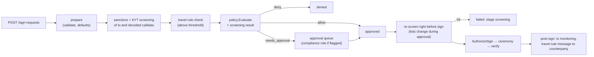

# Scaling quorum-vault to a million wallets

This note takes the miniature in this repo (a custody core on one Postgres,
SoftHSM tokens, and a two-party MPC signer: `mpc-party` A and B with a
cosigner next to B) and works out what changes at 1M wallets. Each section gives a recommendation, the alternatives, and the
math.

**How to read the numbers.** Numbers marked **[M]** were measured in this
repo on an Apple M3 Pro (12 logical CPUs, macOS, darwin/arm64), see
[docs/measurements/mpc-service.md](docs/measurements/mpc-service.md) (the two-party
signer inside the custody system), [docs/spikes/p5a-cbmpc.md](docs/spikes/p5a-cbmpc.md)
(the cb-mpc library on its own) and [docs/measurements/closed-loop.md](docs/measurements/closed-loop.md).
Numbers marked **[P4]** are what the load-test phase (P4) will measure and are not known
yet. Numbers marked **[A*n*]** are assumptions; the table below gives the basis for each.
Replace them with your vendor's and your network's figures; the math is
written out so that is a one-line change. The earlier three-party GG20 design is gone
(history: [docs/measurements/mpc.md](docs/measurements/mpc.md)).

## Recommendations in one table

| Topic | Recommendation |
|---|---|
| Key model | A few master keys per partition, one derived child per wallet (BIP-32 non-hardened). Dedicated per-client key sets only for clients who contract for segregation. |
| Signer topology | Shared signer pools, partitioned by (tier, asset, region); per-tenant queues and quotas inside a pool. |
| HSM sizing | Sized by availability and geography, not throughput: N+1 per region. Signing goes through a queue with back-pressure. |
| Quorum geography | Two parties (A and B), run by different operators in different availability zones; both are needed to sign. Availability comes from fast restore, not from a third share. |
| MPC key rotation | `Refresh` (same address, new shares, durable two-phase commit). Rotate to a new address only after a suspected key compromise. |
| Backup | Per-party encrypted backups (`mpc-party backup`), verified on export, stored apart; the recovery key stays offline. See the runbooks. |
| Cold keys | **Not built.** Design: offline party plus M-of-N human quorum; scripted ceremonies with dual control and split knowledge. |
| Compliance | Sanctions screening and travel-rule checks are policy inputs before signing, and screening runs again right before the ceremony. |

## Assumptions

| Id | Assumption | Value used | Basis |
|---|---|---|---|
| A1 | Wallets | 1,000,000 | the brief |
| A2 | Normal day | 2% of wallets withdraw, 3 tx each = 60,000 withdrawals; 5% receive a deposit that needs a sweep = 50,000 sweeps. Total 110,000 signatures/day | retail-custody order of magnitude; set from your own data |
| A3 | Stress day | 10× normal = 1.1M signatures/day; peak hour carries 15% of the day | market-event behaviour: withdrawals and sweeps bunch together |
| A4 | Network HSM ECDSA secp256k1 | 1,000 signatures/s per device (planning value; plausible range 500–5,000) | order of magnitude of vendor-published ECDSA figures for general-purpose network HSMs; secp256k1 is often slower than P-256 on hardware that accelerates only NIST curves. Benchmark the chosen model. |
| A5 | HSM utilisation target | 50% at design peak | headroom for failover of one device |
| A6 | Key objects per HSM partition | tens of thousands | typical storage limits of network HSM partitions; varies a lot by model |
| A7 | Round-trip times | same AZ 0.5 ms; cross-AZ 1.5 ms; US-East↔US-West 65 ms; US-East↔EU-West 80 ms; US-East↔Tokyo 160 ms; EU-West↔Tokyo 220 ms | typical public-cloud inter-region latency; measure your links |
| A8 | MPC CPU per two-party ECDSA signature | **[M]** 22 ms (A) + 28 ms (B) at low load, 33 + 42 ms at 32 concurrent sessions | [docs/spikes/p5a-cbmpc.md](docs/spikes/p5a-cbmpc.md): process CPU time divided by signatures. Ed25519: 3.5 ms per party. |
| A9 | Audit append cost | ~2 ms per append on local Postgres | [M] HSM end-to-end request 17.5 ms, of which ~16 ms is Postgres; estimated ~8 DB round trips on the allow path (4 audit appends, insert, 2 status updates, key/wallet reads) → ~2 ms each. Not measured per append. |
| A10 | Gas for a native ETH transfer | 21,000 gas at 20 gwei, ETH at $3,000 | protocol constant; price and fee are placeholders |
| A11 | Cloud HSM instance | ~$1.5/hour (~$1,100/month) | order of magnitude of public on-demand cloud HSM pricing |

Derived load (from A2, A3):

- Normal day: 110,000 / 86,400 s = **1.3 signatures/s** on average.
- Stress peak hour: 1.1M × 15% / 3,600 s = **46 signatures/s**. Design for **50/s sustained**.
- Burst: the queue that built up while chain fees spiked drains at up to 10× sustained: **500/s for ~10 minutes**.

## 1. Shared signer pools vs per-wallet signer sets

Two questions are mixed up here: how many **keys** exist, and how many
**signer deployments** hold them.

### Key count at 1M wallets

| Option | HSM objects | MPC share sets | Keygen work | Backup items | Blast radius of one key |
|---|---:|---:|---|---:|---|
| (a) One HSM key per wallet | 1M private keys | 0 | 1M `C_GenerateKeyPair` (ms each, cheap) | 1M objects | 1 wallet |
| (b) HD under masters in the HSM | P masters (e.g. 64) | 0 | 64 | 64 | 1M / 64 = 15,625 wallets |
| (c) One MPC key per wallet | 3 wrap keys per party | 1M (3M sealed shares) | see below: months of CPU | 3M shares | 1 wallet |
| (d) MPC master + derivation | 3 wrap keys per party | P (e.g. 64) = 192 shares | 64 DKGs, minutes | 192 shares | 15,625 wallets |

Option (a): 1M private keys exceed a partition's object limit (A6) by
10–100×. The alternatives are 20–100 partitions, or keys wrapped outside the
HSM and unwrapped per signature (`C_UnwrapKey`, `C_Sign`, `C_DestroyObject`:
3 HSM operations instead of 1, so a third of the throughput).

Option (c) with this repo's numbers (two parties, cb-mpc):
- Keygen [M] p50 170–225 ms per DKG (the Paillier key is generated inside it; there are no
  separate pre-params any more). 1M × ~0.2 s = 200,000 s ≈ **2.3 days** of one
  M3-class machine with both parties busy. Cheap enough to do, but each key adds a
  sealed share to both parties and to both backups.
- Storage: 2 sealed shares × 1M, each a few KB: tens of GB, multiplied by every
  backup copy.
- After one party is compromised, every one of the 1M keys needs a `Refresh`
  ([M] 112–152 ms each).

Option (d) gives the same address-per-wallet result for 64 DKGs. Deposit
addresses come from the extended public key with no MPC at all, so creating
a wallet costs ~0 signer work. At sign time the parties apply the public
derivation tweak to their shares; `mpc-party` does this today: one DKG makes a
keyset, `Derive` ([M] 1.45 ms) gives every address and matches stock BIP-32 for
non-hardened children. The custody core's hot shards are exactly that.
With non-hardened BIP-32, a child private
key plus the xpub reveals the parent. In MPC no child private key ever
exists, so that risk does not apply. In an HSM it means child keys must never
be exported.

**Recommendation: (d) for the hot tier, (b) or (d) with separate masters for
cold.** Use (a) or (c) only for segregated institutional accounts that
contract for their own keys: hundreds to low thousands of keys, not 1M.

### Signer deployments

| | Shared pool (one A+B pair per region serves all partitions) | Per-wallet / per-tenant signer sets |
|---|---|---|
| Count at 1M wallets | 2 parties × N regions | per-wallet: 2M nodes (not possible); per-tenant: 2 × tenants |
| Cost | 6–8 HSMs total (see §2): ~$7–9k/month at A11 | per tenant 2 HSMs × 3 regions = 6 → ~$6.6k/month **each** at A11 |
| Blast radius: one party node compromised | one share of every key on that node. One share cannot sign alone (B also re-checks every request in its cosigner), but all keys on it must be refreshed | one tenant |
| Blast radius: one master key compromised | its partition (15,625 wallets at P = 64), capped by the hot balance in that partition | one tenant |
| Noisy neighbour | yes: needs per-tenant queues, quotas and priorities | none |

The blast radius that counts for a hot wallet is **value at risk**, not the
number of keys. Hot balances are bounded by policy (daily limits) and by
treasury top-ups from cold storage. More partitions (larger P) shrink the
blast radius linearly and cost one extra DKG and one extra row in the
routing table each. P = 64 is a starting value, not a magic number.

## 2. HSM throughput, cluster sizing, and why signing is queued

**Measured here:** SoftHSM `C_Sign` [M] ~0.9–1.0 ms, so ~1,000 signatures/s
per thread in software. The full HSM request path is [M] 17.5 ms, and ~16 ms
of that is Postgres. The HSM is the cheap part.

**Sizing for 50/s sustained and 500/s burst** at A4 = 1,000/s per device and
A5 = 50% utilisation:
- Capacity per device at target = 500/s. Sustained 50/s needs 0.1 device;
  the 500/s burst needs 1 device.
- Availability decides the count: N+1 per region = **2 per region × 3
  regions = 6 online HSMs**, plus **2 offline HSMs** in a separate security
  domain for cold keys and ceremonies. Total 8.
- Throughput would decide the count only above ~1,000/s sustained per
  region, which is far above A3.

**MPC is the expensive signer, but far less than the GG20 design was.** At A8
(22 + 28 ms per ECDSA signature), 50/s sustained needs about 1.1–1.7 cores on party
A and 1.4–2.1 on party B; the library benchmark reached 130–150 sig/s on this
12-core laptop with both parties on it. **Measured through the whole system**
([docs/measurements/mpc-service.md](docs/measurements/mpc-service.md)): 50
signatures/s for 10 minutes, 30,000 of 30,000 signed, party A at 63 MB and 22
threads, party B at 58 MB and 21 threads, flat after the first minute. Provision 4
vCPU per party per ECDSA chain as a floor and re-measure on target hardware **[P4]**.
A 500/s burst is still not a reason to provision for the burst: queue it.
Pre-signatures are not needed; a signature is already three message exchanges.

**Why a signing queue, not direct calls:**
1. **Back-pressure.** Signers have fixed capacity (HSM sessions, MPC cores).
   Without a queue, a burst turns into timeouts and retries, which add more
   load. With a queue: bounded depth per partition, `429` + `Retry-After` at
   the API when the queue is full, and a deadline per request (this repo's
   sign timeout is 2 minutes).
2. **Priorities.** Customer withdrawals before sweeps; approved cold
   transfers before both, because humans already spent time on them.
3. **Idempotency.** The queue item is the request id. This repo's
   compare-and-set `approved -> signing` already makes "sign twice" a no-op;
   a queue consumer that crashes and is retried gets the same guarantee.
4. **Batching.** A sweep wave becomes one job per partition: one HSM session
   and one unseal of the partition's master shares for many ceremonies (the
   price: plaintext shares stay in memory longer). On UTXO chains, many outputs fit in one
   transaction. On Ethereum, batch transfers go through a contract
   (fewer signatures, more gas per transaction).
5. **Nonce order.** Ethereum nonces per address are strictly sequential. A
   per-address queue is the natural place to assign them; this demo takes
   the nonce from the caller.

**The bottleneck this repo would actually hit first: the audit chain.** One
global hash chain serialised by `pg_advisory_xact_lock` allows at most
1 / 2 ms (A9) = 500 appends/s. With 4–7 events per request that is
**70–125 requests/s**: above the 50/s sustained load, below the 500/s
burst. Fixes: one chain per partition (64 independent chains), and batched
appends (one Merkle root per batch of events, chained). Anchor each chain
head externally (§5).

Little's law gives the number of ceremonies in flight: concurrency = rate ×
latency. At 50/s and ~1.2 s cross-ocean signing latency (§3), that is **58
concurrent ceremonies**. Each one needs memory and a session on every
participating party.

## 3. Key partitioning, regional deployment, quorum geography

**Partition key:** `(tier, asset/curve, region of residency, shard)`, fixed
when the wallet is created and stored on the wallet row. Each partition has
its own master key or MPC key set, its own HSM partition (a PKCS#11 token
with its own PIN and object limit), its own sign queue, and its own audit
chain. Routing is a table lookup; moving a wallet between partitions means
moving funds, so the choice is permanent.

**Regional deployment:** data residency rules often require that the
signing quorum for a client's keys stays in a jurisdiction. Put each
partition's signer parties in its region. Only replicated metadata and the
anchored audit heads cross regions.

**Latency model:** a two-party ECDSA signature is [M] 3 messages each way (about 3 KB
one way, 7 KB the other) and takes [M] 49 ms in the library with no network. The
service adds a session handshake and closing frames, so one signature through the
real system is about **12 sequential one-way hops** (6 round trips). Measured by
adding delay to every frame between A and B: sign job created to done was 186 ms
with no added delay, 414 ms at +20 ms per frame, 1,553 ms at +100 ms and 13.3 s at
+1 s, i.e. **190 ms + about 12 × the one-way delay = 190 ms + 6 × RTT**
([docs/measurements/mpc-service.md](docs/measurements/mpc-service.md)). A withdrawal adds
about 300 ms of polling on top ([closed-loop.md](docs/measurements/closed-loop.md)).

| Signing parties placed in | RTT (A7) | Sign job latency (190 ms + 6 × RTT) |
|---|---:|---|
| one AZ | 0.5 ms | **193 ms** |
| two AZs, one region | 1.5 ms | **199 ms** |
| US-East + US-West | 65 ms | **580 ms** |
| US-East + EU-West | 80 ms | **670 ms** |
| US-East + Tokyo | 160 ms | **1,150 ms** |
| EU-West + Tokyo | 220 ms | **1,510 ms** |

The rows are computed from the measured slope; no real cross-region network was
measured **[P4]**. Sending the handshake together with the first message would save
round trips; that is not done. A concurrency of at least 8 per party keeps
throughput up when latency is high (library spike: at 20 ms RTT, concurrency 4 gives
only about 33 sig/s). Bandwidth is not a concern: about 10 KB per signature × 50/s
≈ 0.5 MB/s.

**Recommendation:**
- **Hot keys:** party A and party B run by different teams or clouds, in two AZs
  of one region (~200 ms). Both are always needed, so there is no "keep signing with
  the rest": losing either stops signing until it is restored. Availability comes
  from a standby for each party and from short, regular restore drills (§4).
- **Cold keys (not built):** spread shares across regions and organizations. A second
  of protocol latency does not matter next to hours of human approval and an offline
  step.
- **Threshold choice:** this repo is 2-of-2. A t-of-n scheme (e.g. 2-of-3) would keep
  signing through the loss of one party, at the cost of more messages and more
  parties online; this repo does not use one.

## 4. Backup and recovery

**Rule:** a key does not become `active` until its backup has been restored
somewhere and checked (public key recomputed). `mpc-party backup export` verifies
every backup it writes, and `Health` reports the generation of the last verified
backup and whether it is stale after a `Refresh`. Making a verified backup a hard
gate for activation is not built.

| Asset | Backup | Recovery |
|---|---|---|
| HSM master keys | vendor HSM-to-HSM backup inside one security domain (encrypted under a domain key that only that vendor's HSMs in the domain hold), kept in two sites | restore into a replacement HSM of the same domain |
| MPC shares | each party backs up its **own** share with `mpc-party backup`, encrypted to an offline recovery key (cold ceremony, M-of-N custody); never two backups in one vault or under one custodian, since both backups plus the recovery key are the whole key | see below and [the runbook](docs/runbooks/mpc-backup-restore.md) |
| Metadata (Postgres) | point-in-time recovery, cross-region replica | RPO seconds; keys are not in the DB, so DB loss loses no keys |
| Audit chain | replicated, plus chain heads anchored externally | `Verify` from genesis, compared with the anchors |

**MPC failure scenarios (2-of-2):**

| Lost | Can still sign? | Action |
|---|---|---|
| 1 party (node, AZ, or its token / wrap key) | **no**: jobs wait (`UNAVAILABLE`), nothing is lost | Restore that party from its backup on a new host and token; it rejoins through the reconcile step with a self-test. A backup older than the current generation is refused. Then `Refresh`, so the old share is useless. Drilled by `mpc-party/scripts/restore-drill.sh`. |
| both parties | no | restore both from backups with the offline recovery key |
| one party and its backup, or both backups, or the recovery key | no | funds lost. This is why backups sit in different places under different custodians. |
| a party's host compromised | the attacker has one share and cannot sign alone | `Refresh` (same address; the stolen share becomes useless), investigate, replace the host |

**Reconstruction ceremony** (putting the full private key back together) is
break-glass only: leaving MPC, or a chain event that needs a raw key. Do it
offline, in a ceremony room, on a machine that is destroyed afterwards, with
the full quorum of custodians. Prefer `Refresh` or restore every time it is possible.

**Rotation cost on an account-model chain.** An HSM key rotation creates a
new address, and funds must move. For all 1M wallets: 1M × 21,000 gas × 20
gwei = 420 ETH ≈ **$1.26M** (A10), plus ERC-20 balances at roughly 3× the
gas each. MPC `Refresh` rotates key material with **no on-chain cost** and
no new address. This is the strongest operational argument for MPC in the
hot tier. Address rotation (moving funds to a new key) remains the answer to a
suspected compromise; this repo has no key-replacement flow yet.

**HSM vendor failure or migration.** Non-exportable keys cannot move to
another vendor. That is the point of them, and also lock-in. Options:
1. **On-chain migration:** new keys at the new vendor, sweep the funds
   (cost as above; with HD masters it is P keys, but still every funded
   address).
2. **Trusted wrapping:** generate keys with `CKA_EXTRACTABLE=true` and
   `CKA_WRAP_WITH_TRUSTED=true`, so they can be wrapped only by a key with
   `CKA_TRUSTED=true`. Only the security officer can set that attribute,
   under dual control. A migration KEK shared with the new vendor's HSM
   then moves keys without exposing them. You give up some assurance
   because the key is extractable at all.
3. **MPC across vendors:** put party shares in HSMs or enclaves from two
   different vendors. Losing one vendor is losing one party, which is
   recovered from its backup (see above).

## 5. Cold-key ceremonies, dual control, split knowledge

- **Dual control** means no single person can complete a sensitive action.
  This repo enforces it for spending: approver ≠ requester, one vote per
  approver (DB unique constraint), the demo's cold wallets need 2 approvals. It does **not** enforce it for key administration:
  `rotate` and `retire` accept one actor. Production puts key-admin actions
  behind the same M-of-N approval queue.
- **Split knowledge** means no single person knows a whole secret. HSM
  security-officer and user credentials are split into M-of-N smart cards
  (e.g. 3-of-5) or PIN halves held by different custodians. MPC is split
  knowledge for the signing key itself. In this repo all PINs are one
  dev-only value in an environment variable, so there is no split
  knowledge.
- **Cold signing flow:** the online system builds the unsigned transaction
  and the policy and approval record. The digest goes to the offline party
  over a one-way channel (QR code or a write-once medium). The offline party
  joins the ceremony, or signs alone in HSM cold storage. The signature
  comes back the same way, and the online system verifies it before storing
  it (this repo's "verify before store").
- **Ceremony discipline:** a written script read aloud; named roles
  (ceremony administrator, ≥ 2 key custodians, security officer, independent
  witness); an air-gapped room; tamper-evident bags with logged serial
  numbers for smart cards and backup media; video recording; a transcript
  signed by every participant. The participant set goes into the audit log,
  as `sign.completed` records `participants` here. Run a recovery drill at
  least yearly. Replace a custodian's card when the custodian changes role.

## 6. Compliance hooks in the signing path

Where it fits in a request-and-approve orchestrator (the removed /v1 demo had
one; in `/v2` the same slots are the withdrawal request and the signing step):

| Hook | Slot | Behaviour |
|---|---|---|
| Sanctions / KYT screening | request submit, after validation and **before** any per-wallet lock | it is a network call: keep it outside the per-wallet lock. Pass the result into the policy decision as an input. A sanctions hit → `deny` with a reason; a high risk score → `needs_approval` with a compliance approver role. |
| Calldata decoding | same slot | an ERC-20 `transfer(to, amount)` has `to` = the token contract. Screen and allowlist the **beneficiary** in calldata. An allowlist that checks only the transaction `to` misses this. |
| Travel rule | same slot | above the jurisdiction's threshold (FATF Recommendation 16 suggests USD/EUR 1,000; the US rule applies from $3,000; the EU transfer-of-funds rule has no minimum for transfers between service providers), require originator and beneficiary data. Store a reference on the request and its hash in the `request.created` payload. Hold the request in `pending_approval` until the counterparty service provider acknowledges, or route unhosted-wallet transfers to manual review. |
| Re-screening | just before the signing step | approvals can take hours and sanctions lists change. A hit sends the request to `failed` with stage `screening`, like any other signing-time refusal. |
| Evidence | `policy.decision` / `sign.failed` payloads | provider, list version, score, decision. The audit chain already makes these tamper-evident. |

## 7. What this repo does not do, and how production would

| This repo | Production |
|---|---|
| Two MPC parties as separate processes with mTLS and pinned certificates, shares sealed under SoftHSM keys; but on one machine and run by one team | separate hosts, operators and organizations; hardware-backed tokens; each share unsealed only inside its own host (HSM or enclave) |
| Demo auth: an `X-Actor` header names the caller | OIDC or mTLS identities, approvals signed by the approver's own key (e.g. a WebAuthn assertion over the request hash), so an approval cannot be forged by the API server |
| Audit append happens **after** the state change commits; a crash in between loses one event | transactional outbox (state change and event in one DB transaction, a relay appends to the chain), or an `Auditor` that takes the `pgx.Tx` |
| Per-wallet `Submit` serialization is an in-process mutex; two server instances could both pass a velocity or daily limit | `pg_advisory_xact_lock(hash(wallet_id))` inside the evaluate+insert transaction, or a partitioned sign queue with one consumer per wallet partition |
| One Postgres, one global audit chain | per-partition databases or schemas, per-partition chains, chain heads anchored to WORM storage or signed by an HSM key |
| Key admin (rotate, retire) by a single actor | M-of-N approval for key admin, like spending |
| SoftHSM tokens with dev PINs from the environment; token files on local disk | network or cloud HSMs (FIPS 140-3 Level 3), PINs from a secrets manager or split across custodians, HSM audit logs exported |
| Backups, restore and `Refresh` exist and are drilled, but a verified backup does not gate activation and nothing schedules a refresh | a backup check before activation, scheduled refresh, restore drills on a calendar |
| Retiring an MPC key changes only its state; sealed share files stay on disk | destroy the shares (and the party backups) under dual control |
| One MPC key per wallet | master key per partition + derived child keys (§1) |
| Two-party ECDSA (cb-mpc) behind a service: no cold tier, no t-of-n, one pair of parties | a cold tier; consider t-of-n for availability; an external review of the cb-mpc integration |
| Nonce from the node at submit, re-checked at sign time under an in-process per-sender lock; broadcast + receipt verified only on a local anvil node (automine), nothing waits for confirmations | per-address nonce manager, fee bumping, stuck-tx replacement, confirmation tracking, reorg handling |
| No queue, no rate limits | per-partition sign queues, back-pressure, per-tenant quotas (§2) |
| Allowlist checks the transaction `to` only | decode calldata; screen the beneficiary (§6) |
