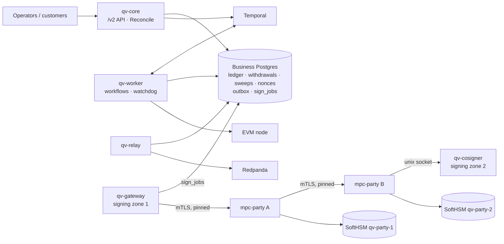

# quorum-vault

> **Testnet and local chains only.** Everything runs against a local anvil node that impersonates Sepolia
> (chain id 11155111). Test PINs are generated on your machine (`make dev-env`), and bitcoind uses a cookie. Never point this code at
> real funds or real keys.

quorum-vault is a working model of how an institution holds customer crypto.

**The custody core (`/v2`)**: customers, deposit addresses, **deposits, sweeps and withdrawals on EVM chains** with a
  double-entry ledger, holds, nonce management, stuck-transaction replacement, crash-safe Temporal workflows, an outbox to
  Redpanda, and a `Reconcile` check that compares the books with the chain. Hot wallets sign with **MPC** (EVM: 2-of-3 threshold ECDSA on three parties; Bitcoin: two-party)
  (`mpc-party` A and B, Coinbase's cb-mpc), behind a **signing gateway** and a **cosigner** that are separate trust zones
  and each re-check every request.

[DESIGN_SCALE.md](DESIGN_SCALE.md) works out how the design scales to 1M wallets, with measured figures.

## Architecture



Components, data model, state machines and a sequence diagram of a withdrawal signed by two parties:
[docs/architecture.md](docs/architecture.md).

## What is here

| Capability | Where | Proof |
|---|---|---|
| Deposit addresses (CREATE2 forwarders), scan, crediting, sweeps to the hot wallet | [internal/custody](internal/custody), [internal/chain/evm](internal/chain/evm), [contracts](contracts) | `e2e/custody` happy path, 50 customers at once |
| Withdrawals: holds, tiers, dual-control approvals, nonce allocation, fee replacement, cancel, settle or void | [internal/custody](internal/custody), [internal/workflow](internal/workflow) | `e2e/custody`: reverted, dropped, stuck, consumed-nonce, duplicate-request tests |
| Double-entry ledger and `Reconcile` (books against the chain, to the wei) | [internal/ledger](internal/ledger), `/v2/reconcile` | clean `Reconcile` at the end of every custody test |
| Crash safety: worker killed at every workflow boundary, gateway and relay restarted | [internal/workflow](internal/workflow) | `TestCrashAtEveryBoundary` (7 boundaries) |
| Workflow watchdog: a loop that stops making progress is alerted, terminated and restarted | [internal/workflow/watchdog.go](internal/workflow/watchdog.go) | `TestWatchdog*` |
| Signing gateway (zone 1) and cosigner (zone 2): approver signatures, policy, replay guard, each with its own database | [internal/gateway](internal/gateway), [internal/cosigner](internal/cosigner) | attack tests, rogue-party tests |
| MPC signer (EVM: 2-of-3 on parties A, B, C; Bitcoin: two-party HD): DKG, sign, refresh, freeze, sealing in HSM tokens, backup and restore | [mpc-party](mpc-party), [internal/mpcsigner](internal/mpcsigner) | `make test-mpc`, the custody tests with `QV_CUSTODY_SIGNER=mpc` |
| Failure tests on MPC: kill a party or the cosigner, partition, latency, refresh and freeze under live withdrawals | [e2e/custody/mpc_test.go](e2e/custody/mpc_test.go) | see [measurements](docs/measurements/mpc-service.md) |
| Tamper-evident audit: a hash chain in each trust zone (core, gateway, cosigner), heads published to Kafka, verify commands | [internal/audit](internal/audit), [internal/auditchain](internal/auditchain) | `TestTamperingIsCaught`, `e2e/custody` audit checks |
| Runbooks: MPC backup and restore, keyset freeze | [docs/runbooks](docs/runbooks) | `mpc-party/scripts/restore-drill.sh` |

## Limits, honestly

- **Local chains only.** Tested against anvil with instant blocks and zero confirmations. Nothing here has met reorgs, real
  fee markets or a real network.
- **SoftHSM.** The tokens are software: no tamper resistance, dev PINs. The structure (own token per party, PIN from the
  environment, non-exportable wrap key) is what a hardware HSM would need, not a substitute for one.
- **All MPC parties run on one machine, run by one team.** The cryptographic and protocol separation is real; the operational
  separation is not.
- **The cold tier is not built.** There is one hot tier. The design is in [DESIGN_SCALE.md](DESIGN_SCALE.md).
- **2-of-3 for EVM only.** EVM keeps signing with any one of the three parties down. Bitcoin is still two-party: losing one
  party stops Bitcoin signing until it is restored from its backup.
- **EVM and Bitcoin only.** No Solana yet (the signer supports Ed25519 keysets; nothing uses them).
- **`X-Actor` is not authentication.** It names the caller for dual control. No real identity, no UI.
- **Measured on a laptop**, not on target hardware, and not under a real load-test yet (P4).
- **cb-mpc has had no external review in this project**, and its soundness history is why the signer freezes a keyset on any
  cryptographic failure.

## Quickstart

Prerequisites: Go ≥ 1.25 with CGO, SoftHSM2, Docker (Postgres, anvil, and for the custody tests Temporal and Redpanda). For the MPC parts also a C++ toolchain (clang, cmake, ninja); `make mpc-build` fetches and builds cb-mpc
at the pinned commit into `mpc-party/.deps` (a few minutes once).

```bash
brew install softhsm           # Ubuntu: apt-get install softhsm2
```

```bash
make dev-env      # first: writes .env (gitignored) with random SoftHSM PINs; never overwrites an existing one
make setup        # SoftHSM tokens in ./data/softhsm + Postgres 16 on localhost:55432 + anvil on 127.0.0.1:18545
```

```bash
make test-short   # unit and integration tests, fast
```

```bash
make test         # every package; fails instead of skipping if Postgres or SoftHSM is missing (the e2e packages skip without their env)
```

### The custody system

The end-to-end tests start every process for you. They need Temporal and Redpanda, and an anvil with chain id 11155111:

```bash
make infra-up     # Temporal + Redpanda (docker compose)
```

```bash
docker run -d --name qv-anvil -p 127.0.0.1:18545:8545 ghcr.io/foundry-rs/foundry:v1.8.5 "anvil --host 0.0.0.0 --chain-id 11155111"
```

```bash
make test-custody                 # the closed loop with HSM hot keys (about 5 minutes)
```

```bash
make mpc-build                    # once: cb-mpc at the pinned commit
make test-mpc                     # gateway -> party A/B/C (2-of-3) -> cosigners, about 1.5 minutes
make test-e2e-evm             # the closed loop with 2-of-3 MPC hot keys plus all failure tests (about 15 minutes)
```

`QV_CUSTODY_SIGNER=hsm|mpc` chooses the signer for `e2e/custody`. To run one test, or a few, by name (a Go `-run` regexp):

```bash
make test-e2e-evm TEST=TestMPCRefreshDuringLiveWithdrawals
```

Pull requests run the light tests in three parallel CI jobs (`make test-e2e-evm-flows`, `-tx-failures`, `-recovery`) next to `make test-mpc`; the
heavy ones (every crash boundary, a component killed at each custody boundary, freeze, partition, latency) run nightly or on
demand from the Actions tab (`nightly` > Run workflow), and locally with `make test-e2e-evm-failure`. Crash boundaries can be
picked with `QV_CRASH_BOUNDARIES=withdrawal.after_broadcast,sweep.after_settle`.

### Every CI test group at once

`make test-e2e-all` runs all thirteen groups of the CI workflow (the `test` job, `make test-mpc`, three EVM groups, eight Bitcoin groups) at the same
time and takes about 8 minutes on a 12-core laptop, instead of 45 to 60 minutes one after the other. Run `make softhsm mpc-build` once first, and have
Docker running; nothing else needs to be up, and the ports and containers of `make setup` and `make infra-up` are left alone.

The groups run in six lanes. A lane has its own Postgres, anvil, bitcoind and SoftHSM tokens, because the tests change those (they mine and reorg a chain,
restart bitcoind, switch a database role on and off, and write to the token files). Temporal and Redpanda are one shared pair. A lane runs its groups
one after another. Each group writes `data/e2e-all/<time>/<group>.log`; the script prints one line per group when it finishes, then a summary, and exits
non-zero if any group failed. Ctrl-C stops the tests and removes every container the run started. Two options:

```bash
make test-e2e-all GROUPS=e2e-btc-cold,test    # some groups; "evm" and "btc" stand for all of theirs
make test-e2e-all LANES=4                     # another number of lanes
```

Soak: `make test-mpc-soak` (50 signatures per second for 10 minutes; `QV_MPC_SOAK_MINUTES` and `QV_MPC_SOAK_RATE` change it). The
`mpc-party` module has its own tests: `cd mpc-party && go test ./...`, and `mpc-party/scripts/restore-drill.sh` destroys a party
and restores it from backup.

### Configuration

All optional; see [.env.example](.env.example).

| Variable | Default | Meaning |
|---|---|---|
| `DATABASE_URL` | `postgres://qv@localhost:55432/quorumvault?sslmode=disable` | Postgres (dev only: trust auth, bound to 127.0.0.1) |
| `SOFTHSM2_CONF` | `./data/softhsm/softhsm2.conf` | repo-local token store |
| `QV_HSM_PIN` | none; `make dev-env` generates it | user PIN of all tokens (no PIN is committed; a test that needs it fails and names `make dev-env`) |
| `QV_PKCS11_LIB` | the SoftHSM2 library of the OS | PKCS#11 module |
| `QV_CUSTODY_SIGNER` | `hsm` | `e2e/custody`: `hsm` or `mpc` |
| `QV_E2E_TIMEOUT_SCALE` | `1` | stretches the limit of every condition wait in the e2e tests (CI sets 3); a slow runner gets longer before a test calls it stuck |
| `QV_E2E_DELAY_SCALE` | `1` | stretches the delays of the system under test in `e2e/custody` (engine timeouts, stuck-after, gateway lease) and its negative checks; CI leaves it at 1 |

## The API

The `/v2` API (customers, deposit addresses, balances, withdrawals, approvals, `reconcile`) is served by `qv-core`; routes are in
[internal/custody/api.go](internal/custody/api.go) and used throughout [e2e/custody](e2e/custody).

## Numbers

Apple M3 Pro, Go 1.27.3, SoftHSM 2.7.0, all processes on one machine. Sources:
[docs/measurements/closed-loop.md](docs/measurements/closed-loop.md) (HSM), [docs/measurements/mpc-service.md](docs/measurements/mpc-service.md)
(MPC), [docs/spikes/p5a-cbmpc.md](docs/spikes/p5a-cbmpc.md) and [docs/measurements/mpc.md](docs/measurements/mpc.md) (the library).
The whole-path rows were measured with the two-party signer, before EVM moved to 2-of-3.

| | HSM signer | MPC signer |
|---|---:|---:|
| Withdrawal, request to confirmed, median | 412 ms | 409 ms |
| 20 withdrawals at once, all confirmed | 1.18 s | 2.41 s |
| One signature (library, no network) | — | two-party 49 ms; 2-of-3 p95 103 ms |
| One signature through the service, p50 / p95 | — | two-party 65 / 69 ms; 2-of-3 109 / 112 ms |
| Soak: 50 signatures/s for 10 min, whole path | — | 30 000 of 30 000, 0 failed |
| Added 100 ms per frame between the parties, sign job | — | 1.55 s |

## Security notes

- **Keys.** HSM keys are non-exportable (`CKA_SENSITIVE`, `!CKA_EXTRACTABLE`). MPC shares are sealed with an AES key inside each
  party's own token; the associated data binds role, keyset and generation. A refresh commits in two durable phases and a crash
  at any step converges to one working generation.
- **Two gates.** The gateway and the cosigners of party B and party C each check approver signatures, policy and the replay guard from their own
  config and database. An attacker who owns party A, or the business database, cannot get a signature for a request that was not
  approved.
- **Freeze.** A cryptographic failure freezes the keyset on every party that holds it until an operator signs an unfreeze.
- **Ledger.** Money moves only through balanced entries; a withdrawal's hold is released only when its nonce is settled or
  provably cancelled.
- **No secrets in the repo**; test PINs are generated at run time (`make dev-env`) and bitcoind uses cookie authentication.

## Documentation

- [DESIGN_SCALE.md](DESIGN_SCALE.md): scaling to 1M wallets, with measured numbers and what is still to be measured
- [docs/architecture.md](docs/architecture.md): processes, trust zones, data model, state machines
- [docs/runbooks](docs/runbooks): MPC backup and restore, keyset freeze
- [docs/measurements](docs/measurements): raw benchmark and test output
- [docs/learn](docs/learn): study guides per task, each with a quiz

## History

The first version was a single `/v1` binary (HTTP API, policy, approvals, HSM key registry); it was retired in P6b-1 and the
custody core replaced it. Before that it used a 2-of-3 GG20 threshold-ECDSA cluster (tss-lib) with all three parties in one process. GG20 has known
attacks and nothing in the custody path used it, so it was removed in P5b-6. Its study guide
([docs/learn/t3-mpc-gg20.md](docs/learn/t3-mpc-gg20.md)) and measurements ([docs/measurements/mpc.md](docs/measurements/mpc.md))
are kept as a record.
