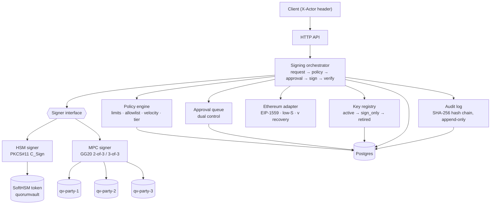

# quorum-vault

> **Testnet only.** Ethereum Sepolia (chain id 11155111). All PINs and
> passwords in this repo are dev-only defaults. Never point this code at
> real funds or real keys.

quorum-vault is a small working model of how an institution manages wallets
at scale. Keys are generated inside an HSM over raw PKCS#11 and never leave
it. A 2-of-3 GG20 threshold-ECDSA cluster (tss-lib) runs a distributed
keygen with no dealer, and seals each party's share under an AES key inside
that party's own HSM token. Every signature passes a policy engine (limits,
allowlist, velocity), an approval queue with dual control, and a key
lifecycle check (`active -> sign_only -> retired`). Every step is written to
a hash-chained, append-only audit log. Each run ends in an EIP-1559 Sepolia
transaction whose recovered sender is checked locally. The design note
[DESIGN_SCALE.md](DESIGN_SCALE.md) works out how this design scales to 1M
wallets.

## Architecture



Details: components, data model, state machines and a sequence diagram of
an MPC cold-wallet signature are in [docs/architecture.md](docs/architecture.md).

## Features

| Requirement | Where | Proof |
|---|---|---|
| HSM key generated in token, non-exportable (`CKA_TOKEN`, `CKA_SENSITIVE`, `!CKA_EXTRACTABLE`), secp256k1, token found by label | [internal/hsm](internal/hsm) | `TestPrivateKeyNotExportable`: reading `CKA_VALUE` returns `CKR_ATTRIBUTE_SENSITIVE` |
| Key registry and lifecycle: generate, rotate (drain), retire (`C_DestroyObject`) | [internal/keys](internal/keys) | `TestRotationDrill`; [docs/rotation-ceremony.md](docs/rotation-ceremony.md) |
| Policy engine: per-tx and daily limits, allowlist, velocity, approval threshold | [internal/policy](internal/policy) | allow / deny / needs-approval tests |
| Approval queue: approver ≠ requester, one vote each, any reject ends it | [internal/approval](internal/approval) | self-approval → HTTP 403 in the demo |
| Append-only, hash-chained audit log with `Verify` | [internal/audit](internal/audit) | DB triggers reject UPDATE/DELETE/TRUNCATE; `GET /audit/verify` |
| MPC 2-of-3 GG20: dealerless keygen, sealed shares, threshold sign | [internal/mpc](internal/mpc) | `TestSignRefusesOneParty`, `TestCopiedShareWithOtherTokenFails` |
| Hot/cold tiering: hot = 2-of-3, cold = 3-of-3 + 2 approvals | [internal/signing](internal/signing) | `TestMPCColdWalletFullQuorum`, demo step 3 |
| Policy-gated signed Sepolia tx from both backends, verified locally | [internal/chain/eth](internal/chain/eth), [scripts/demo-sepolia.sh](scripts/demo-sepolia.sh) | recovered sender == wallet address, checked by the server and again offline by `quorumvault verify-tx` |
| Measured latencies, rounds, messages | [docs/measurements](docs/measurements) | tables below |
| Scale design note | [DESIGN_SCALE.md](DESIGN_SCALE.md) | — |

**Not exercised:** broadcasting to Sepolia. The code can broadcast when
`SEPOLIA_RPC_URL` is set, but no funded address was used. The deliverable
is a signed transaction that is well-formed and whose signature recovers to
the wallet's address, which the brief accepts as a complete demo.

## Quickstart

Prerequisites: Go ≥ 1.25 with CGO (the PKCS#11 binding is cgo), SoftHSM2,
Docker (for Postgres only), `jq` and `curl` for the demo.

```bash
brew install softhsm jq        # Ubuntu: apt-get install softhsm2 jq
```

```bash
make setup        # SoftHSM tokens in ./data/softhsm + Postgres 16 on localhost:55432
```

```bash
make test-short   # unit + integration tests; skips the slow MPC ceremonies
```

```bash
make test         # full suite incl. MPC keygen/sign (minutes); fails instead of skipping if DB/HSM are missing
```

Run the server, then the demo in a second terminal:

```bash
make run          # go run ./cmd/quorumvault, listens on :8080
```

```bash
./scripts/demo-sepolia.sh
```

The demo creates an HSM hot wallet, an MPC hot wallet and an MPC cold
wallet, sets policies and allowlists, and signs four transactions: HSM
allow, HSM over-threshold (self-approval refused, a second person
approves), MPC 2-of-3, and MPC cold 3-of-3 after two approvals. It ends with
the audit trail and `{"ok":true}` from the chain check. The first MPC wallet
takes 10–15 s while each party generates and seals its Paillier pre-params;
later ones take ~3 s.

Configuration (all optional; see [.env.example](.env.example), copy to `.env`):

| Variable | Default | Meaning |
|---|---|---|
| `DATABASE_URL` | `postgres://qv@localhost:55432/quorumvault?sslmode=disable` | Postgres (dev only: trust auth, bound to 127.0.0.1) |
| `QV_HTTP_ADDR` | `:8080` | listen address |
| `QV_DATA_DIR` | `./data` | MPC sealed shares and pre-params |
| `QV_PKCS11_LIB` | `/opt/homebrew/lib/softhsm/libsofthsm2.so` (macOS), `/usr/lib/softhsm/libsofthsm2.so` (Linux) | PKCS#11 module |
| `SOFTHSM2_CONF` | `./data/softhsm/softhsm2.conf` | repo-local token store |
| `QV_HSM_PIN` | `user-dev-1234` (dev only) | user PIN of all tokens |
| `SEPOLIA_RPC_URL` | empty | if set: nonce/fees from the node, and broadcast (`QV_BROADCAST=0` disables) |

## API

Every mutating call needs an `X-Actor: <name>` header (401 without it).
Wei amounts are decimal strings; bytes are 0x-hex. Errors are
`{"error": "..."}` with 400, 401, 403 (self-approval), 404, 409 (state
conflict / duplicate), 422 (invalid).

| Method | Path | Does |
|---|---|---|
| GET | `/healthz` | DB and HSM token check |
| POST | `/wallets` | `{name, tier: hot\|cold, backend: hsm\|mpc}` → wallet + key v1 (MPC runs a DKG) |
| GET | `/wallets`, `/wallets/{id}` | list; one wallet with keys, policy, allowlist |
| POST | `/wallets/{id}/rotate` | new key version `active`, old one `sign_only` |
| PUT | `/wallets/{id}/policy` | limits, velocity, `required_approvals` (0 = tier default: hot 1, cold 2) |
| POST | `/wallets/{id}/allowlist` | `{address, label}` |
| DELETE | `/wallets/{id}/allowlist/{address}` | remove a destination |
| POST | `/keys` | `{}` → new HSM wallet + key; `{wallet_id}` → next HSM key version |
| GET | `/keys?wallet_id=` | key metadata (public key, address, state, timestamps) |
| POST | `/keys/{id}/retire` | `sign_only` → `retired`; HSM private key destroyed |
| POST | `/sign-requests` | `{wallet_id, to, value_wei, nonce, …}` → `signed`, `pending_approval`, `denied` or `failed`, with `raw_tx`, `from`, `timings_ms` |
| GET | `/sign-requests?wallet_id=`, `/sign-requests/{id}` | list / one |
| POST | `/sign-requests/{id}/approve`, `/reject` | vote; the deciding approval signs in the same call |
| GET | `/audit?wallet_id=&request_id=&limit=` | events with `prev_hash` and `hash` |
| GET | `/audit/verify` | walks the chain; first bad `seq` if broken |

## Measured numbers

Apple M3 Pro, 12 logical CPUs, macOS, Go 1.27.3, SoftHSM 2.7.0, Postgres 16
in Docker. All MPC parties in one process (no network). Sources:
[docs/measurements/mpc.md](docs/measurements/mpc.md) (10 runs per row),
[docs/measurements/e2e.md](docs/measurements/e2e.md) (one demo run).

| Operation | Latency | Rounds | Messages | Bytes |
|---|---:|---:|---:|---:|
| HSM `C_Sign` (SoftHSM) | ~0.9 ms | — | — | — |
| HSM request end to end, allow → signed | 17.5 ms | — | — | — |
| MPC pre-params, 3 parties in parallel (once, cached) | 5.1–16.0 s | — | — | — |
| MPC keygen (DKG, 3 parties) | 2.7–3.0 s | 3 | 24 | 1.35 MB |
| MPC sign 2-of-3, median | 367–375 ms | 9 | 20 | 21 KB |
| MPC sign 3-of-3, median | 494 ms | 9 | 60 | 64 KB |
| MPC 2-of-3 request end to end | 382 ms | | | |
| MPC 3-of-3 final approve call (2nd approval → signed) | 500 ms | | | |

On a network, add about 9 × RTT per MPC signature (9 sequential rounds); at
50 ms RTT that is +450 ms. [DESIGN_SCALE.md](DESIGN_SCALE.md#3-key-partitioning-regional-deployment-quorum-geography)
works through the regional cases.

## Security model

- **Non-exportable HSM keys.** EC key pairs are generated in the token with
  `CKA_TOKEN`, `CKA_SENSITIVE`, `!CKA_EXTRACTABLE`; the code only ever holds
  a `CKA_ID`. Retiring a key destroys the private key object.
- **Sealed MPC shares.** Each party's keygen output and Paillier pre-params
  are encrypted with `CKM_AES_GCM` under a non-extractable AES-256 key inside
  that party's own token; AAD `<keyRef>|party-<id>` binds a file to its key
  and party. A stolen disk, or one party's share file copied to another
  party, is useless.
- **No dealer.** The MPC private key never exists in one place, including
  during keygen.
- **Dual control on spending.** Approver ≠ requester (HTTP 403); one vote
  per approver, enforced by a DB unique constraint; cold wallets need two
  approvals and all three parties.
- **Policy before signature.** No signer is called unless the request row
  moved `approved → signing` by compare-and-set: one winner, never a double
  signature.
- **Verify before store.** Every signature is low-S normalised, its recovery
  id found by `ecrecover`, and the recovered sender compared with the key's
  address before anything is stored.
- **Tamper-evident audit.** DB triggers reject UPDATE, DELETE and TRUNCATE;
  each row hashes the previous one; `GET /audit/verify` finds the first bad
  row.
- **Testnet only, dev-only secrets.** Sepolia chain id is inside every
  signed digest (no mainnet replay). The PINs and the DB password are public
  dev defaults.
- **Known gaps (by design for a demo).** `X-Actor` is not authentication;
  all MPC parties share one process; key admin needs only one actor. See
  [DESIGN_SCALE.md §7](DESIGN_SCALE.md#7-what-this-repo-does-not-do-and-how-production-would).

## Design tradeoffs

| Choice | Why | Cost |
|---|---|---|
| Raw PKCS#11 (`miekg/pkcs11`), not a wrapper | shows the real Cryptoki calls and attributes | more code; session and handle care |
| SoftHSM | free, scriptable, real PKCS#11 | software only: no tamper resistance |
| GG20 via tss-lib, parties in one process | the brief's library; the library's own tests work this way | one memory dump leaks every share; no network latency in the numbers |
| Seal shares with `CKM_AES_GCM` instead of `C_WrapKey` | a tss-lib share is a data blob, not a PKCS#11 key object; GCM adds integrity and AAD binding | the share is plaintext in memory during a ceremony |
| Drain (`sign_only`) before retire | requests that were already approved finish with the key their approvers saw | an extra state; old address stays usable for a while |
| Audit append after commit | `domain.Auditor` has no transaction parameter | a crash in between can lose one event (fix: outbox) |
| Per-wallet mutex around evaluate + insert | concurrent requests see each other in velocity and daily windows | single instance only (fix: DB advisory lock) |
| Allowed requests stored as `approved` | one `approved → signing` path for both cases | `approved` counts toward 24h spend immediately |

## Documentation

- [DESIGN_SCALE.md](DESIGN_SCALE.md): signer pools, HSM sizing, quorum
  geography, backup and recovery, ceremonies, compliance hooks, production gaps
- [docs/architecture.md](docs/architecture.md): components, data model, state
  machines, MPC sign sequence
- [docs/rotation-ceremony.md](docs/rotation-ceremony.md): key rotation drill
  with API calls, roles, verification, rollback
- [docs/measurements/](docs/measurements): raw benchmark and demo output
- [docs/learn/](docs/learn): study guides per component (foundations, HSM
  lifecycle, policy and audit, MPC, sign path), each with a quiz
