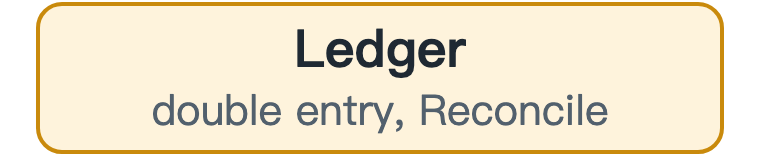
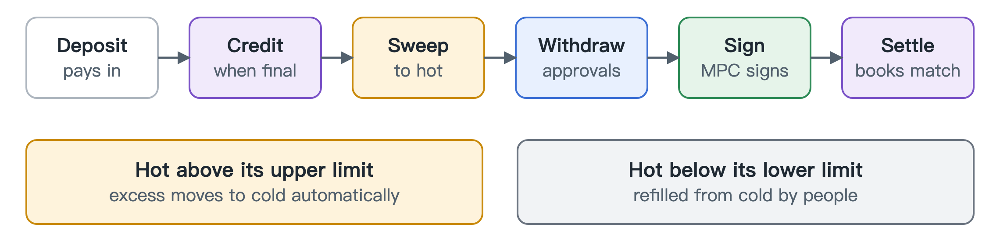

# QuorumVault

English | [中文](README.zh-CN.md)

A custody system for crypto: it holds customers' coins on EVM chains, Bitcoin and Solana, and moves them only when people with the right to approve have approved, and the system that holds the keys has checked it again itself.

Exchanges and custodians lose money in two ways: a key gets stolen, or the books stop matching the chain. QuorumVault splits every key across several machines, so no single machine can sign, and it keeps a ledger that can be checked against the chain at any time.

Two rules carry the design:

- **The side that holds the keys trusts nothing it is told.** Every payment is read back and checked before any key signs.
- **The books must match the chain at every step.** A check called Reconcile compares them, down to the smallest unit.

## Architecture

<p align="center">
<a href="docs/people.md"></a><br/>
<picture></picture><br/>
<a href="docs/identity.md"></a><br/>
<picture></picture><br/>
<a href="docs/api.md"></a><br/>
<picture></picture><br/>
<a href="docs/workflows.md"></a><a href="docs/ledger.md"></a><a href="docs/audit.md"></a><br/>
<picture></picture><br/>
<a href="docs/tiers.md"></a><br/>
<picture></picture><br/>
<a href="docs/signing-zone.md"></a><br/>
<picture></picture><br/>
<a href="docs/mpc.md"></a><br/>
<picture></picture><br/>
<a href="docs/evm.md"></a><a href="docs/bitcoin.md"></a><a href="docs/solana.md"></a>
</p>

## How it works

<p align="center"></p>

| Area | What it does |
|---|---|
| [People](docs/people.md) | Who asks, who approves, who runs it, and how each proves it |
| [Core API](docs/api.md) | The one door in: checks who asks, records it, hands the work on |
| [Services](docs/services.md) | The nine services, what each does and what it is trusted with |
| [Ledger](docs/ledger.md) | Records every coin in double entry and checks it against the chain |
| [Workflows](docs/workflows.md) | Carries each deposit, sweep and withdrawal through a crash |
| [Signing zone](docs/signing-zone.md) | Checks every payment before any key signs |
| [MPC signing](docs/mpc.md) | Splits each key across machines so no one machine can sign |
| [Deployment](docs/deployment.md) | Four clusters, one per trust domain, and what tests share with production |
| [Enclaves](docs/enclaves.md) | Running a party where even its host cannot look in; simulated today |
| [Key replacement](docs/key-replacement.md) | What happens when a key is no longer trusted: a new key takes over and the old one is emptied |
| [Hot and cold](docs/tiers.md) | Keeps a little online, the rest offline, and moves money between them |
| [EVM](docs/evm.md) · [Bitcoin](docs/bitcoin.md) · [Solana](docs/solana.md) | What is special about each chain |
| [Bitcoin sends](docs/bitcoin-sending.md) | How a Bitcoin send gets confirmed: fee room, replacement, cancel, child and batches |
| [Identity](docs/identity.md) | Who may call the API, and how a login is proved |
| [Audit trail](docs/audit.md) | A record of every decision that can't be quietly changed |
| [Testing](docs/testing.md) | How it is tested, including crashes and attacks |
| [Limits](docs/limits.md) | What it can't do yet |

## Try it

You need Go, Docker, SoftHSM and a C++ toolchain (clang, cmake, ninja).

```bash
make dev-env && make setup && make mpc-build
```

```bash
make test-e2e-all
```

The first command builds the MPC library once, which takes a few minutes. The second runs every test group CI runs, on local chains, in about ten minutes. Developer setup is in [CONTRIBUTING.md](CONTRIBUTING.md); runbooks are in [docs/runbooks](docs/runbooks) and measured numbers in [docs/measurements](docs/measurements).

## Releases

QuorumVault ships as container images, one per binary, public on `ghcr.io`. A release is manual: a version tag on `main`, a workflow run, a signed manifest of image digests that the Helm charts use. The steps, the checks and the rollback are in [docs/runbooks/release.md](docs/runbooks/release.md).

## Status

| Verified | How |
|---|---|
| Deposits, sweeps, withdrawals, cold storage on EVM, Bitcoin and Solana | End-to-end tests on local chains, in CI |
| Crash safety | A worker is killed at every step of every flow; each payment settles once |
| Attacks on the signing side | A compromised gateway, party or database is refused |
| Login and approvals | A real OpenID Connect token is required; passkey approvals are checked by the signing zone. Tested with Keycloak and software authenticators, not hardware keys |
| Audit record | Chain heads are copied into write-once storage; tamper checks in tests |
| Replacing an EVM hot key | End-to-end tests, planned and emergency, with a real gateway, cosigners and parties. Bitcoin and Solana deposit keys are tested the same way; a Solana hot wallet cannot be replaced yet |
| Enclave start-up | Simulated only: the broker and sealed shares are tested with a stand-in for the enclave. **No real enclave yet** |
| Kubernetes shape | Charts and images are built and checked by tests. **No real cluster has run them yet** ([Deployment](docs/deployment.md)) |
| Real networks, real load | A local load test exists ([results](docs/measurements/load-local.md)): one laptop, local chains, software HSM. **No testnet or mainnet use, and no cloud or real-network load run yet.** See [Limits](docs/limits.md) |
