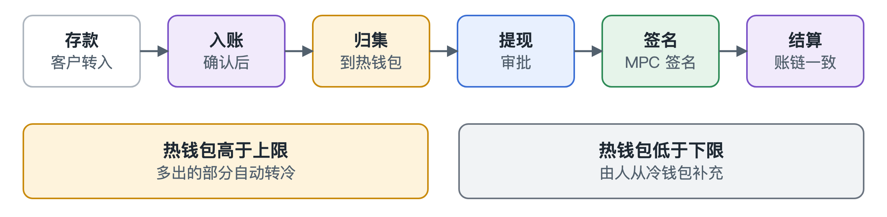

# QuorumVault

[English](README.md) | 中文

一套加密货币托管系统：替客户保管 EVM 链、Bitcoin 和 Solana 上的币。只有经过有权审批的人批准，而且持有密钥的那一侧自己再核对一遍，币才会被转出。

交易所和托管机构丢钱，通常是两种原因：密钥被盗，或者账和链对不上。QuorumVault 把每把密钥拆到几台机器上，任何一台都签不了名；账本也随时能和链上逐笔对账。

设计靠两条原则：

- **持有密钥的一侧不轻信任何输入。** 每笔付款在签名前都要被解读回来核对。
- **每一步账都要和链对得上。** 对账（Reconcile）会把账本和链逐项比对，精确到最小单位。

## 架构

<p align="center">
<br/>
<br/>
<a href="docs/zh/workflows.md"></a><a href="docs/zh/ledger.md"></a><a href="docs/zh/audit.md"></a><br/>
<br/>
<a href="docs/zh/signing-zone.md"></a><a href="docs/zh/tiers.md"></a><br/>
<br/>
<a href="docs/zh/mpc.md"></a><br/>
<br/>
<a href="docs/zh/evm.md"></a><a href="docs/zh/bitcoin.md"></a><a href="docs/zh/solana.md"></a>
</p>

点击方框可打开对应页面。

## 怎么运作

<p align="center"></p>

| 部分 | 作用 |
|---|---|
| [账本](docs/zh/ledger.md) | 每一枚币都用复式记账，并和链上对账 |
| [工作流](docs/zh/workflows.md) | 保证每笔存款、归集、提现在崩溃后也能走完 |
| [签名区](docs/zh/signing-zone.md) | 每笔付款签名前都要核对 |
| [MPC 签名](docs/zh/mpc.md) | 把每把密钥拆到多台机器上，没有哪台能单独签名 |
| [冷热钱包](docs/zh/tiers.md) | 少量放在线上，其余离线保管，并在两者之间调拨 |
| [EVM](docs/zh/evm.md) · [Bitcoin](docs/zh/bitcoin.md) · [Solana](docs/zh/solana.md) | 每条链各自的特殊之处 |
| [Bitcoin 发送](docs/zh/bitcoin-sending.md) | 一笔 Bitcoin 交易怎么上链：加价余量、替换、取消、子交易和批量 |
| [身份](docs/zh/identity.md) | 谁能调用 API，登录怎么证明 |
| [审计记录](docs/zh/audit.md) | 记下每个决定，事后没法悄悄改 |
| [测试](docs/zh/testing.md) | 怎么测，包括崩溃和攻击 |
| [局限](docs/zh/limits.md) | 目前还做不到的事 |

## 试一试

需要 Go、Docker、SoftHSM 和 C++ 工具链（clang、cmake、ninja）。

```bash
make dev-env && make setup && make mpc-build
```

```bash
make test-e2e-all
```

第一条命令会编译一次 MPC 库，要几分钟。第二条会在本地链上跑 CI 跑的所有测试组，大约十分钟。开发环境的说明在 [CONTRIBUTING.md](CONTRIBUTING.md)，运维手册在 [docs/runbooks](docs/runbooks)，实测数字在 [docs/measurements](docs/measurements)。

## 现状

| 已验证 | 怎么验证的 |
|---|---|
| EVM、Bitcoin、Solana 的存款、归集、提现和冷钱包 | 本地链上的端到端测试，在 CI 里跑 |
| 崩溃安全 | 在每个流程的每一步杀掉工作进程，每笔付款都只结算一次 |
| 针对签名侧的攻击 | 网关、某个参与方或数据库被攻破，都会被拒绝 |
| 登录和审批 | API 要求真实的 OpenID Connect 令牌；通行密钥审批由签名区自己核对。用 Keycloak 和软件认证器测过，没试过硬件密钥 |
| 审计记录 | 链头复制进一次写入的存储；篡改检查在测试里验证 |
| 真实网络、真实负载 | **还没有。** 没上过测试网或主网，也没做压测。见[局限](docs/zh/limits.md) |
