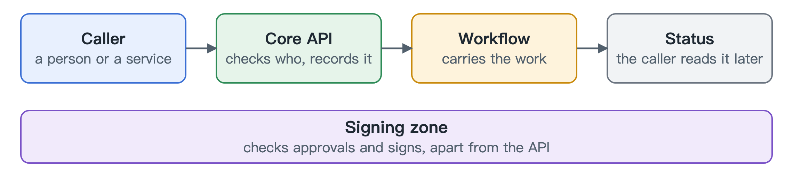

# Core API

[中文](zh/api.md)

The core API is the one door into QuorumVault. People and services ask it for things: open a customer, get a deposit address, request or approve a withdrawal. It checks who is asking, writes the request down and hands the work on. It holds no keys and signs nothing.

## What you can ask it

| Area | Requests |
|---|---|
| Customers | Open a customer, get deposit addresses, read balances |
| Withdrawals | Request, approve or reject, read the status |
| Cold storage | Export and import refill files, book cold movements |
| Keys | Register, activate, drain or retire a key generation |
| Checks | Run reconcile, verify the audit trail |

## What it does with every request

1. Checks the caller's token and role ([Identity](identity.md), [People](people.md)).
2. Records who asked before anything changes; if that cannot be written, nothing happens.
3. Returns the first answer again when a request is repeated, so a retry is safe.
4. Starts a [workflow](workflows.md) and answers at once; the caller reads the status later.

An approval sent here is only carried along: the [signing zone](signing-zone.md) checks it itself.
