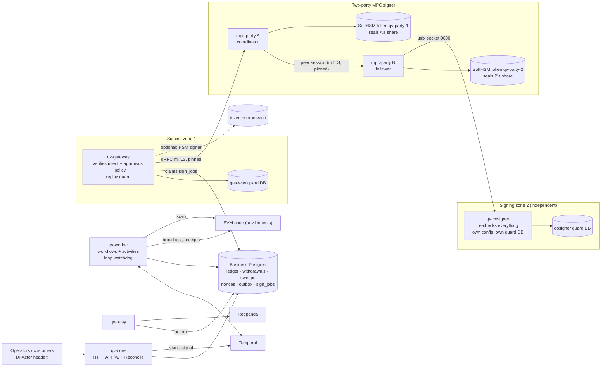
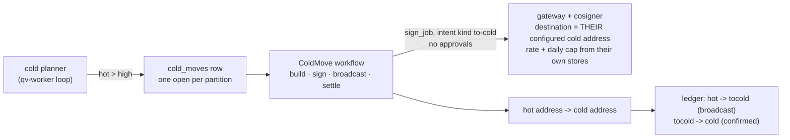
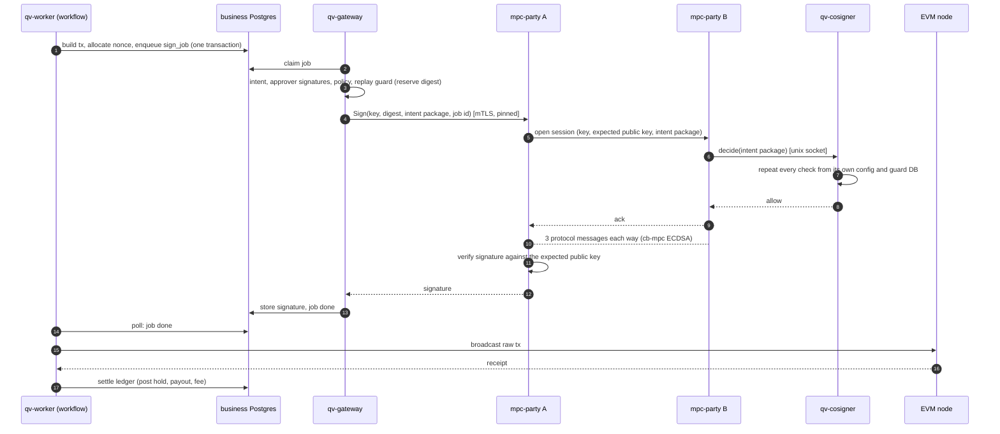

# Architecture

quorum-vault is one custody system (`/v2`): deposits, sweeps and withdrawals on EVM chains, a Temporal-driven workflow engine, a
signing gateway that is a separate trust zone, and **two-party MPC hot signing** (`mpc-party` A and B plus a cosigner).

## The custody system: processes and trust zones

| Process | Does | Trusts |
|---|---|---|
| `qv-core` | HTTP API (`/v2`): customers, deposit addresses, withdrawals, approvals, balances, `Reconcile` | the business database |
| `qv-worker` | Temporal workflows: scan, sweep planner, withdrawal reconciler, cold planner (long-running loops), one workflow per withdrawal, sweep and hot-to-cold move; a watchdog restarts a loop that stops making progress | the business database, the chain |
| `qv-relay` | outbox to Redpanda, at least once | the business database |
| `qv-gateway` | signing zone: claims `sign_jobs`, re-verifies the intent, the approver signatures and the policy (for a hot-to-cold move: the pinned cold address, a rate and a daily cap; for a hot-shard rebalance: another hot shard of the pool, a rate and a daily cap), reserves the digest in its own replay-guard database, then asks a signer | **not** the business database: it only reads and updates `sign_jobs` as a restricted role |
| `mpc-party` A and B | two-party threshold ECDSA (cb-mpc): DKG, derive, sign, refresh; shares sealed by each party's own HSM token; durable two-phase refresh; backup and restore | each other only through pinned mTLS certificates |
| `qv-cosigner` | party B's gate: repeats the gateway's checks from its own config and its own database before B takes part in a signature; fail closed | nothing from A or the gateway |

One withdrawal, end to end: API commits the row, the hold and an outbox event, then starts a workflow. The workflow waits for
approvals, builds the transaction and allocates a nonce, enqueues a `sign_job`. The gateway claims it, checks it, and asks
party A; A opens a session with B; B asks its cosigner; the two parties sign; the signature returns through the gateway to the
job row; the workflow broadcasts, waits for the receipt, and settles the ledger. Every crash boundary in that sequence is a test
(`e2e/custody`).

## Hot to cold

Most funds should not sit in a wallet that signs all day. Each hot partition has a low mark, a high mark and a target
([config](../internal/custody/config.example.json), section `cold`). The **cold planner** loop looks at every partition: free
liquidity above the high mark (the hot balance less what open withdrawals have reserved and less a move already planned) is moved
down to the target, to the cold address. Below the low mark it logs one `ALERT` per outage asking for a refill (the refill is not
built yet).

No human approves a move: the destination is pinned in the signing zone's config, which the business side cannot change, so a move
can only make funds safer. Both the gateway and party B's cosigner check it, from their own config and their own stores, so a
rogue party A or a rogue business database cannot send "cold" money anywhere else. `Reconcile` compares each cold address's
on-chain balance with the sum of the `cold:<partition>` accounts that deliver to it. Design and tests:
[learn/p6-1-hot-to-cold.md](learn/p6-1-hot-to-cold.md).

### Between hot shards: the rebalance

Every sweep pays one hot shard, so the others run dry. Per asset, a shard below its **target** (config `cold.rebalance.targets`) receives from
the fullest shard when that holds more than its own target: intent kind `rebalance`, no approval, its own workflow and ledger clearing
account (`rebal`), planned by the same loop *before* the move to cold. The signing zone pins the destination to another hot shard of the same
pool and asset from its own `hot_addresses`, and rate-limits and caps it from its own store (gateway and cosigner both). Targets must lie
between a shard's low mark and its cold target, so a rebalance and a move to cold cannot undo each other.
Design and tests: [learn/p6-4-shard-rebalance.md](learn/p6-4-shard-rebalance.md).

### Cold to hot: the refill

The way back needs people. A hot partition below its low mark gets a **refill request** (one open per cold address); an operator exports it
(`POST /v2/refills/{id}/export`: nonce and fees read online), carries the file across an air gap to the **offline signer** `qv-cold`
(the `qv-cold` SoftHSM token, no network client at all), where M of N operators approve and the HSM signs; the signed file comes back
(`POST /v2/refills/{id}/import`), is checked against the request, and the refill workflow broadcasts it and follows it to confirmation.
The offline config alone decides what may be signed (pinned hot destinations, per-ceremony caps, chain id); the online side is untrusted.
M-of-N is enforced in software with SoftHSM. Details and runbook: [learn/p6-2-cold-refill.md](learn/p6-2-cold-refill.md),
[runbooks/cold-refill.md](runbooks/cold-refill.md).

## Audit log

Three hash chains, one per trust zone, each in its own database: **core** (the business database), the **gateway**'s guard
database, and the **cosigner**'s guard database. Each row stores the hash of the row before it; database triggers refuse UPDATE,
DELETE and TRUNCATE; `internal/audit` appends and verifies.

- **Core.** Business code writes an audit event to the outbox in the same transaction as the change, so the event exists exactly
  when the change does. One chainer in `qv-relay` (one at a time, by advisory lock) appends the events not yet chained to the
  chain, once each. It picks "not yet chained", never "after the last seq", because a row with a lower seq can commit later.
  Chaining inside the business transactions would make them all queue for the chain head. The outbox row cannot be edited or
  deleted once written.
- **Gateway and cosigner.** Every decision is recorded in the zone's own database, in the transaction that decides: the permission
  to sign together with the reservation of the digest, the stored signature, and every refusal with its reason. If the record
  cannot be written, nothing is signed and nothing is answered: the job is retried. This works with `qv-core` down, and the
  business zone cannot touch it.
- **Anchors.** Each chain publishes its head (count and last hash) to Kafka topic `qv.audit.heads` whenever it changes and at a
  set interval. A chain cut short or rewritten by someone who can switch the triggers off is still a valid chain, but it no longer
  has the entry that was published. If Kafka is down chaining and signing go on, and the heads catch up.
- **Checking.** `GET /v2/audit/verify` checks the core chain. `qv-relay verify`, `qv-gateway verify` and `qv-cosigner verify`
  check a chain against a file of published heads (`-anchors`). Details and what each kind of tampering looks like:
  [learn/p6b-2-audit.md](learn/p6b-2-audit.md).

## A withdrawal signed by two parties

If B, the cosigner or the link is down, A answers `UNAVAILABLE` and the gateway keeps the job open and retries: one ALERT per
outage, no refusal, no void. If a party detects a bad message, it freezes the keyset on both sides and an operator must
unfreeze it; withdrawals then park with their hold and nonce kept (see
[learn/p5b-5-custody-on-mpc.md](learn/p5b-5-custody-on-mpc.md)).

## Trust boundaries

| Boundary | Protects | Does not protect |
|---|---|---|
| HSM token (`CKA_SENSITIVE`, `!CKA_EXTRACTABLE`) | HSM private keys never leave the token | anyone holding the token PIN can call `C_Sign` |
| Per-party HSM seal | a copied share file is useless without that party's token; AAD binds role, keyset and generation, so blobs cannot be swapped | plaintext shares in process memory during a signature; a software token (SoftHSM) is not tamper resistant |
| Party B's cosigner | a compromised party A or gateway cannot get a signature for something B's own config and database refuse | a compromise of B's host and A's host together |
| Gateway zone | the business database cannot make the gateway sign: it re-verifies approver signatures and policy | anyone who holds the approver keys and the gateway config |
| Policy + approval before `sign` | no signer call without an `approved` row | a caller who can reach the signer packages directly |
| Append-only triggers + hash chain + published heads | silent edits or deletions in the log; a cut or rewritten chain disagrees with the heads that left the database | an attacker who also rewrites what is already in Kafka |
| `X-Actor` header | names the caller for dual control | anything: it is not authentication |
