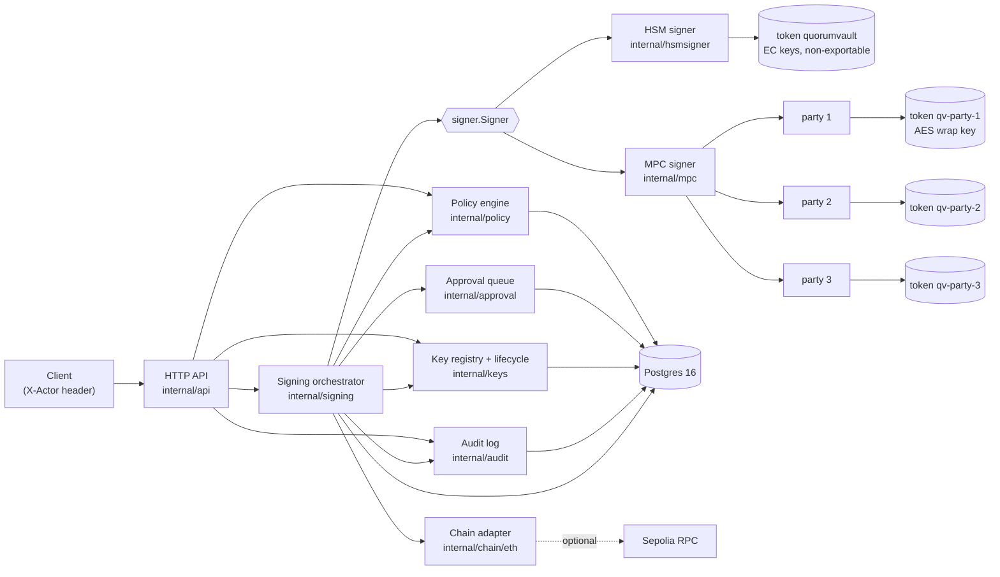
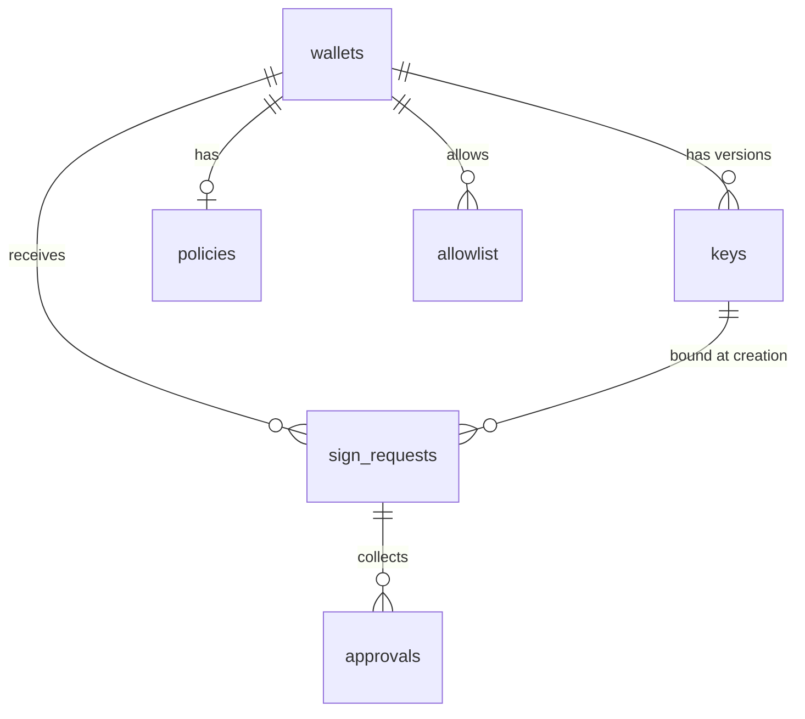
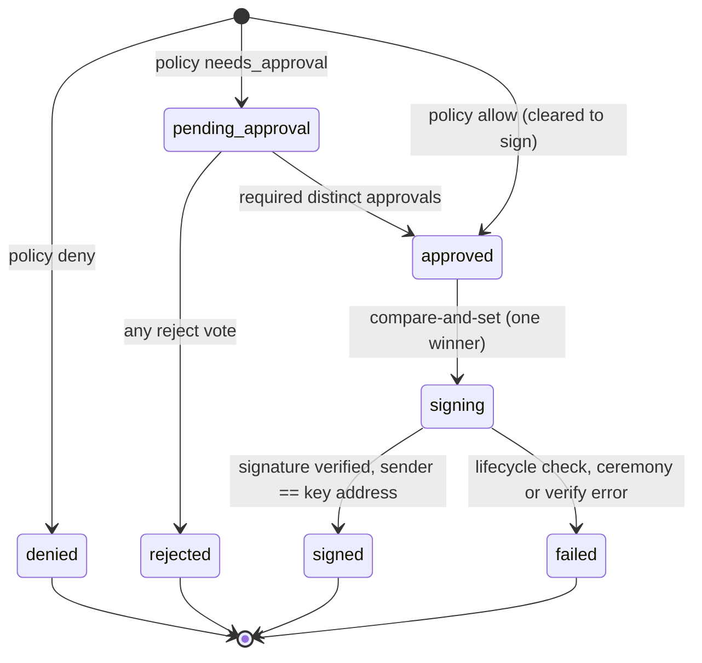
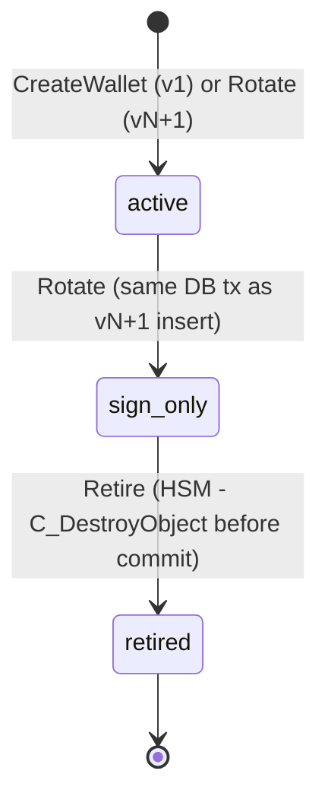
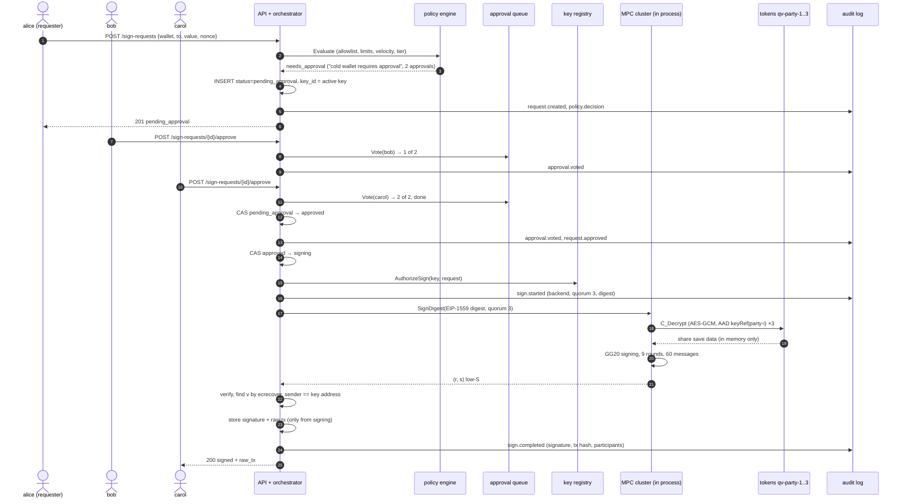

# Architecture

One Go binary (`cmd/quorumvault`) serves an HTTP API, owns a Postgres
database, and talks PKCS#11 to four SoftHSM tokens. Every signature goes
through the same path: request, policy, approval, lifecycle check, sign,
verify, audit.

## Components

| Component | Package | Owns | Key facts |
|---|---|---|---|
| HTTP API | [internal/api](../internal/api/api.go) | routes, JSON errors | `X-Actor` required on every mutating call (demo auth, 401 without it); wei as decimal strings; bytes as 0x-hex |
| Signing orchestrator | [internal/signing](../internal/signing/service.go) | `sign_requests` (only writer) | `Submit`, `Vote`, `sign`; status moves are compare-and-set `UPDATE ... WHERE status = ANY($from)`; per-wallet mutex around evaluate+insert |
| Policy engine | [internal/policy](../internal/policy) | `policies`, `allowlist` | `Evaluate` is read-only; order: allowlist, per-tx limit, velocity, then approval triggers (cold tier, threshold, 24h spend) |
| Approval queue | [internal/approval](../internal/approval/approval.go) | `approvals` | approver != requester; one vote per approver (DB unique constraint); any reject ends it |
| Key registry | [internal/keys](../internal/keys/keys.go) | `wallets`, `keys` | lifecycle `active -> sign_only -> retired`; `AuthorizeSign` drain rule; destroys HSM private key on retire |
| Audit log | [internal/audit](../internal/audit/audit.go) | `audit_log` | hash chain `SHA-256(prev_hash ‖ canonical JSON)`; appends serialized by `pg_advisory_xact_lock`; DB triggers reject UPDATE/DELETE/TRUNCATE |
| HSM signer | [internal/hsmsigner](../internal/hsmsigner/hsmsigner.go), [internal/hsm](../internal/hsm) | EC key objects in token `quorumvault` | raw PKCS#11 via `miekg/pkcs11`; token found by label; `CKM_ECDSA` over a 32-byte digest |
| MPC signer | [internal/mpc](../internal/mpc) | `data/mpc/keys/<keyRef>/party-<id>.sealed` | tss-lib GG20, 3 parties in one process, in-memory transport; each share sealed with `CKM_AES_GCM` under an AES key inside that party's token |
| Chain adapter | [internal/chain/eth](../internal/chain/eth/eth.go) | — | EIP-1559 tx + digest, low-S, recovery-id search, sender check, optional RPC fill/broadcast |

## Data model

Schema: [migrations/0001_init.sql](../migrations/0001_init.sql).

`audit_log` has no foreign keys on purpose: it must outlive the rows it
describes.

| Table | Columns that matter | Constraints |
|---|---|---|
| `wallets` | `id`, `name`, `tier` (hot/cold), `backend` (hsm/mpc) | `name` unique |
| `keys` | `wallet_id`, `version`, `state`, `hsm_label`, `hsm_key_id` (CKA_ID), `mpc_key_ref`, `public_key` (65-byte SEC1), `address`, `activated_at`, `sign_only_at`, `retired_at` | `unique(wallet_id, version)`; partial unique index: one `active` key per wallet |
| `policies` | `daily_limit_wei`, `per_tx_limit_wei`, `approval_threshold_wei` (`numeric(78,0)`), `velocity_max_tx`, `velocity_window_seconds`, `required_approvals` | one row per wallet; no row = deny |
| `allowlist` | `wallet_id`, `address` (lowercase), `label` | PK `(wallet_id, address)` |
| `sign_requests` | `key_id`, `chain_id`, `to_address`, `value_wei`, `data`, `nonce`, gas fields, `requester`, `status`, `decision` (jsonb), `signature`, `raw_tx`, `tx_hash` | `status` CHECK; index `(wallet_id, created_at)` for velocity/spend windows |
| `approvals` | `request_id`, `approver`, `approve`, `comment` | `unique(request_id, approver)` |
| `audit_log` | `seq`, `at`, `actor`, `type`, `request_id`, `wallet_id`, `key_id`, `payload`, `prev_hash`, `hash` | append-only triggers; genesis `prev_hash` = 32 zero bytes |

No private key material is in the database. HSM keys are referenced by
`CKA_ID`; MPC keys by a directory name whose files are ciphertext.

## Request state machine

- The status is decided before the insert and stored with the row, so no
  concurrent reader sees a half-decided request.
- An allowed request is stored as `approved`; both paths then share the one
  `approved -> signing` compare-and-set. Of N concurrent callers exactly one
  gets the row and calls a signer (`TestConcurrentApprovalsSignOnce`,
  `TestConcurrentSignCallsSignOnce`).
- `sign` runs detached from the HTTP request's cancellation with its own
  2-minute timeout, so a client hanging up cannot leave a row in `signing`.
- Audit events per path: allow `request.created, policy.decision,
  sign.started, sign.completed`; approval adds `approval.voted` (×N) and
  `request.approved` before `sign.started`; reject ends with
  `request.rejected`; a lifecycle refusal ends with `sign.failed` (stage
  `authorize`) and no `sign.started`.

## Key lifecycle state machine

| State | May sign |
|---|---|
| `active` | requests bound to it |
| `sign_only` | requests bound to it **and** created before its `sign_only_at` (drain) |
| `retired` | nothing |

The new key is generated before the rotation transaction (keygen can take
seconds for MPC); if the transaction fails, the new HSM key is destroyed.
Concurrent rotations serialize via `SELECT ... FOR UPDATE` and a version
re-check. The full drill with API calls is in
[rotation-ceremony.md](rotation-ceremony.md).

## MPC cold-wallet sign (3-of-3 + two approvals)

Measured on an Apple M3 Pro: the ceremony takes ~480 ms; the final approve
call ~500 ms end to end ([measurements/e2e.md](measurements/e2e.md)). A hot
MPC wallet skips the approvals (when policy allows) and signs with parties
{1,2}: 9 rounds, 20 messages, ~360 ms.

## Trust boundaries

| Boundary | Protects | Does not protect |
|---|---|---|
| HSM token (`CKA_SENSITIVE`, `!CKA_EXTRACTABLE`) | HSM private keys never leave the token | anyone holding the token PIN can call `C_Sign` |
| Per-party AES-GCM seal | a copied share file is useless without that party's token; AAD stops swapping files between keys/parties | plaintext shares in process memory during a ceremony (all three parties share one process here) |
| Policy + approval before `sign` | no signer call without an `approved` row | a caller who can reach the signer packages directly |
| Append-only triggers + hash chain | silent edits or deletions in the middle of the log | a DB superuser rewriting the whole chain (needs external anchoring) |
| `X-Actor` header | names the caller for dual control | anything: it is not authentication |
