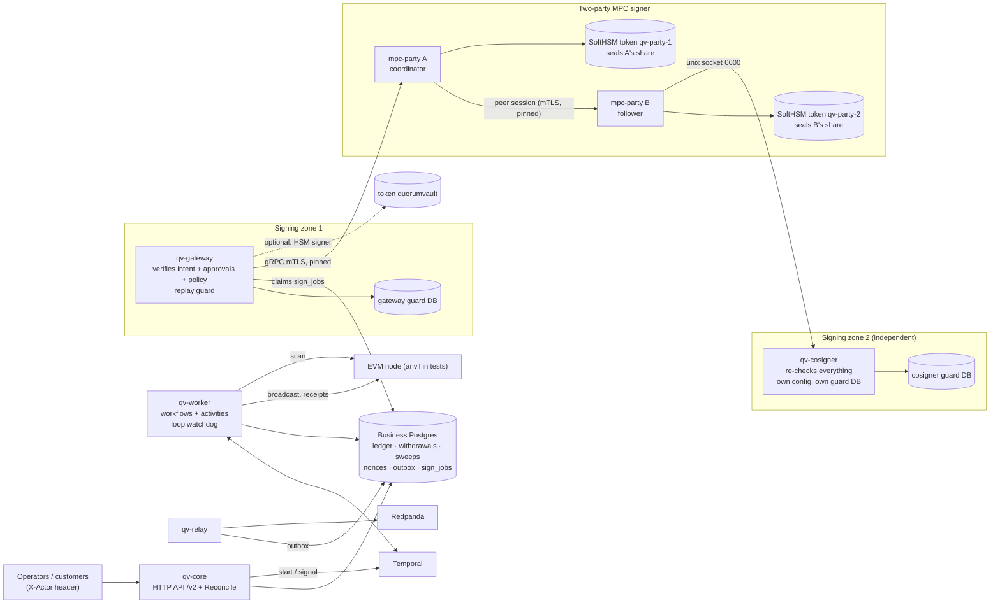
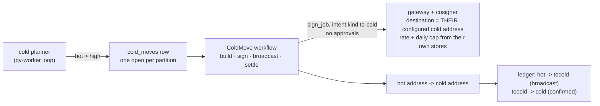
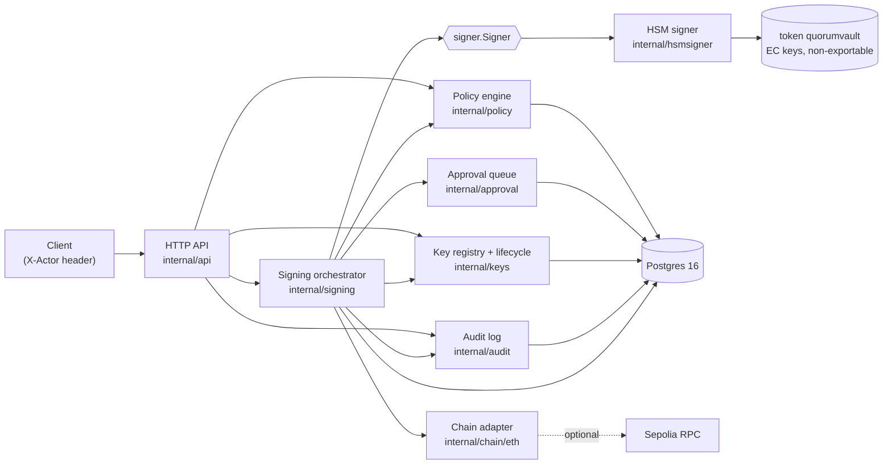
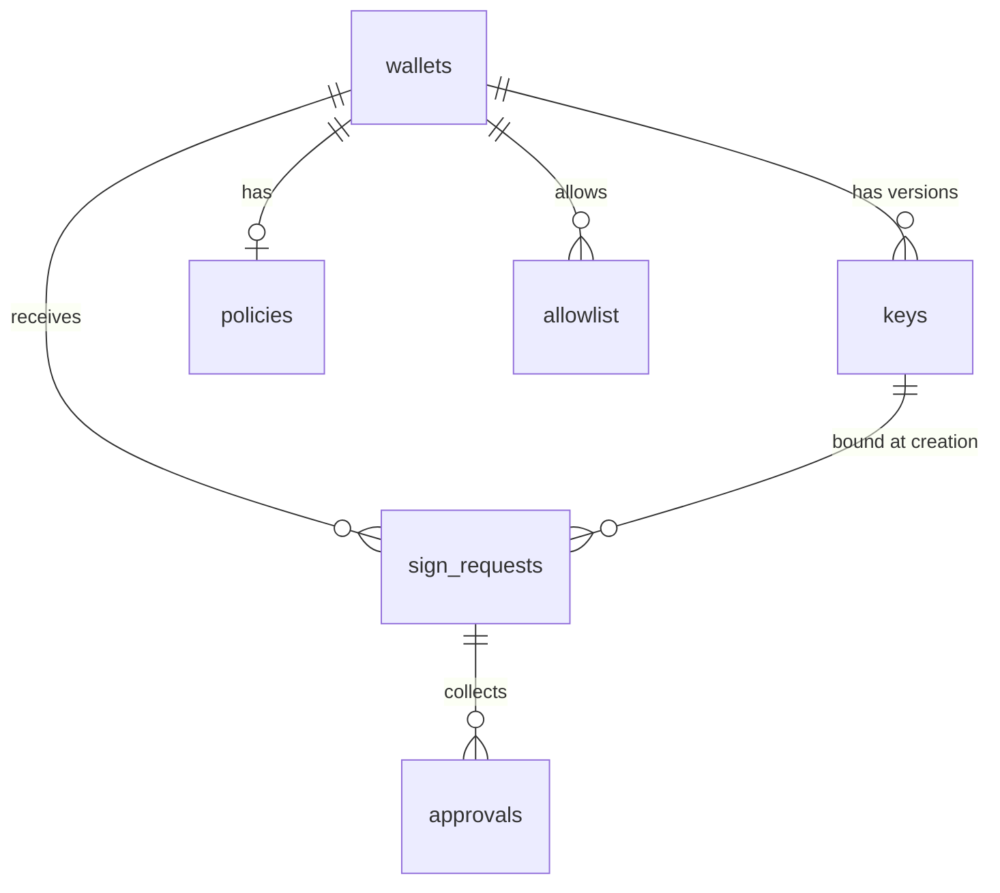
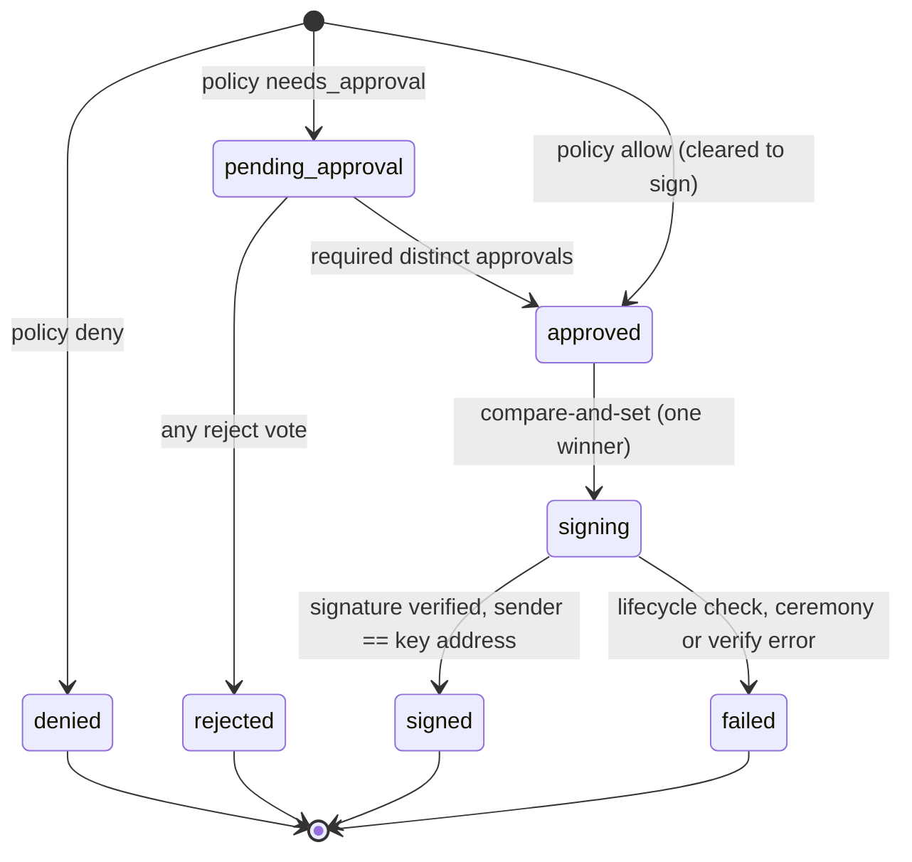
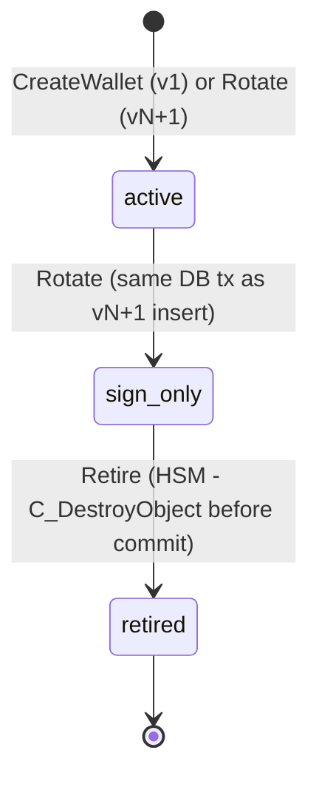
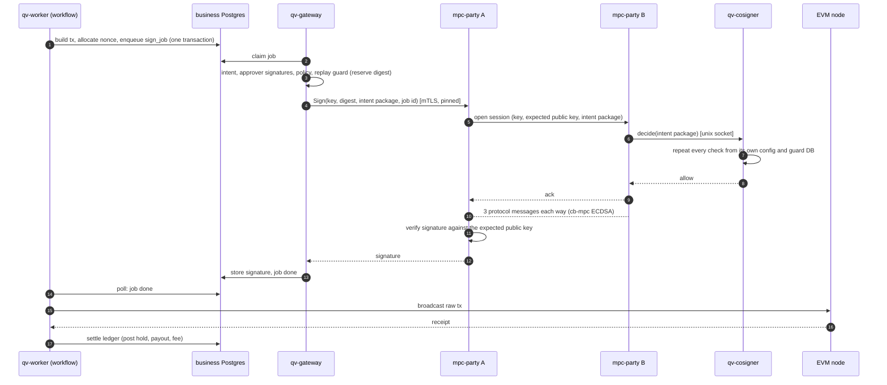

# Architecture

quorum-vault has two layers that share one repository:

1. **The custody core** (`/v2`): deposits, sweeps and withdrawals on EVM chains, a Temporal-driven workflow engine, a signing
   gateway that is a separate trust zone, and **two-party MPC hot signing** (`mpc-party` A and B plus a cosigner).
2. **The `/v1` demo** (`cmd/quorumvault`): one binary with an HTTP API, policy, approvals, key lifecycle, a hash-chained audit
   log and an **HSM-only** signer. It is where the policy and audit ideas were first worked out; the "mpc" wallet backend
   was removed from it.

## The custody system: processes and trust zones

| Process | Does | Trusts |
|---|---|---|
| `qv-core` | HTTP API (`/v2`): customers, deposit addresses, withdrawals, approvals, balances, `Reconcile` | the business database |
| `qv-worker` | Temporal workflows: scan, sweep planner, withdrawal reconciler, cold planner (long-running loops), one workflow per withdrawal, sweep and hot-to-cold move; a watchdog restarts a loop that stops making progress | the business database, the chain |
| `qv-relay` | outbox to Redpanda, at least once | the business database |
| `qv-gateway` | signing zone: claims `sign_jobs`, re-verifies the intent, the approver signatures and the policy (for a hot-to-cold move: the pinned cold address, a rate and a daily cap), reserves the digest in its own replay-guard database, then asks a signer | **not** the business database: it only reads and updates `sign_jobs` as a restricted role |
| `mpc-party` A and B | two-party threshold ECDSA (cb-mpc): DKG, derive, sign, refresh; shares sealed by each party's own HSM token; durable two-phase refresh; backup and restore | each other only through pinned mTLS certificates |
| `qv-cosigner` | party B's gate: repeats the gateway's checks from its own config and its own database before B takes part in a signature; fail closed | nothing from A or the gateway |

One withdrawal, end to end: API commits the row, the hold and an outbox event, then starts a workflow. The workflow waits for
approvals, builds the transaction and allocates a nonce, enqueues a `sign_job`. The gateway claims it, checks it, and asks
party A; A opens a session with B; B asks its cosigner; the two parties sign; the signature returns through the gateway to the
job row; the workflow broadcasts, waits for the receipt, and settles the ledger. Every crash boundary in that sequence is a test
(`e2e/custody`).

## Hot to cold

Most funds should not sit in a wallet that signs all day. Each hot partition has a low mark, a high mark and a target
([config](../internal/custody/config.example.json), section `cold`). The **cold planner** loop looks at every partition: free
liquidity above the high mark (the hot balance less what open withdrawals have reserved and less a move already planned) is moved
down to the target, to the cold address. Below the low mark it logs one `ALERT` per outage asking for a refill (the refill is not
built yet).

No human approves a move: the destination is pinned in the signing zone's config, which the business side cannot change, so a move
can only make funds safer. Both the gateway and party B's cosigner check it, from their own config and their own stores, so a
rogue party A or a rogue business database cannot send "cold" money anywhere else. `Reconcile` compares each cold address's
on-chain balance with the sum of the `cold:<partition>` accounts that deliver to it. Design and tests:
[learn/p6-1-hot-to-cold.md](learn/p6-1-hot-to-cold.md).

## `/v1` demo components

| Component | Package | Owns | Key facts |
|---|---|---|---|
| HTTP API | [internal/api](../internal/api/api.go) | routes, JSON errors | `X-Actor` required on every mutating call (demo auth, 401 without it); wei as decimal strings; bytes as 0x-hex; creating an `mpc` wallet is refused with a pointer to `/v2` |
| Signing orchestrator | [internal/signing](../internal/signing/service.go) | `sign_requests` (only writer) | `Submit`, `Vote`, `sign`; status moves are compare-and-set `UPDATE ... WHERE status = ANY($from)`; per-wallet mutex around evaluate+insert |
| Policy engine | [internal/policy](../internal/policy) | `policies`, `allowlist` | `Evaluate` is read-only; order: allowlist, per-tx limit, velocity, then approval triggers (cold tier, threshold, 24h spend) |
| Approval queue | [internal/approval](../internal/approval/approval.go) | `approvals` | approver != requester; one vote per approver (DB unique constraint); any reject ends it |
| Key registry | [internal/keys](../internal/keys/keys.go) | `wallets`, `keys` | lifecycle `active -> sign_only -> retired`; `AuthorizeSign` drain rule; destroys HSM private key on retire |
| Audit log | [internal/audit](../internal/audit/audit.go) | `audit_log` | hash chain `SHA-256(prev_hash ‖ canonical JSON)`; appends serialized by `pg_advisory_xact_lock`; DB triggers reject UPDATE/DELETE/TRUNCATE |
| HSM signer | [internal/hsmsigner](../internal/hsmsigner/hsmsigner.go), [internal/hsm](../internal/hsm) | EC key objects in token `quorumvault` | raw PKCS#11 via `miekg/pkcs11`; token found by label; `CKM_ECDSA` over a 32-byte digest |
| Chain adapter | [internal/chain/eth](../internal/chain/eth/eth.go) | — | EIP-1559 tx + digest, low-S, recovery-id search, sender check, optional RPC fill/broadcast |

## Data model

Schema: [migrations/0001_init.sql](../migrations/0001_init.sql).

`audit_log` has no foreign keys on purpose: it must outlive the rows it
describes.

| Table | Columns that matter | Constraints |
|---|---|---|
| `wallets` | `id`, `name`, `tier` (hot/cold), `backend` (hsm; old rows may say mpc) | `name` unique |
| `keys` | `wallet_id`, `version`, `state`, `hsm_label`, `hsm_key_id` (CKA_ID), `mpc_key_ref`, `public_key` (65-byte SEC1), `address`, `activated_at`, `sign_only_at`, `retired_at` | `unique(wallet_id, version)`; partial unique index: one `active` key per wallet |
| `policies` | `daily_limit_wei`, `per_tx_limit_wei`, `approval_threshold_wei` (`numeric(78,0)`), `velocity_max_tx`, `velocity_window_seconds`, `required_approvals` | one row per wallet; no row = deny |
| `allowlist` | `wallet_id`, `address` (lowercase), `label` | PK `(wallet_id, address)` |
| `sign_requests` | `key_id`, `chain_id`, `to_address`, `value_wei`, `data`, `nonce`, gas fields, `requester`, `status`, `decision` (jsonb), `signature`, `raw_tx`, `tx_hash` | `status` CHECK; index `(wallet_id, created_at)` for velocity/spend windows |
| `approvals` | `request_id`, `approver`, `approve`, `comment` | `unique(request_id, approver)` |
| `audit_log` | `seq`, `at`, `actor`, `type`, `request_id`, `wallet_id`, `key_id`, `payload`, `prev_hash`, `hash` | append-only triggers; genesis `prev_hash` = 32 zero bytes |

No private key material is in the database. HSM keys are referenced by
`CKA_ID`. (Old rows from the removed `mpc` backend keep their `mpc_key_ref` column; nothing reads it.)

## Request state machine

- The status is decided before the insert and stored with the row, so no
  concurrent reader sees a half-decided request.
- An allowed request is stored as `approved`; both paths then share the one
  `approved -> signing` compare-and-set. Of N concurrent callers exactly one
  gets the row and calls a signer (`TestConcurrentApprovalsSignOnce`,
  `TestConcurrentSignCallsSignOnce`).
- `sign` runs detached from the HTTP request's cancellation with its own
  2-minute timeout, so a client hanging up cannot leave a row in `signing`.
- Audit events per path: allow `request.created, policy.decision,
  sign.started, sign.completed`; approval adds `approval.voted` (×N) and
  `request.approved` before `sign.started`; reject ends with
  `request.rejected`; a lifecycle refusal ends with `sign.failed` (stage
  `authorize`) and no `sign.started`.

## Key lifecycle state machine

| State | May sign |
|---|---|
| `active` | requests bound to it |
| `sign_only` | requests bound to it **and** created before its `sign_only_at` (drain) |
| `retired` | nothing |

The new key is generated before the rotation transaction (an HSM keygen is fast, but the
rotation transaction may still fail); if the transaction fails, the new HSM key is destroyed.
Concurrent rotations serialize via `SELECT ... FOR UPDATE` and a version
re-check. The full drill with API calls is in
[rotation-ceremony.md](rotation-ceremony.md).

## A withdrawal signed by two parties

If B, the cosigner or the link is down, A answers `UNAVAILABLE` and the gateway keeps the job open and retries: one ALERT per
outage, no refusal, no void. If a party detects a bad message, it freezes the keyset on both sides and an operator must
unfreeze it; withdrawals then park with their hold and nonce kept (see
[learn/p5b-5-custody-on-mpc.md](learn/p5b-5-custody-on-mpc.md)).

## Trust boundaries

| Boundary | Protects | Does not protect |
|---|---|---|
| HSM token (`CKA_SENSITIVE`, `!CKA_EXTRACTABLE`) | HSM private keys never leave the token | anyone holding the token PIN can call `C_Sign` |
| Per-party HSM seal | a copied share file is useless without that party's token; AAD binds role, keyset and generation, so blobs cannot be swapped | plaintext shares in process memory during a signature; a software token (SoftHSM) is not tamper resistant |
| Party B's cosigner | a compromised party A or gateway cannot get a signature for something B's own config and database refuse | a compromise of B's host and A's host together |
| Gateway zone | the business database cannot make the gateway sign: it re-verifies approver signatures and policy | anyone who holds the approver keys and the gateway config |
| Policy + approval before `sign` | no signer call without an `approved` row | a caller who can reach the signer packages directly |
| Append-only triggers + hash chain | silent edits or deletions in the middle of the log | a DB superuser rewriting the whole chain (needs external anchoring) |
| `X-Actor` header | names the caller for dual control | anything: it is not authentication |
