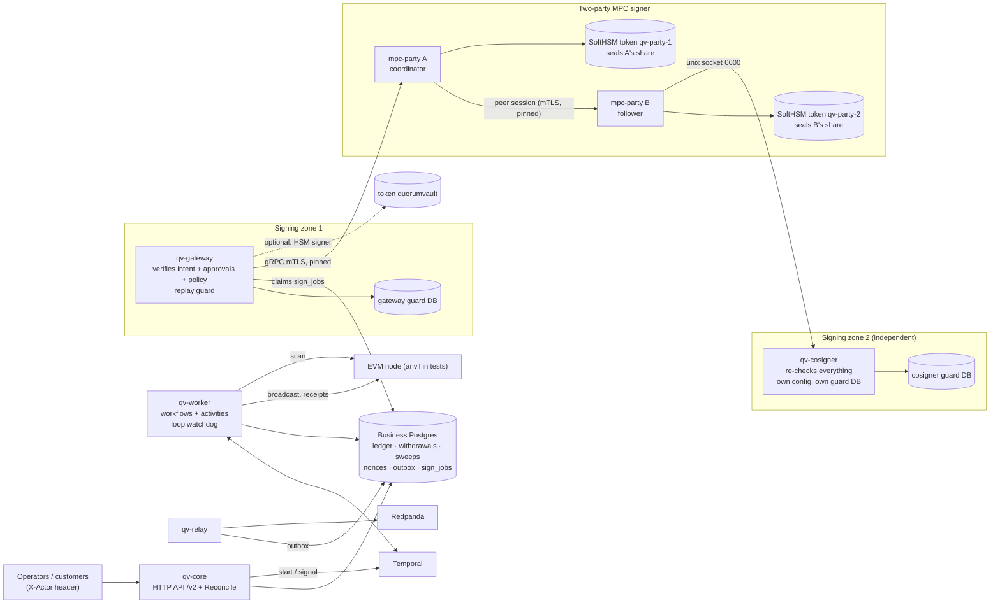
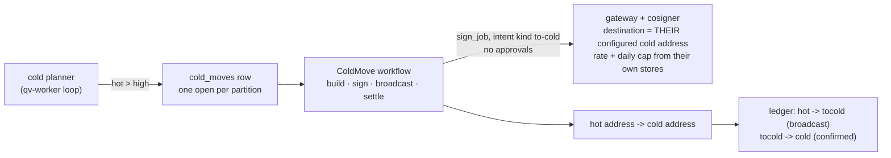
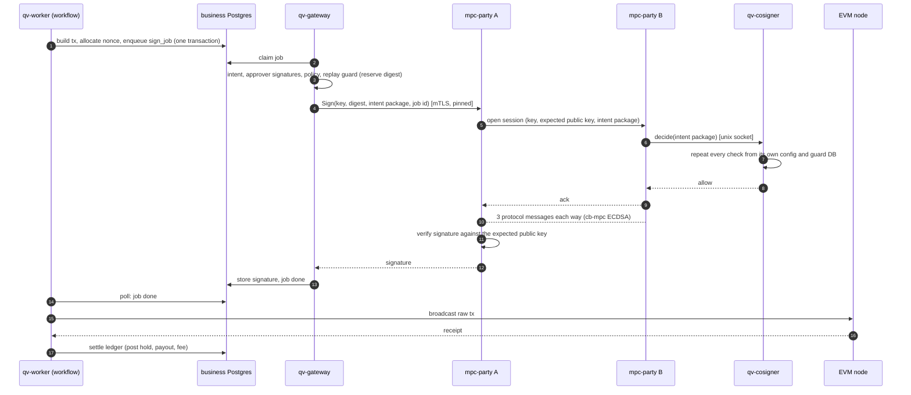

# Architecture

quorum-vault is one custody system (`/v2`): deposits, sweeps and withdrawals on EVM chains, a Temporal-driven workflow engine, a
signing gateway that is a separate trust zone, and **MPC hot signing** (`mpc-party` A, B and C plus a cosigner next to B and one next to C: EVM hot shards are 2-of-3 keysets, Bitcoin stays two-party).

## The custody system: processes and trust zones

| Process | Does | Trusts |
|---|---|---|
| `qv-core` | HTTP API (`/v2`): customers, deposit addresses, withdrawals, approvals, balances, `Reconcile` | the business database |
| `qv-worker` | Temporal workflows: scan, sweep planner, withdrawal reconciler, cold planner (long-running loops), one workflow per withdrawal, sweep and hot-to-cold move; a watchdog restarts a loop that stops making progress | the business database, the chain |
| `qv-relay` | outbox to Redpanda, at least once | the business database |
| `qv-gateway` | signing zone: claims `sign_jobs`, re-verifies the intent, the approver signatures and the policy (for a withdrawal: the destination must be on the asset's list in its config, and only so many may start per hour; for a hot-to-cold move: the pinned cold address, a rate and a daily cap; for an EVM hot-shard rebalance: another hot shard of the pool, a rate and a daily cap; Bitcoin has no rebalance and refuses the kind), reserves the digest in its own replay-guard database, then asks a signer | **not** the business database: it only reads and updates `sign_jobs` as a restricted role |
| `mpc-party` A, B and C | threshold ECDSA (cb-mpc): 2-of-3 keysets (EVM, any two of A, B, C sign; each EVM hot shard is its own keyset) and two-party HD keysets (Bitcoin, A and B): DKG, derive, sign, refresh; shares sealed by each party's own HSM token; durable two-phase refresh; backup and restore | each other only through pinned mTLS certificates |
| `qv-cosigner` (two: next to B, next to C) | the gate of party B and of party C: each repeats the gateway's checks from its own config file and its own replay-guard database before its party takes part in a signature, in every role; fail closed | nothing from A, the gateway or each other |

One withdrawal, end to end: API commits the row, the hold and an outbox event, then starts a workflow. The workflow waits for
approvals, builds the transaction and allocates a nonce, enqueues a `sign_job`. The gateway claims it, checks it, and asks
party A; A opens a session with B; B asks its cosigner; the two parties sign; the signature returns through the gateway to the
job row; the workflow broadcasts, waits for the receipt, and settles the ledger. Every crash boundary in that sequence is a test
(`e2e/custody`).

## Hot to cold

Most funds should not sit in a wallet that signs all day. Each hot partition has a low mark, a high mark and a target
([config](../internal/custody/config.example.json), section `cold`). The **cold planner** loop looks at every partition: free
liquidity above the high mark (the hot balance less what open withdrawals have reserved and less a move already planned) is moved
down to the target, to the cold address. Below the low mark it logs one `ALERT` per outage asking for a refill (the refill is not
built yet).

No human approves a move: the destination is pinned in the signing zone's config, which the business side cannot change, so a move
can only make funds safer. Both the gateway and the cosigners of B and C check it, from their own config and their own stores, so a
rogue party A or a rogue business database cannot send "cold" money anywhere else. `Reconcile` compares each cold address's
on-chain balance with the sum of the `cold:<partition>` accounts that deliver to it. Design and tests:
[learn/p6-1-hot-to-cold.md](learn/p6-1-hot-to-cold.md).

### Between hot shards: the rebalance

Every sweep pays one hot shard, so the others run dry. Per asset, a shard below its **target** (config `cold.rebalance.targets`) receives from
the fullest shard when that holds more than its own target: intent kind `rebalance`, no approval, its own workflow and ledger clearing
account (`rebal`), planned by the same loop *before* the move to cold. The signing zone pins the destination to another hot shard of the same
pool and asset from its own `hot_addresses`, and rate-limits and caps it from its own store (gateway and cosigner both). Targets must lie
between a shard's low mark and its cold target, so a rebalance and a move to cold cannot undo each other.
Design and tests: [learn/p6-4-shard-rebalance.md](learn/p6-4-shard-rebalance.md).

Bitcoin has no rebalance: it keeps **one hot shard per pool**. The core, the gateway and the cosigner refuse a config with two hot shards in one
pool at start, naming the pool, and the Bitcoin verifier refuses the `rebalance` kind. To use more than one shard on Bitcoin, use more than one pool.

### Cold to hot: the refill

The way back needs people. A hot partition below its low mark gets a **refill request** (one open per cold address); an operator exports it
(`POST /v2/refills/{id}/export`: nonce and fees read online), carries the file across an air gap to the **offline signer** `qv-cold`
(the `qv-cold` SoftHSM token, no network client at all), where M of N operators approve and the HSM signs; the signed file comes back
(`POST /v2/refills/{id}/import`), is checked against the request, and the refill workflow broadcasts it and follows it to confirmation.
The offline config alone decides what may be signed (pinned hot destinations, per-ceremony caps, chain id); the online side is untrusted.
M-of-N is enforced in software with SoftHSM. Details and runbook: [learn/p6-2-cold-refill.md](learn/p6-2-cold-refill.md),
[runbooks/cold-refill.md](runbooks/cold-refill.md).

## Where withdrawals may go

A compromised `qv-core` with enough approvals could pay any address, and many small amounts up to the daily cap. The signing zone
bounds both. Per chain and asset, the gateway's and the cosigner's config either lists the addresses a withdrawal may pay
(`withdrawal_destinations`) or says on purpose that any address will do (`any_destination: true`); neither, or both, stops the
start. Per chain, `withdrawals_per_hour` caps how many withdrawals may be first signed in a rolling hour, counted from the zone's
own store; it is required. Both checks run in the shared decision code, so the gateway and the cosigner each apply them from
their own config. The destination is read from the signed transaction itself: for an ERC-20 transfer the recipient in the calldata,
never the token contract, and addresses are compared as addresses, so checksum case never matters. A refusal carries
`policy_destination` or `policy_withdrawal_rate` and is recorded in the zone's audit chain.

## Audit log

Three hash chains, one per trust zone, each in its own database: **core** (the business database), the **gateway**'s guard
database, and the **cosigner**'s guard database. Each row stores the hash of the row before it; database triggers refuse UPDATE,
DELETE and TRUNCATE; `internal/audit` appends and verifies.

- **Core.** Business code writes an audit event to the outbox in the same transaction as the change, so the event exists exactly
  when the change does. One chainer in `qv-relay` (one at a time, by advisory lock) appends the events not yet chained to the
  chain, once each. It picks "not yet chained", never "after the last seq", because a row with a lower seq can commit later.
  Chaining inside the business transactions would make them all queue for the chain head. The outbox row cannot be edited or
  deleted once written.
- **Gateway and cosigner.** Every decision is recorded in the zone's own database, in the transaction that decides: the permission
  to sign together with the reservation of the digest, the stored signature, and every refusal with its reason. If the record
  cannot be written, nothing is signed and nothing is answered: the job is retried. This works with `qv-core` down, and the
  business zone cannot touch it.
- **Anchors.** Each chain publishes its head (count and last hash) to Kafka topic `qv.audit.heads` whenever it changes and at a
  set interval. A chain cut short or rewritten by someone who can switch the triggers off is still a valid chain, but it no longer
  has the entry that was published. If Kafka is down chaining and signing go on, and the heads catch up.
- **Checking.** `GET /v2/audit/verify` checks the core chain. `qv-relay verify`, `qv-gateway verify` and `qv-cosigner verify`
  check a chain against a file of published heads (`-anchors`). Details and what each kind of tampering looks like:
  [learn/p6b-2-audit.md](learn/p6b-2-audit.md).

## A withdrawal signed by two parties

If B, the cosigner or the link is down, A answers `UNAVAILABLE` and the gateway keeps the job open and retries: one ALERT per
outage, no refusal, no void. If a party detects a bad message, it freezes the keyset on both sides and an operator must
unfreeze it; withdrawals then park with their hold and nonce kept (see
[learn/p5b-5-custody-on-mpc.md](learn/p5b-5-custody-on-mpc.md)).

## The chain seam

Nothing above the chain cell assumes EVM, except where listed in [learn/p7-1-chain-seam.md](learn/p7-1-chain-seam.md). A chain
cell is a `chain.Adapter` in the business zone and a `ChainCodec` in the signing zone, picked by the chain's `family` (default
`evm`; an unknown family refuses to start). `qv-core` and `qv-worker` open their chain through `internal/chainfactory`;
`qv-gateway` and `qv-cosigner` build their codecs through `gateway.NewCodec`. One process serves one chain, on its own Temporal
queue `qv-core-<chain>`, so two chain cells on one Temporal server never take each other's work.

Four things were EVM-shaped and are now neutral:

- **Several signatures per transaction.** A built transaction lists every input to sign, each with its own key. Each input is one sign
  job. A transaction with one signature (all of EVM) keeps the job IDs it always had; input `i` after the first is `<id>.<i>`. The
  workflow waits for all jobs of an attempt, a refusal of any job refuses the attempt, and `Assemble` gets all signatures in order.
- **Exclusive attempts.** What makes two attempts unable to both confirm is a set of claims that the codec reads from the payload (EVM:
  one claim, sender and nonce). The gateway's guard records claims, refuses a second intent on a claimed key, and lets a known
  intent send a replacement only over the same claims and with higher fees, as the codec defines "higher". Several signatures of one
  transaction (same payload) are not a replacement.
- **Outcome of an attempt.** The adapter says whether the attempts of an owner are open, confirmed (by the transaction, a cancel, or
  failed) or consumed by something this system did not make, and whether the owner still holds a reservation. `BuildCancel` is
  optional: a chain without it has nothing to free after a refusal.
- **Destinations.** The withdrawal allowlist holds canonical address strings; the codec defines the canonical form (EVM: checksum case,
  so case never matters).

## Bitcoin deposits

A second chain family, `btc`, serves deposits only; nothing leaves an address yet. One `qv-core` and one `qv-worker` run per chain, on
the same database and ledger, each with its own queue. For `btc` the worker runs the scan loop and nothing else.

The core holds the account's extended public key (m/84'/coin'/0'), obtained once from mpc-party `Node`. It derives each customer's
native SegWit address offline, on the external branch, at the next unused index of the chain; it never asks MPC for an address.
That the address equals the P2WPKH of the key mpc-party derives at the same path is tested end to end. A key or address of another
network than the config names refuses to start.

The scan reads whole blocks from bitcoind over JSON-RPC, up to the tip minus the confirmations plus one (default 6), a bounded batch
at a time, and matches outputs to deposit addresses. Each output is one deposit, keyed `chain:txid:vout`, credited through the same
path as EVM. The hash of every block read is stored with the cursor. If the chain no longer contains the block the last scan ended on,
the reorganization is deeper than the safe depth: the worker logs an ALERT, scanning for the chain stops, credits stay, and an operator
decides (see [learn/p7-2-btc-deposits.md](learn/p7-2-btc-deposits.md)). A coinbase output is credited only at 100 confirmations.

## Bitcoin signing zone

The signing zone can decide, with no chain access, whether to sign one input of a Bitcoin transaction. A sign job carries the whole
transaction (every input with its outpoint, value and derivation path; every output) and the digest of one input. The zone rebuilds the
BIP143 digest of every input itself, from its own copy of the account xpub, and requires the job's digest to be that of exactly one input,
signed under the key derived for that input; the key that would sign must be that derived key. Every intent is bound to its own partition: a withdrawal, hot to cold or rebalance spends only that
partition's shard, with any change back to it, hot to cold pays the cold address of the partition's pool, a rebalance another shard of the same
pool, a consolidation, sweep or cancel the partition's own shard. A cancel needs no approval, so the guard lets it spend only inputs that one signed intent of its
partition claimed, all of them. Fees, fee rate, input count, dust, version, locktime and RBF are checked. Bitcoin signs every input under
its own derived key, so a partition's signer is a key tree: the gateway asks party A to derive the key of the job's path.

The guard claims outpoints, each with a pin: the value of the input. A claim named again with another pin is refused, and a transaction
id signed under a second payload is refused. This closes the segwit v0 fee attack, in which signatures gathered under payloads that understate
each other's inputs are combined into one transaction with a fee neither payload showed. Details and the list of refusals:
[learn/p7-3-btc-verifier.md](learn/p7-3-btc-verifier.md).

## Bitcoin withdrawals

A Bitcoin withdrawal is requested, approved (the automated key for the lowest tier), built, signed by MPC, broadcast, confirmed and settled, by the
same workflow as EVM. The hot wallet is a table of outputs (`btc_utxos`) of the partition's shard. The build runs in one database transaction: it
picks the shard's oldest available outputs one at a time with `FOR UPDATE SKIP LOCKED` (the largest ones instead, when the oldest `max_inputs` cannot
carry the payment), reserves each at once, and makes a transaction with the payment
first and change second, to the shard's own address; change at or under the dust limit goes to the fee. If the available outputs cannot pay, the withdrawal
waits instead of failing: outputs free up when an earlier withdrawal settles and returns its change. The gateway and the cosigner check the transaction
as described above; the core derives the same shard address from its xpub at start or refuses.

A withdrawal settles at `spend_confirmations` (default 2), not at the deposit depth: our own transactions spend only our own outputs, so a
reorganization can only delay them. Settlement books the payment and the fee actually paid, marks the inputs spent and records the change as available.
Operator funding of a hot address is found by the scan at safe depth, recorded once and booked through the operator funding account; the change of our own
transactions is never booked as funding. A refusal where nothing was signed gives the outputs back; a refusal after a signature may exist parks the
withdrawal with an alert and releases nothing (fee bumps and cancel come next). See [learn/p7-4a-btc-withdrawals.md](learn/p7-4a-btc-withdrawals.md).

## Bitcoin: when a withdrawal goes wrong

A broadcast transaction that sticks is replaced by one that spends the same inputs and pays the same payment from less change, for a higher fee (the
rule is in [learn/p7-4b-btc-recovery.md](learn/p7-4b-btc-recovery.md)); with no change to pay from, an ALERT is raised and the withdrawal keeps waiting,
never voided. Whichever of the original and its replacements confirms is the one settled and whose fee is booked. If one input of an attempt is refused
after another was signed, a signature exists, so the attempt is cancelled: a transaction that spends exactly the same inputs back to the partition's
shard confirms first, and only then is the money released (the guard accepts such a cancel only for inputs one signed intent of the partition claimed).
If the inputs of an attempt are spent on chain by something that is none of our transactions, the withdrawal is parked with an ALERT and nothing is
released. A transaction the node forgot (a restart, an eviction) is sent again; a refusal by the node never makes an activity retry for ever.

## Bitcoin sweeps

A credited deposit moves into the partition's hot shard by the same planner and workflow as EVM. The scan transaction that credits a deposit also
records its output in `btc_utxos`, marked as a deposit output with the address and the key path `0/<index>`; an output booked to suspense is not
recorded and stays where it is. Withdrawals select only hot outputs and sweeps only deposit outputs of one address, so neither ever sees the other's.
The rule is the EVM one made neutral: sweep when the value is at least the larger of `min_sweep` and `k` times the fee, in satoshis (the asset's
price is 1), the fee being the current rate times the size of that transaction. The planner makes one sweep per address, over its oldest outputs
up to `max_inputs`, leaving out any output that costs more to spend than it carries; the rest wait for the next round, and a deposit that lands while a
sweep is open waits for the next one. The build reserves exactly the outputs the plan summed, one job per input, all under the address's own key; the
gateway and cosigner require every input from that address and one output to the partition's own shard. The ledger moves the full amount from the
deposit address to hot through the sweep account and books the fee, which is the operator's cost since the customer was credited the whole deposit.
Settlement spends the deposit outputs and records the sweep's output as an available hot output; the scan does not book it as funding. Routine sweeps wait while the fee rate is above
`sweep_max_fee_rate`; a sweep of at least `sweep_urgent_value` goes anyway, up to `max_fee_rate`. A stuck sweep is replaced by one with a lower output,
if it is still worth it. If one input is refused after another was signed, a cancel sends the same inputs to the hot shard and settles like the sweep
with the cancel's fee, so the customer's credit and the sweep account stay right. A sweep refused with nothing signed gives its outputs back and the
planner leaves the address alone for a growing while; an outside spend parks the sweep, and withdrawals go on. See
[learn/p7-5-btc-sweeps.md](learn/p7-5-btc-sweeps.md).

## EVM: reconciliation in flight

`Reconcile` compares the books with the chain at a pinned safe height, and does so while transactions are in flight. The differences are explained from the
cell's own rows: a transaction of ours that mined at or below the pinned height and is not settled yet (the chain is ahead), a transaction booked at
broadcast that has not mined yet (the books are ahead), and a revert settled before it was final. The books are put in the terms of the chain by taking
out the broadcast bookings of the items not mined and adding the legs their settlement will book, including the gas of reverted transactions and cancels;
every clearing account is then exactly zero, and what is left raises the ALERT. The books are read from one database snapshot, so a busy cell answers; a difference is
checked again from a new snapshot and reported only if both reads show it. A comparison that
cannot be made is counted and makes the report not Clean. See [learn/p3b-closed-loop.md](learn/p3b-closed-loop.md).

## Bitcoin: reconciliation and cold

Reconcile compares the ledger, the output table and the chain. The chain is read with `scantxoutset` at the node's tip (batched, never on a request
path), counting an output once the books should have it; a difference names the address, both figures and the height, logs an ALERT and changes
nothing. Hot shards, cold addresses and deposit addresses (suspense included) are covered, and the output table is compared with the UTXO set row by
row. What is in flight is computed, not skipped: the cell's own records of the transactions it sent explain the differences between the books and the chain (spent but not settled, outputs not settled yet, payments not yet deep enough to credit), and what remains is a real difference. A read that a block keeps interrupting is skipped after three tries; the report is then not clean, and a long run of skips raises an ALERT. Hot-to-cold uses the EVM planner and workflow: a move is a withdrawal of the shard's
own outputs to the pool's cold address, with change back to the shard; its size is capped at what `max_inputs` of the oldest available outputs can
carry, so a shard of many small outputs is emptied in rounds. See [learn/p7-6-btc-cold.md](learn/p7-6-btc-cold.md).

## Bitcoin: consolidation

A hot shard fed by many small outputs can hold enough value and still fail a withdrawal, because one transaction takes at most `max_inputs` outputs.
When a shard holds more than `consolidate_above` available outputs that are worth spending at the current fee rate (dust does not count), the cold planner starts a consolidation: one transaction that spends the shard's
smallest outputs that are worth spending at the current fee rate (at most `max_inputs`, at least two) and pays one output back to the same shard. The
largest outputs stay free for withdrawals. It waits while the fee rate is above `consolidate_max_fee_rate` (logged once per change), while a
consolidation or a hot-to-cold move is open on the partition, and while scanning is halted. It is off when `consolidate_above` is 0.

No value moves, so the ledger books only the network fee, at settlement. The gateway and the cosigner sign it with no approval after checking the
shape (the partition's own shard in and out, at least two inputs, one output, the amount equal to the sum of the inputs) and count it against
`consolidations_per_hour`. A compromised core can therefore lose only fee with it: at most that limit times `max_tx_fee_sats` an hour. A bump keeps the
inputs and lowers the one output; a cancel has the same shape and settles as the consolidation. See
[learn/p7-6d-btc-consolidation.md](learn/p7-6d-btc-consolidation.md).

## Bitcoin: the offline cold signer

`qv-cold` also signs Bitcoin refills, from files only. The request is the whole transaction (inputs with their outpoints, values and address; the payment to
a hot shard; optional change to the cold address). The tool recomputes everything from its own config: it pays only a pinned hot shard, change goes only back
to the cold address, every input is from the cold address, the fee is under a cap and a rate cap, and the addresses belong to the configured network.
Because a SegWit signature commits only to its own input's value and the tool has no chain, it keeps a durable record per outpoint it has signed: the value
it was signed with, and the one transaction (inputs, destination, amount) that may spend it again, only with a higher fee. A request that gives a signed
outpoint another value, or spends it in a different transaction, is refused. See [learn/p7-6-btc-cold.md](learn/p7-6-btc-cold.md).

## Bitcoin: refills from cold

When a hot shard falls below its low-water mark and its cold address has an output to give, a refill opens. The core builds the request from the cold
address's oldest outputs (at most `max_inputs`, so a large refill is done in rounds); operators take the file across the air gap and approve it on `qv-cold`;
the signed file comes back and is imported, which checks it against the request, reserves the inputs and records the transaction like any other attempt of
ours. It is then broadcast, tracked and settled by the ordinary code, with no sign job and no gateway. Cold outputs are marked in the output table and are
seen by neither withdrawals, sweeps nor moves to cold; money put on the cold address from outside is found by the scan; our own are never booked as funding.
A request that is not imported in time ends with nothing reserved. See [learn/p7-6-btc-cold.md](learn/p7-6-btc-cold.md).

## Trust boundaries

| Boundary | Protects | Does not protect |
|---|---|---|
| HSM token (`CKA_SENSITIVE`, `!CKA_EXTRACTABLE`) | HSM private keys never leave the token | anyone holding the token PIN can call `C_Sign` |
| Per-party HSM seal | a copied share file is useless without that party's token; AAD binds role, keyset and generation, so blobs cannot be swapped | plaintext shares in process memory during a signature; a software token (SoftHSM) is not tamper resistant |
| Party B's cosigner | a compromised party A or gateway cannot get a signature for something B's own config and database refuse | a compromise of B's host and A's host together |
| Gateway zone | the business database cannot make the gateway sign: it re-verifies approver signatures and policy | anyone who holds the approver keys and the gateway config |
| Policy + approval before `sign` | no signer call without an `approved` row | a caller who can reach the signer packages directly |
| Append-only triggers + hash chain + published heads | silent edits or deletions in the log; a cut or rewritten chain disagrees with the heads that left the database | an attacker who also rewrites what is already in Kafka |
| `X-Actor` header | names the caller for dual control | anything: it is not authentication |
