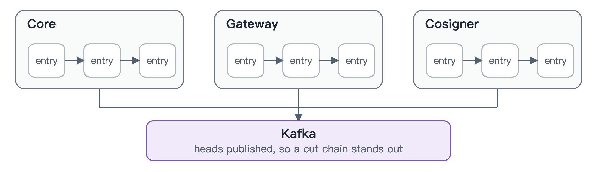

# Audit trail

[中文](zh/audit.md)

The audit trail records every decision so it can't be quietly changed later. Each line carries a fingerprint of the line above, like a numbered ledger with each page stamped from the last: tear one out and the stamps stop matching.

## One chain per trust zone
The core, the gateway and the cosigner each keep their own chain in their own database. Database rules refuse edits, deletes and truncation. The gateway and cosigner write each decision in the same transaction as the decision itself: if the record can't be written, nothing is signed. Their chains keep working while the core is down.

## Heads are published
Each chain sends its head, the count and the last fingerprint, to Kafka whenever it changes and at set intervals. Someone who switches the database rules off could cut a chain short and still leave it valid, but not with the entry that was already published. If Kafka is down, signing goes on and the heads catch up.

## Checking compares the chain with the heads

| What was done | What the check finds |
|---|---|
| A row was edited | Its fingerprint no longer matches |
| A row was removed from the middle | The chain breaks |
| The end was cut off | The published head is not in the chain |
| The whole chain was rewritten | Its head differs from the published one |

The core, the gateway and the cosigner each ship a verify command that checks a chain against the published heads.
