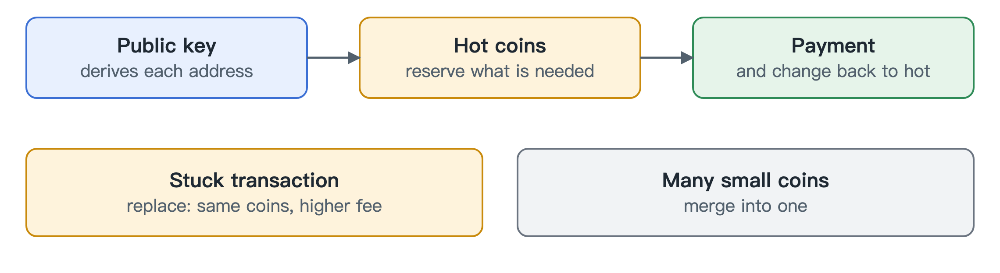

# Getting a Bitcoin send confirmed

[中文](zh/bitcoin-sending.md)

A Bitcoin transaction can sit unconfirmed when fees rise. The system keeps room to raise the fee, can replace or cancel a send, and can pay several withdrawals in one transaction.

## Every send keeps room to raise its fee
Each send leaves enough in its change to be raised up to the fee cap, so a stuck withdrawal can always be bumped with its own coins. If the hot wallet cannot cover that on top of the payment, the withdrawal waits, and the alert says how much would release it. The signing zone checks the same thing. The core's and the zone's fee caps must be equal, or the zone refuses with an alert that says so ([runbook](runbooks/btc-fee-caps.md)).

## When a send is stuck or fails

| Situation | Result |
|---|---|
| Stuck | Replaced by a transaction that spends the same coins for a higher fee, paid from the change |
| Replacements used up or over the caps, still unconfirmed (child switched on) | A child spends the change back to the hot wallet and pays for both |
| One input refused after another was signed | A cancel spends the same coins back to the hot wallet |
| Coins spent by something else | The withdrawal is parked with an alert |

A replacement or cancel the node refuses for a low fee is followed by one that pays more than every earlier attempt, even after a restart. Both stop at the fee caps with one alert; nothing is voided because of a cap ([runbook](runbooks/btc-stuck.md)).

## A child can pull a stuck send in
A child spends the stuck send's change back to the same hot wallet and pays enough for the pair to be worth mining. It is off by default, starts after the replacements are used up,.

- **Within the caps.** The pair together may not pay more than one transaction of their size may, so a send already at the rate ceiling gets no child.
- **No approval needed,** because it can only keep money where it is. The zone signs only a child with no payment that spends a signed send's change back to that wallet.
- **One child per send.** Once it exists the send is no longer replaced; a cancel still can, and must outbid both.
- **Booked with its parent.** Its fee is a cost of the withdrawal or batch.

## Batches pay several withdrawals in one transaction
Batching is off by default. Once on, approved withdrawals queue, oldest first, and one transaction pays many of them, so inputs and change are paid for once. A batch is sealed when the oldest has waited long enough or enough are queued. It takes the longest run from the front that confirmed coins can fund; nobody is skipped.

Approval stays per withdrawal: the zone signs a batch only if every payment is exactly one approved withdrawal, in order, within its own limits.

| Situation | Result |
|---|---|
| Cancel one queued withdrawal | It leaves the queue; its hold is released |
| Cancel one withdrawal of an unsigned batch | The batch is discarded; the others return in order |
| Cancel one withdrawal of a signed batch | Refused; only the whole batch can be cancelled, and its withdrawals then queue again and are paid once |
| Stuck batch | Replaced as a whole, within the caps |
| One withdrawal fails the destination check | Removed from the batch and parked with an alert |

Each withdrawal is booked once, with its own share of the fee. A batch shows on the chain that its recipients were paid together, so turn it on only if that is acceptable ([runbook](runbooks/btc-batch.md)).
