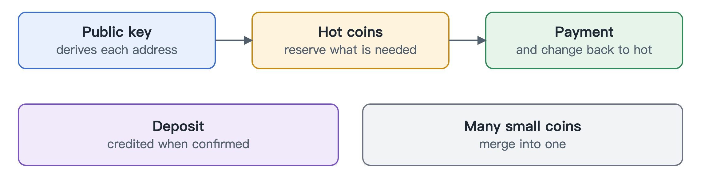

# Bitcoin

[中文](zh/bitcoin.md)

Bitcoin has no balances, only coins (UTXOs). Paying is like handing over notes and getting change: a transaction names the exact coins it spends.

## Addresses come from a public key
The core holds the account's extended public key and derives each customer's address on its own, without asking the signers. A test proves the address matches the key the parties derive. A deposit is credited only after enough confirmations. If the chain reorganises deeper than that, scanning stops with an alert, credits stay, and an operator decides.

## A withdrawal spends chosen coins
The build reserves coins from the hot wallet, pays the customer, and sends change back to the hot wallet. If the coins cannot cover it, the withdrawal waits for change to come back. Each input is signed under its own derived key, and the signing zone rebuilds the digest of every input itself. This closes the attack where signatures are collected under understated fees.

Each send keeps enough in its change to be raised up to the fee cap, so a stuck withdrawal can always be bumped with its own coins. If the hot wallet cannot cover that on top of the payment, the withdrawal waits, and the alert names the reserve as the reason and says how much would release it. The signing zone checks the same thing with its own limits, so a faulty core cannot send a transaction that could never be raised. The core and the zone keep the same fee limits, and each refuses to start if its limits could not carry the largest transaction it may build.

## Stuck or failed transactions

| Situation | Result |
|---|---|
| Stuck | Replaced by a transaction that spends the same coins for a higher fee, paid from the change |
| No change to pay from (a transaction made before the reserve existed) | An alert; the withdrawal keeps waiting |
| One input refused after another was signed | A cancel spends the same coins back to the hot wallet |
| The coins were spent by something we did not make | The withdrawal is parked with an alert |

A replacement the node refuses for a fee that is too low is followed by one that pays more than the highest fee refused so far, even after a restart. A cancel does the same: if it is refused or stays unmined, the next cancel pays more than every earlier attempt and every refused cancel. Both stop at the fee caps, with one alert, and nothing is voided because of a cap.

## Consolidation merges small coins
A wallet fed by many small payments can hold enough value, yet no single transaction can carry it. Consolidation merges the small coins into one before that happens, and a withdrawal keeps working meanwhile. Each partition has one hot shard.
