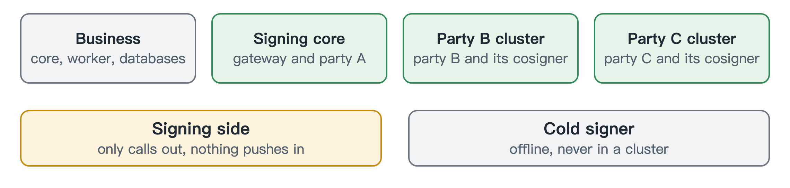

# Deployment

[中文](zh/deployment.md)

QuorumVault is meant to run as four separate clusters, one for each group of people who must not be able to take each other over. This page says what runs where and why, and what is the same in tests and in production.

## One cluster for each trust domain

| Cluster | Runs | Why it is apart |
|:---|:---|:---|
| Business | Core API, workers, ledger database, Kafka, Temporal, approval page | Holds no key material |
| Signing core | Gateway and party A | The gateway is not trusted, so it can share a cluster with party A |
| Party B | Party B and its own cosigner | One administrator of this cluster must not hold B and the cosigner that reads every job |
| Party C | Party C and its own cosigner | Same, for C |

Any two parties can sign, so two parties must never share an administrator. Putting them in one cluster would give that administrator the keys. The cold signing machine is offline and never runs in a cluster ([Hot and cold](tiers.md)).

## The signing side only calls out

Nothing pushes anything into the signing clusters. They fetch jobs, publish audit heads and reach each other over the party links; nobody scrapes them from outside. This keeps the rule of the [signing zone](signing-zone.md) true on a cluster: the business side can only ask.

## How each process is kept safe

- **Certificates.** Every service has a certificate with a name, and each endpoint keeps its list of names it accepts ([Identity](identity.md)). The links between parties use pinned keys.
- **Databases.** Each service has its own database role with only the rights it uses. The signing zone's databases are separate from the business one.
- **Schema changes** run as a separate step before the new version starts, and stay compatible with the old version.
- **Secrets** are files given at run time, never part of an image, a chart or a log.
- **State.** A party has exactly one copy and one data volume; a second copy or a rolling update must never run beside it. Stateless services run in several copies.
- **Health and stopping.** Each service answers a health check, and a worker that is told to stop finishes or hands over its work.

## One image for each process

Each process ships as its own image, pinned by digest, with a separate set of tools for each zone. Charts for the business side, the signing core, each party and the certificates are checked automatically. The first release has not been made.

## What is the same in tests and what is only simulated

| Same as production | Different in tests |
|:---|:---|
| The code, the checks and the images' contents | The HSM is software, and the code refuses it outside development and test |
| The charts and their rules | Certificates come from a script, not from a certificate manager |
| The trust domains and the links between them | Chains are local; all parties run on one machine |

No real cluster has run the charts yet. The shape on this page is a design checked by tests, not a running system with real funds.
