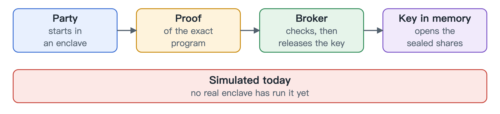

# Enclaves

[中文](zh/enclaves.md)

An enclave is a locked room inside a machine: even the machine's owner cannot look in, and the room can prove which program runs in it. QuorumVault plans to run each party in one, so that an administrator with full access to the host still cannot read the shares. Today this runs only in simulation.

## What an enclave adds
Today each party's shares are sealed under a key in its own HSM token, on a host its administrator controls. An enclave goes one step further: the key that opens the shares is given only to the exact approved program. An administrator who swaps the code, or reads the memory from outside, gets nothing ([MPC signing](mpc.md)).

## The key is released only on proof
1. The party starts and asks a broker for its key.
2. The broker answers with a fresh challenge.
3. The party replies with proof of which program it runs, tied to its own connection.
4. The broker compares the proof with a list that several operators signed. Only on a match does it release the key, and it writes its record first.

The key lives in memory only. A running party keeps signing if the broker goes away, but a party that restarts cannot open its shares until the broker is back. Taking a program off the list stops new starts, not a party that is already running.

## What is simulated
The broker, its checks, the sealed shares, the start gate and the tests with real party processes are real code. The enclave and its proof are not: a stand-in measures the program file and its settings. No vendor hardware has produced a proof, so nobody has shown that real hardware measures what the stand-in measures ([Limits](limits.md)).
