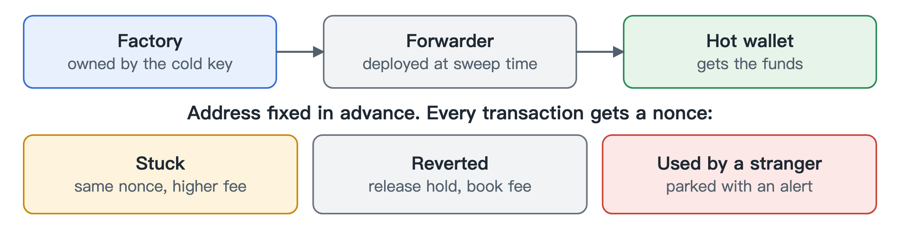

# EVM

[中文](zh/evm.md)

On EVM chains (Ethereum and its relatives), a customer's deposit address can be worked out before anything exists on the chain. It is like reserving a postbox number: the box is built only when the first parcel has to be collected.

## Deposit addresses are contracts that don't exist yet

Each address is a small forwarder contract. Its address is computed offline from the factory and the customer, with no key and no node. Native coin arrives even before the contract is deployed. Tokens do not notify the contract, so a sweep is a real transaction that the hot wallet pays for.

## The factory decides where deposits go

Every forwarder asks the factory for its destination. The cold key owns the factory, so a stolen hot key cannot redirect deposits. An operations key can freeze sweeping, but only the cold key can unfreeze it or change the destination. The signing zone's settings must then follow, and until they do every sweep is refused, which is the point. A hot key can be replaced without changing any deposit address ([Key replacement](key-replacement.md)).

## Every transaction has a nonce

A hot address numbers its transactions. The number is taken in the same database transaction as the withdrawal, so there are no gaps and no reuse.

| Situation | Result |
|:---|:---|
| Stuck | Replaced at the same nonce with a higher fee, up to a cap |
| Reverted | The hold is released and the fee is booked |
| Cancelled | An empty transaction at the same nonce takes its place |
| The nonce was used by something else | The withdrawal is parked with an alert |

A stuck withdrawal is never voided, because the old transaction may still be mined.
