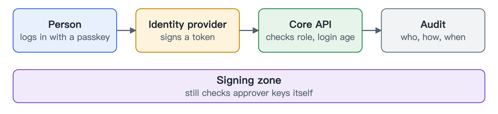

# Identity

[中文](zh/identity.md)

The core API used to take the caller's name from a free-text header. Now every caller proves who they are with a signed token from an OpenID Connect identity provider, and the token's `sub` is the actor everywhere: in the dual-control checks and in the audit trail.

## Who gets in

The core accepts a token only if the issuer's published keys verify its signature, and the issuer, audience and times are right. Anything else is a 401. Only Keycloak in the dev setup is Keycloak; in production the customer's own provider (Okta, Entra, any standard one) takes its place, and the core is configured with its issuer and a map from its group names to the core's roles.

| Role | May |
|---|---|
| Requester | open customers, deposit addresses and withdrawals |
| Approver | approve or reject withdrawals |
| Operator | run refills, cold ceremonies, batches and reconcile |
| Admin | change what the factory contracts do |

Roles do not include each other: the person who requests is never also the one who approves, and the core compares `sub` to enforce it. Every route lists the roles it needs, and a route without a list does not start.

## Fresh logins for the big actions

Approving a withdrawal, booking cold-address funds, closing a parked refill and changing the factory need a login that is recent and strong: the token's `auth_time` at most five minutes old and an authentication level of `aal3`. A person with an older login gets a 401 that says what to do, in the standard step-up form, and the client logs in again. Sessions follow the NIST limits for the highest level: twelve hours in all, fifteen minutes idle. The core checks the twelve hours itself; the identity provider enforces the idle time, because only it sees the person's activity.

## Services

Workers and scripts that call the core use their own service identity with a client-credentials token, not a person's. A service skips the fresh-login rule, since nobody logs in for it, and it can never approve or change the factory.

## How services prove who they are

Services do not trust a network address. Each trust zone, the business side and the signing zone, has its own private certificate authority, and a certificate from one is not accepted by the other. Every service holds a certificate that lasts hours to days, with a name of the form `spiffe://quorumvault/<zone>/<service>`, and swaps in the renewed files by itself while it runs. A server does not stop at "my authority signed it": each endpoint keeps its own list of names that may call it. A service whose certificate has expired refuses to start, and an alert fires before that happens. The few links that cross the zones are explicit: the business authority issues a named visitor certificate, and the signing zone's authority is never trusted on a business endpoint.

The core API and every database connection use it. The business database trusts only the business authority, and the replay-guard databases sit on a separate server that trusts only the signing authority. A database maps the name in a certificate to one role, so a name it has not listed is refused. The gateway reads the job queue through the one explicit link, with a certificate that the business authority issued for it.

On the core API, people log in at the identity provider and need no certificate; a service that calls with its own token must also show a certificate whose name is on the list, so a stolen token alone is no use. The runbook for renewing certificates is [certificates](runbooks/certificates.md).

## What the audit trail records

Every write first leaves a row naming the issuer, `sub`, authentication level, login time and token id, then the change itself carries the same identity. If that row cannot be written, nothing changes.

## Development only

- **The `X-Actor` header** still works, but only with `QV_DEV_ACTOR_HEADER=1` and `QV_ENV=dev` or `test`. An unset or unknown `QV_ENV` means production, and a production start refuses the header, a plain-http issuer and the test keys.
- **The test issuer** signs tokens with a local key that the core trusts only under `QV_ENV=test` or `dev`. Most end-to-end groups use it, because it is fast. One group uses real Keycloak tokens.
- **The Keycloak realm** requires a passkey at login. The automated tests use a client that skips the passkey and states the authentication level itself, so what the tests cannot show is a real hardware key. That client exists only in the dev realm file.

The signing zone does not trust the identity provider at all: approvals are still signatures that it checks against keys in its own configuration. A stolen provider could queue withdrawals, but could not approve one.
