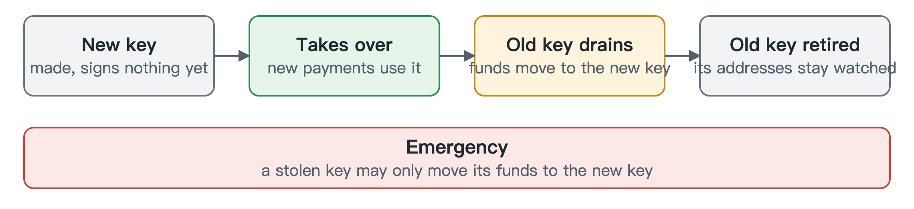

# Key replacement

[中文](zh/key-replacement.md)

A key that someone else may have seen has to be replaced, not just refreshed. QuorumVault makes a new key next to the old one, switches to it, empties the old one into it and then retires it. It is like changing the lock on a safe and carrying the contents across.

## A refresh is not a replacement
A refresh gives every party new shares of the same key. It helps when someone saw one share and no longer has it. It does not help when someone may hold enough shares to sign, or when the key itself leaked, because the key stays the same. Then the key must be replaced ([MPC signing](mpc.md)).

## Every key has a generation and a state
Each place that holds a key, such as one hot shard, numbers its keys: generation 1, then 2, and so on. The [signing zone](signing-zone.md) decides what a key may do from its state.

| State | What the zone signs from it |
|---|---|
| New | Nothing |
| Active | Normal payments |
| Draining | Only a move of everything to its successor, and the finishing of work already signed |
| Retired | Nothing |
| Compromised | Only the move to its successor |

Only operators change a state. Several of them sign each change, the zone writes it into its own log, and the business side cannot make one.

## Planned and emergency replacement

| | Planned | Emergency |
|---|---|---|
| When | A key reaches the end of its planned life, or people change | A key may be stolen |
| New key | Made and checked at leisure; the old key keeps working | Made as fast as people allow |
| Switch | New payments move to the new key and the drain starts together | The old key is marked compromised at once; from then on it can only move its funds out |
| Old key | Retired after it is empty | Never retired; it stays on the watch list |

In an emergency the thief's own copy of the key is not affected. The time before the compromised mark is the loss window, which is why the [stolen hot key runbook](runbooks/stolen-hot-key.md) starts with freezing the factory.

## The old key is emptied by the system
The core moves each token, then the coin itself, from the old key to the new one. No approver is needed: the operators' signatures that started the drain are the approval. The zone signs only a move to the named successor, within a total the operators set in the same record, and counts only the moves it actually signed. A refused move costs nothing, so a broken planner cannot use up the allowance. One tool walks the whole replacement but signs nothing itself ([runbook](runbooks/key-replacement.md)).

## What a customer sees
On EVM chains nothing: a deposit address is a forwarder that asks the factory where to send, so the address stays the same. On Bitcoin and Solana a deposit address comes from the key itself, so a new key means new addresses. The customer then gets an address per generation, and the old addresses stay watched for a window after the new key takes over, because people still pay to them.

This part is not finished. The books already record deposit addresses per generation, but the signing zone does not yet sign from a second generation of a Bitcoin or Solana deposit key.
