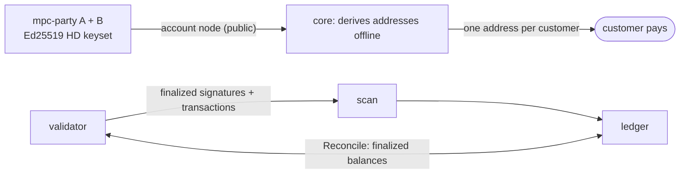

# Solana

A customer gets a Solana address, pays it in SOL or in one SPL token, and is credited once, after the payment is final, through the same
ledger as EVM and Bitcoin. Nothing leaves the address yet. Family `sol`, package [internal/chain/sol](../../internal/chain/sol).

## Addresses come from public data

Each customer's address is an Ed25519 public key derived below an account node of the two-party HD keyset (parties A and B). The two parties
walk the hardened part of the path together once and hand out a public key and a chain code, the account node. From then on anyone holding the
node derives every child public key alone, with no MPC and no secret, the way Bitcoin does from an xpub. cb-mpc applies the BIP32 rule to
Edwards points (SLIP-0010, the other common Ed25519 scheme, has no public derivation), and a test on real mpc-party proves that the address
derived offline is the key the parties derive. The path mirrors Bitcoin's: a hardened account level, then the external branch, then the
customer's index. The hot shards will use the other branch. The core's config holds only the node.

## Tokens live in the associated token account

A token balance is not kept on the address but in a token account. The address's associated token account (ATA) is the one account every
wallet pays by default, and the only one the books credit. Tokens sent to any other token account the address owns are on the chain and not in
the ledger: they are not credited, and Reconcile raises an alert that names the account, so an operator decides. Tokens of a mint nobody
configured, and Token-2022 tokens, are never credited. The ATA does not exist until someone creates it; wallets do that in the same transaction
as the payment.

## Rent can make a small payment fail

An account must hold a minimum balance to exist. A payment to an address that does not exist yet fails on the chain when it is smaller than
that minimum, and a failed transaction moves nothing, so there is nothing to credit and the scanner skips it. The configured minimum deposit
is a separate, business rule: a payment above the rent minimum and below the configured one lands on the chain and goes to suspense.

## Finality is rooting

A transaction that is confirmed can still be dropped with its fork. The scanner reads at the finalized commitment, which means rooted, a few
dozen slots later, and credits only what it finds there. It does not use the node's idea of "seen" for anything that moves money. Heights in the
cursor are slots.

## How the scan works

The node lists transactions per account, not per block, so the scanner asks for the finalized signatures of every deposit address and of its
token account for each configured mint, newest first, back to the cursor. It reads each transaction once, parsed, and walks its instructions,
inner ones included, so a payment made through another program counts. A deposit's identity is the signature plus the instruction's position.
The cost grows with the number of addresses; a very large customer base would want a different feed.

## Reconcile has no history to read

A Solana node keeps no balances of the past, so Reconcile cannot pin its comparison to a height. It reads each address's finalized balances,
puts them beside the books, and waits when the cell reports finalized activity the scan has not covered yet, or when the books changed
during the read. If that keeps happening the comparison is skipped and the report says so and is not clean. Anything left after that is a real
difference, in lamports or token base units.

## Limits

- **Deposits only.** Building, signing and sending Solana transactions come later; so do sweeps, withdrawals and cold storage.
- **One token program.** The classic SPL Token program only.
- **A token's decimals are checked at start** against the mint; a mismatch refuses to start.
- **The account node is fetched with a small helper** (`sol.AccountNode`); there is no operator command for it yet.
- **The validator in the tests is Agave 3.0**, pinned by checksum; the newer line cannot start under Docker's emulation on Apple silicon.
