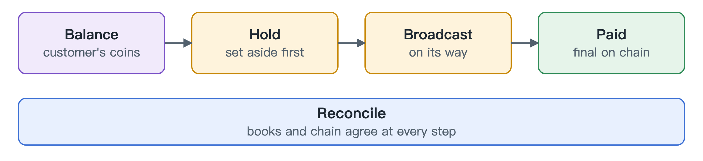

# Ledger

[中文](zh/ledger.md)

The ledger records where every coin is: in a customer's deposit address, in a hot wallet, in cold storage, or on its way between them. It works like a checkbook that you match against the bank statement, except the matching never stops.

## Every move is written twice

Each entry takes an amount from one account and puts the same amount into another, so the books always add up to zero (double entry). Amounts are whole numbers in the chain's smallest unit (wei, satoshi, lamport), so nothing is lost to rounding. Entries are only ever added, never edited.

## Money is held before it moves

When a customer asks to withdraw, the amount is held first, so two requests can't spend the same balance. When the payment lands, the hold becomes the payment; if it fails, the hold is released.

## Reconcile checks the books against the chain

Reconcile reads every address the system owns from the chain and compares it with the books, down to the smallest unit. Money on its way is explained from the chain's own record of each transaction, so the books match at every step, not only when things are quiet. After a key has been replaced, the addresses of the old and new key are added together and compared with the one account, so moving funds between them changes nothing. The comparison is made as at the height the deposit scan has reached: a scan that is a few blocks behind is a status, not a difference, and only a stuck or far-behind scan raises an alert.

## What Reconcile says when the answer is unclear

| Situation | What Reconcile says |
|:---|:---|
| Books and chain agree | Clean |
| They differ | An alert naming the address, the asset and both amounts |
| It cannot yet read a settled view of the chain | Not clean, with the reason. It never guesses |
