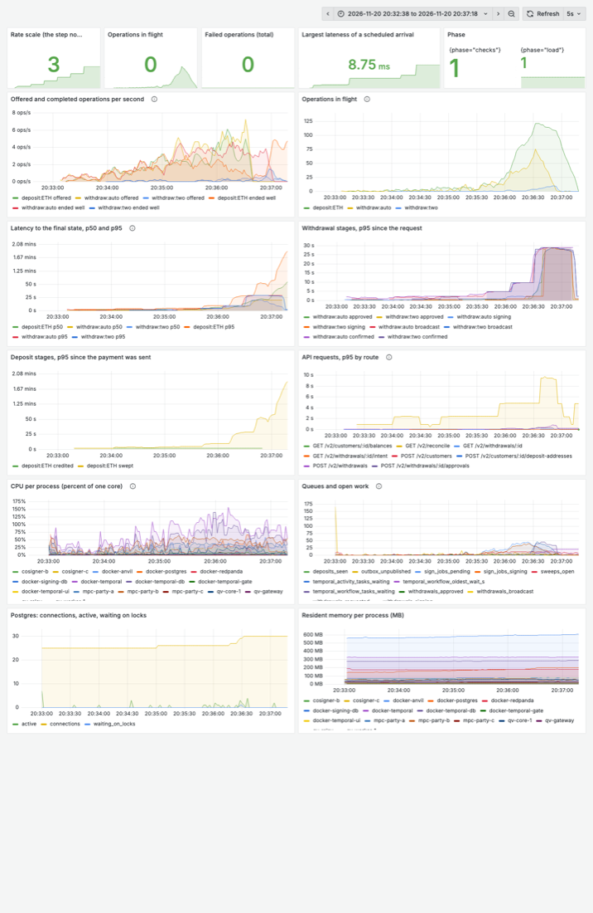
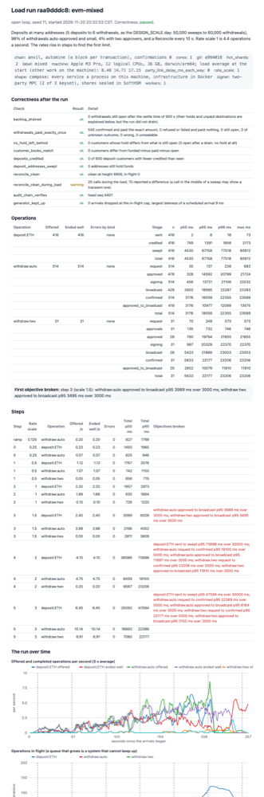

# Local load test (P4-local)

A load generator, a repeatable local run, numbers and pictures. **Everything here is one laptop**: all services are processes on one machine, Postgres, Temporal, Redpanda and the chain are containers on the same machine, the chain is a local node with a block per transaction, the HSM is SoftHSM and the two MPC parties share a loopback. It says where the system's first limit sits on this machine and why. It is **not a capacity plan** and says nothing about a real network, a real chain or a hardware HSM. A run on a cluster waits for a cloud account (checklist at the end).

Machine: Apple M3 Pro, 12 logical CPUs, 36 GB; Docker Desktop VM with 12 CPUs. **The machine was not quiet**: other work (end-to-end test groups of other branches, a kind cluster) ran on it all the time, so the load average at the start of a run was 12 to 40 on 12 CPUs (each result file records it). Absolute figures are therefore lower than a quiet machine would give; read the shape (which queue grows first, which process is busy) and the ratios between steps, not the third digit. Versions: Postgres 16, Temporal 1.32.1, Redpanda 26.2.4, anvil v1.8.5 (foundry), Go 1.27.3, cb-mpc v0.2.2, repository commit a994018 plus the load test.

Reproduce: `make setup infra-up softhsm mpc-build` once, then `make load-local SCENARIO=loadtest/scenarios/evm-mixed.json OUT=data/load/mixed` ([`loadtest/README.md`](../../loadtest/README.md)). `make load-dash-up` first gives the live dashboard.

## The workload model

The numbers are **assumptions**, marked A. They come from the day [DESIGN_SCALE.md](../../DESIGN_SCALE.md) assumes (1,000,000 wallets; a normal day has 60,000 withdrawals and 50,000 sweeps; a stress day is ten times that, 15% of it in the peak hour), cut down to what one laptop can show. No real market data was used and no claim about any real volume follows.

| Part | Model | Source |
|---|---|---|
| Deposits | Many addresses: one deposit open at a time per address, 600 to 1,500 addresses in a run; sizes uniform 0.05 to 2 ETH (A). Each is paid on the chain from a funded key, then followed to *credited* (scan and ledger) and *swept* (forwarder to the hot wallet). | A: DESIGN_SCALE A2 |
| Withdrawals, auto tier | Small: 0.001 to 0.05 ETH, requested by one initiator, approved by the worker's automated key. 96% of all withdrawals. | A |
| Withdrawals, two-approver tier | 1 to 1.5 ETH (the tier from 1 ETH up in the test config), approved by two named approvers who sign the intent hash with their own keys. 4% of withdrawals. | A |
| Mix at rate scale 1 | 2.0 deposits, 2.3 auto and 0.1 two-approver withdrawals a second: 4.4 operations a second, 5 deposits to 6 withdrawals as in the DESIGN_SCALE day. | A |
| Background | A Reconcile call every 10 s (the operator's loop); audit chain heads published every 2 s (the harness setting); the sweep planner every 300 ms, the scan every 500 ms (the harness settings, shorter than production). Hot-to-cold moves are not exercised: the hot wallets start with a million ETH. | A |
| Chains | **Only EVM is driven.** Bitcoin (batched withdrawals, UTXO consolidation) and Solana (durable nonces, batched sweeps) are modelled in the table below but have no driver yet; see "What is not done". | |
| Arrivals | Open loop: Poisson arrivals at the rate from a fixed seed (and the run identifier), rising linearly during a ramp, then held in steps of 30 to 40 s that multiply every rate; or closed loop: 16 users who start their next operation when the last one ended. | |

| Mix | Rates (per second) | What it asks of the system |
|---|---|---|
| Normal day (DESIGN_SCALE: 1.3 signatures/s) | about 0.6 deposits, 0.7 withdrawals | nothing: far below every limit here |
| Peak hour of a stress day (46 signatures/s) | about 20 deposits, 26 withdrawals | **ten times the first limit measured on this machine** |
| Run here, scale 1 | 2.0 deposits, 2.4 withdrawals | the middle of what this machine does |

## What is measured and checked

The generator drives the core API as a client: bearer tokens, requests, signed approvals, deposits paid on the chain. Each operation records the time of each stage from its **scheduled arrival** (so a late generator cannot hide delay): for a withdrawal *request*, *approved*, *signing*, *broadcast*, *confirmed*; for a deposit *credited* and *swept*. A run is judged by objectives (assumptions too): withdrawal p95 request to confirmed under 5 s, approved to broadcast under 3 s, deposit credited under 5 s and swept under 30 s, error rate under 0.1%. The **first step that breaks one** is where the first limit sits. A run that stops being a good test (more than 200 operations open) stops its arrivals and drains.

**Correctness is part of the result.** After every run, and after waiting for what the generator gave up on to settle: every withdrawal paid exactly once (its destination holds the amount) or not at all; no hold left behind; every customer's books equal funded minus paid; deposits credited and every address swept; Reconcile clean; the audit chain verifies; the services' logs hold no `ALERT` (apart from the two transient kinds named below); every outbox row published and consumed once; no open work, no pending hold, no failed sign job, no two withdrawals sharing a transaction. The checks are made by the generator through the API and the chain, and by the test that brought the stack up; both sets are in the saved result and in the page's verdict. Each customer's credit is compared with the sum of the payments the generator made to their addresses, read from the chain's receipts (equality, in both directions), and each payment's receipt must be a success. All the runs below passed these, except where a table says otherwise.

## Results

All tables are ended-well rates and latencies from the scheduled arrival to the final state, in seconds. "Offered /s" is what the generator started in the step; because every operation was followed until it ended (or the settle time ran out), "ended well" is the share of them that did, not a throughput. The queue and CPU figures are the mean over the step, sampled once a second by the test that brought the stack up (`stack.json`). The pages `report.html` of each run hold all of it as charts; a screenshot is below.

### Withdrawals, auto-approved tier only

Two runs of the same scenario (`evm-withdraw`), 6 and 7 steps from 1 to 8 times 1 operation a second. The first run was made while the machine was busier (load average 14 to 41) and broke at 5.6 a second; the second broke at 8.6 a second.

Run 1 (busy machine):

| Step (rate scale) | withdraw:auto: offered /s | ended well /s | p50 s | p95 s | Objectives broken |
|---|---:|---:|---:|---:|---|
| ramp | 0.60 | 0.60 | 2.3 | 2.3 |  |
| 0 (x1) | 0.80 | 0.80 | 0.8 | 1.9 |  |
| 1 (x2) | 2.07 | 2.07 | 1.1 | 1.5 |  |
| 2 (x3) | 2.83 | 2.83 | 0.9 | 1.4 |  |
| 3 (x4) | 4.43 | 4.43 | 1.6 | 3.3 |  |
| 4 (x6) | 5.60 | 5.60 | 6.3 | 9.2 | auto request to confirmed p95 9217 ms over 5000 ms; auto approved to broadcast p95 6891 ms over 3000 ms |
| 5 (x8) | 8.63 | 8.63 | 26.2 | 44.7 | auto request to confirmed p95 44697 ms over 5000 ms; auto approved to broadcast p95 18667 ms over 3000 ms |

Run 2:

| Step (rate scale) | withdraw:auto: offered /s | ended well /s | p50 s | p95 s | Objectives broken |
|---|---:|---:|---:|---:|---|
| ramp | 0.60 | 0.60 | 1.6 | 1.6 |  |
| 0 (x1) | 0.80 | 0.80 | 0.6 | 2.2 |  |
| 1 (x2) | 2.07 | 2.07 | 0.7 | 1.2 |  |
| 2 (x3) | 2.83 | 2.83 | 0.7 | 1.0 |  |
| 3 (x4) | 4.43 | 4.43 | 0.9 | 1.3 |  |
| 4 (x6) | 5.60 | 5.60 | 1.0 | 1.9 |  |
| 5 (x8) | 8.63 | 8.63 | 6.1 | 8.8 | auto request to confirmed p95 8787 ms over 5000 ms; auto approved to broadcast p95 8121 ms over 3000 ms |

**The first limit is the signing queue, at about 5 to 8 withdrawals a second on this machine.** In run 2 at 8.6 a second the sign jobs waiting for the gateway rise from 2 to 32 and the withdrawals in status `signing` from 4 to 35, while `qv-gateway` uses 2% of a core, the two parties use 44% and 57%, Temporal's workflow-task queue stays empty and the worker uses 16 to 26%. The gateway claims and signs **one job at a time** (`Gateway.Run` calls `RunOnce` in a loop: claim, decide in the guard database, sign with the two parties, record), so its throughput is the inverse of one job's time. Held at 8.4 a second for a minute (below), the jobs left the queue at 4.1 to 4.7 a second, about 210 to 240 ms per job on this busy machine; the same figure with 20 ms of delay added to every frame between the parties is 790 ms. A profile of the gateway during that run (macOS `sample`, 8 s) shows it waiting for the parties' answer, not computing; the parties' own samples show the secp256k1 and zero-knowledge work of the signature in a minority of their time. The gateway is not busy; it is waiting, and nothing else is signing.

Second in line, at higher rates, is Temporal: its container and its Postgres together use 190% of a core (115% and 77%) at the top step and the workflow-task queue starts to wait (14 to 92 tasks, the oldest 15 s) in the fixed-rate runs where the signing queue had also filled.

### Deposits only: scan, credit, sweep

Rates 1 to 12 a second (`evm-deposit`), arrivals stopped when more than 250 operations were open (here at 168 s, 3 s into the last step).

| Step (rate scale) | deposit:ETH: offered /s | ended well /s | p50 s | p95 s | Objectives broken |
|---|---:|---:|---:|---:|---|
| ramp | 0.60 | 0.60 | 1.4 | 1.4 |  |
| 0 (x1) | 1.37 | 1.37 | 2.0 | 2.6 |  |
| 1 (x2) | 1.57 | 1.57 | 1.7 | 2.4 |  |
| 2 (x4) | 4.37 | 4.37 | 2.4 | 3.8 |  |
| 3 (x6) | 6.23 | 6.23 | 3.1 | 93.5 | ETH sent to swept p95 93457 ms over 60000 ms |
| 4 (x8) | 9.30 | 9.30 | 5.9 | 68.5 | ETH sent to swept p95 68549 ms over 60000 ms |
| 5 (x12) | 11.96 | 11.96 | 11.6 | 45.6 |  |

**Credit is not the limit; the sweep is.** Time to *credited* stays at 1.1 to 1.6 s p95 in every step (the scan every 500 ms), while time to *swept* jumps at 6 deposits a second (p50 3.1 s, p95 93 s). Over the same steps the sweeps open at once sit at 7 to 8 and the sign jobs waiting at 3, the gateway at 1.5% of a core: the signing queue is not what limits sweeps. What is left is the sweep planner's own rules (a planning pass every 300 ms in the test configuration, at most 12 open sweeps, each one deploying a forwarder, signing, broadcasting and waiting for the block; [closed-loop](closed-loop.md) describes the cap) together with the chain: anvil's container rises from 12% to 73% of a core as every deposit, deployment and sweep is a block. That is an inference from the queue figures, not a measurement of the planner: it was not profiled. Every address was swept after the run.

### The mixed workload

The reference mix (`evm-mixed`): 2.0 deposits, 2.3 auto and 0.1 two-approver withdrawals a second at scale 1, scales 0.25 to 3, a Reconcile every 10 s. Arrivals were stopped at 219 s, 9 s into the last step, when 200 operations were open.

| Step (rate scale) | deposit:ETH: offered /s | ended well /s | p50 s | p95 s | withdraw:auto: offered /s | ended well /s | p50 s | p95 s | withdraw:two: offered /s | ended well /s | p50 s | p95 s | Objectives broken |
|---|---:|---:|---:|---:|---:|---:|---:|---:|---:|---:|---:|---:|---|
| ramp | - | - | - | - | 0.20 | 0.20 | 0.5 | 1.3 | - | - | - | - |  |
| 0 (x0.25) | 0.23 | 0.23 | 2.1 | 2.6 | 0.57 | 0.57 | 0.5 | 0.8 | - | - | - | - |  |
| 1 (x0.5) | 1.12 | 1.12 | 1.8 | 2.2 | 1.07 | 1.07 | 0.6 | 1.0 | 0.05 | 0.05 | 0.6 | 0.9 |  |
| 2 (x1) | 2.20 | 2.20 | 2.0 | 2.7 | 1.88 | 1.88 | 0.8 | 1.5 | 0.10 | 0.10 | 0.6 | 1.2 |  |
| 3 (x1.5) | 2.40 | 2.40 | 2.7 | 4.1 | 3.98 | 3.98 | 1.5 | 2.6 | 0.05 | 0.05 | 1.9 | 2.0 |  |
| 4 (x2) | 4.10 | 4.10 | 7.7 | 57.7 | 4.75 | 4.75 | 4.7 | 7.4 | 0.20 | 0.20 | 4.6 | 6.5 | ETH sent to swept p95 57697 ms over 30000 ms; auto request to confirmed p95 7406 ms over 5000 ms; auto approved to broadcast p95 6892 ms over 3000 ms; two request to confirmed p95 6549 ms over 5000 ms; two approved to broadcast p95 5930 ms over 3000 ms |
| 5 (x3) | 7.28 | 7.28 | 23.1 | 38.4 | 8.98 | 8.98 | 10.6 | 12.9 | 1.71 | 1.71 | 5.6 | 12.5 | ETH sent to swept p95 38412 ms over 30000 ms; auto request to confirmed p95 12870 ms over 5000 ms; auto approved to broadcast p95 12099 ms over 3000 ms; two request to confirmed p95 12477 ms over 5000 ms; two approved to broadcast p95 11051 ms over 3000 ms |

The last step ran only 9 s before the stop, so its rates rest on few operations.

**The first objectives broken are at scale 2 (4.1 deposits and 4.9 withdrawals a second): sweeps lag by 58 s (p95), withdrawals take 7.4 s (p95) and approved-to-broadcast 6.9 s. At scale 1.5 (2.4 and 4.0 a second) all objectives held, but the signing queue had begun to fill.** Sweeps and withdrawals share the one signing loop, so the mixed limit is lower than either alone: from scale 1.5 the sign jobs waiting go from 1 to 5, 21 and 53 while the gateway stays at 2% of a core. Temporal's container reaches 98% and its Postgres 67% at scale 2, and 153% and 115% at scale 3. The business Postgres is at 17 to 38% of a core and waits on locks in no sample: no lock contention was seen at any rate.

| Mean over the step | x0.25 | x0.5 | x1 | x1.5 | x2 | x3 |
|---|---:|---:|---:|---:|---:|---:|
| sign jobs waiting | 0.1 | 0.3 | 1.0 | 5.2 | 20.9 | 53.3 |
| withdrawals in `signing` | 0.2 | 0.4 | 1.0 | 4.5 | 15.7 | 47.4 |
| sweeps open | 0.1 | 0.8 | 1.8 | 3.7 | 8.8 | 10.6 |
| `qv-gateway` CPU (% of one core) | 0.5 | 0.7 | 1.1 | 1.8 | 2.0 | 1.9 |
| `mpc-party-b` CPU | 6.6 | 17.7 | 33.5 | 52.9 | 55.8 | 52.7 |
| Temporal container CPU | 14.2 | 25.1 | 45.3 | 80.3 | 98.3 | 152.5 |
| Temporal's Postgres CPU | 8.5 | 15.8 | 28.3 | 53.6 | 66.9 | 115.2 |
| `qv-core` CPU | 1.6 | 2.6 | 4.7 | 7.6 | 12.3 | 25.2 |

The dashboard above is the live view of this run (Grafana over the generator's and the sampler's metrics); the page below is what `qv-load report` leaves behind for the same run.

### Adding copies of the stateless parts

`evm-withdraw-fixed`: auto-approved withdrawals offered at a fixed 8.4 a second for 60 s, then drained, with 1, 2 and 4 copies of `qv-worker` and of `qv-core` (requests go round robin over the cores; workers share the task queue). Each row is one run on a machine with another load; the load average at the start is in the last column.

| Copies of worker and core | Jobs leave the queue at (per second) | Withdrawal p50 / p95 (s) | Sign jobs waiting (mean) | Temporal workflow tasks waiting (mean) | Load average at start |
|---|---:|---:|---:|---:|---|
| 1 | 4.7 | 28.7 / 59.5 | 58 | 92 | 41 |
| 2 | 4.1 | 31.8 / 57.6 | 75 | 68 | 31 |
| 4 | 4.6 | 31.2 / 50.5 | 99 | 15 | 14 |

**What it shows:** more workers and cores do what they are for, moving work off the front of the pipe (the workflow tasks waiting fall from 92 to 68 to 15), and **do not raise the rate at which withdrawals complete** (4.1 to 4.7 a second in all three), because the work then waits one step further on, in the sign-job queue, which grows from 58 to 99. This is what the first limit predicts. **What it does not show:** whether more gateways would help (the zone is not scaled out by adding copies by design; the lease on a job in the queue might let several gateways claim jobs, but nobody ran it), how the copies scale on separate machines (here they share 12 CPUs with everything else), or anything about core and worker scaling under a workload that is not signing-bound.

### Delay between the parties

[DESIGN_SCALE.md](../../DESIGN_SCALE.md) models a signature as `190 ms + 6 x RTT`. The stack has a knob that adds a delay to every frame between parties A and B, each way (`DELAY_MS`); with 20 ms the round trip is 40 ms and the model gives 430 ms. The gateway's per-job time, measured as the inverse of the queue's drain rate with 4.2 jobs a second offered, was **293 ms with no delay (arrival-limited, so a lower bound on what a job costs) and 788 ms with 20 ms**, 2.5 times the model's prediction for the signature alone: the sign job has more round trips than six, or the other steps of a job (guard, audit, record) add up. At that delay the jobs left the queue at 1.3 a second, the withdrawal p50 was 54 s, and the services logged alerts that a sign timed out and that the first coordinator did not answer, as they should (the run's no-alert check fails on them, rightly); every withdrawal was still paid once. **On a network with 1.5 ms between zones the same model predicts 205 ms; with 65 ms between regions, 580 ms plus the rest: the single signing loop turns every millisecond of round trip into a loss of throughput.**

### On the kind lane (the charts)

`make kind-up` installs the real charts on one kind node (business zone, gateway, three parties by pods, Temporal, Keycloak, Postgres by CloudNativePG; [kind lane](../../ci/kind/README.md)); `make load-kind` runs the same generator against it through port-forwards (`loadtest/kind/run.sh`), with Keycloak's real tokens. Only auto-approved withdrawals and deposits (the lane has no keys for people approvers). Scenario `evm-kind`, scales 0.25 to 2, on current main (kind lane piece 3 merged), a machine with load average about 6, the generator, anvil and the port-forwards outside the cluster; one hot shard:

| Step (rate scale) | deposit:ETH: offered /s | ended well /s | p50 s | p95 s | withdraw:auto: offered /s | ended well /s | p50 s | p95 s | Objectives broken |
|---|---:|---:|---:|---:|---:|---:|---:|---:|---|
| ramp | - | - | - | - | 0.40 | 0.40 | 0.9 | 1.3 |  |
| 0 (x0.25) | 0.60 | 0.60 | 4.9 | 7.4 | 0.55 | 0.55 | 1.1 | 1.6 |  |
| 1 (x0.5) | 0.93 | 0.93 | 6.0 | 9.3 | 1.30 | 1.30 | 1.2 | 4.8 | auto approved to broadcast p95 3345 ms over 3000 ms |
| 2 (x1) | 1.88 | 1.88 | 5.3 | 9.1 | 2.35 | 2.35 | 1.2 | 1.8 |  |
| 3 (x1.5) | 3.38 | 3.38 | 7.8 | 102.7 | 3.27 | 3.27 | 1.5 | 2.8 | ETH sent to swept p95 102739 ms over 30000 ms |
| 4 (x2) | 3.51 | 3.51 | 21.5 | 72.6 | 4.84 | 4.84 | 5.9 | 7.1 | ETH sent to swept p95 72568 ms over 30000 ms; auto request to confirmed p95 7127 ms over 5000 ms; auto approved to broadcast p95 6757 ms over 3000 ms |

Arrivals stopped at 197 s (7 s into the last step). All checks passed: 454 withdrawals paid exactly once, no hold left, Reconcile clean, audit chain verified, every address swept.

What the kind shape costs, as far as one run says: **withdrawals through the pods answer as fast as the process stack up to 3.3 a second (p50 1.1 to 1.5 s, p95 2.8 s at 3.3) and break the objectives at 4.8 a second (p95 7.1 s)**, close to the 4 to 5 a second where the compose stack with two hot shards broke. Deposits are credited and swept in 5 to 8 s p50 up to 1.9 a second, then the sweeps fall behind at 3.4 a second (p95 103 s). The lane's sweep planner runs every 5 s (the production default; compose uses 300 ms) and the scan every 2 s (500 ms in compose), which is most of the 5 s. The signing path is the same code and the same single signing loop, so the same first limit is expected; the kind run does not measure it separately (no queue sampler on the cluster).

**The zone's hourly limits.** In an earlier kind run on the same cluster, made an hour after another one, 60 withdrawals were refused by the gateway with `policy_withdrawal_rate: 600 withdrawals in the last hour, limit 600` and 123 deposit addresses were left unswept. Correctness held: the refused withdrawals paid nothing and their holds were released, 247 paid exactly once, the books matched, Reconcile was clean. The lane's limits (600 sweeps and 600 withdrawals an hour) are a test setting, not a capacity; they show that a limit set in the zone caps throughput like any other and that it works under load.

This is one node and one run: it does not show what four clusters cost.

### Closed loop, for comparison

`evm-closed`: the mixed workload with 16 users, each starting its next operation when the last one ended (a deposit ends when credited), 60 s, one run:

| Operation | Done | Per second | p50 / p95 (s) |
|---|---:|---:|---|
| auto withdrawal | 234 | 3.90 | 3.6 / 4.1 |
| two-approver withdrawal | 11 | 0.18 | 3.5 / 4.5 |
| deposit, to credited | 157 | 2.62 | 1.0 / 1.2 |

The closed loop settles at **about 4.1 withdrawals and 2.6 deposits a second with every withdrawal taking 3.5 s**: the 16 users keep the system just busy enough that its queues hold a few seconds of work, and the system cannot be driven into the collapse the open loop shows (p95 of 60 s and more) because the users wait. The two modes answer different questions. The closed loop says what the system does with this many people; it hides the limit, since a slower system just lowers the rate. The open loop says what happens to arrivals that do not wait: at 4 withdrawals a second the same system answered in 1.5 s p50 in the open loop, and at 8.6 a second in tens of seconds. Withdrawals reaching a steady 4.1 a second under 16 users agrees with the 4.1 to 4.7 a second at which the open-loop runs' queues drained.

### Rerun after the review fixes

The review of the load test's own checks changed the generator (payments are now tracked independently and each customer's credit is compared with exactly what the chain shows was paid, in both directions; a retried payment can no longer be signed twice; a stopped run stops every stream at once). The headline scenarios were run again on the same stack, on a busier machine (load average 15 to 46 at the start, against 8 to 14 before):

| Scenario | First broken, before | First broken, after | Machine load at start, before / after |
|---|---|---|---|
| Withdrawals only | scale 8 (8.6 a second): p95 8.8 s | scale 8: p95 17.8 s | 14 / 15 to 46 |
| Mixed | scale 2 (4.1 deposits, 4.9 withdrawals): sweep p95 58 s | scale 2: sweep p95 61 s, credit p95 5.0 s | 8 / 12 to 38 |
| Deposits only | scale 6 (6.2 a second): sweep p95 93 s | scale 6: sweep p95 114 s | 9 / 13 to 30 |

**The first limits did not move, and the fixes did not change any conclusion**; the latencies past the limit are 1.5 to 2 times longer on the busier machine, as the load figures say they would be. The fixed-rate runs (copies of worker and core) and the closed loop were rerun in even heavier conditions (load 20 to 29 at the start) and are not comparable with the table above, which stays as the reference; in them the single-copy run left 18 of 521 withdrawals open at the end of the drain (all paid by the settle time) and the four-copy run left 322 of 438 open, with 596 `ALERT: withdrawal or sweep workflow made no progress` lines in the worker's log: the system's own watchdog, on a machine that could not run its workflows, fired as designed, and the run's alert check failed on it, rightly. Every withdrawal in those runs was still paid exactly once. The smoke loop passed 20 of 20 on the new code.

## The first limit, per scenario

| Scenario | First limit | Offered at the first broken objective | What shows it |
|---|---|---|---|
| Withdrawals only | the gateway signs one job at a time | 5.6 to 8.6 a second (the machine's load decides) | sign jobs waiting 2 to 32, withdrawals in `signing` 4 to 35, gateway 2% of a core, parties 44 to 57%, workflow-task queue empty; the gateway's samples show it waiting; more workers and cores change nothing |
| Deposits only | the sweep pipeline (sweeps open stuck at 7 to 8, sign jobs not waiting) | 6.2 a second | credit p95 1.1 to 1.6 s at every step, sweep p95 from 3.8 s to 93 s |
| Mixed | the same signing loop, shared by sweeps and withdrawals | 9 operations a second (scale 2; the queue starts to fill at 6.4, scale 1.5) | sign jobs waiting 1.0, 5.2, 20.9, 53.3 |
| Parties 20 ms apart | the same signing loop, 790 ms a job | below 4.2 withdrawals a second | 1.3 jobs a second |
| On kind | withdrawals queue from 4.8 a second; sweeps lag from 3.4 deposits a second (5 s planner), and the zone's 600 an hour caps a longer run | 4.8 withdrawals a second | p95 7.1 s; sweep p95 103 s; gateway refusals in an earlier run |
| Behind all of them | Temporal (server and its database use about 2 cores together) and the chain node (anvil, a block per transaction) | at 8 or more operations a second | their CPU and the workflow-task queue |

## Findings in the product

These came out of running it under load. None is fixed here (this task changes no service code); each is on the backlog below.

1. **Reconcile reports a difference while the chain moves.** In every run, between 40% and 90% of the Reconcile calls made during the load reported `scan_caught_up` (the books' scan cursor 2 to 5 blocks behind the chain) or `deposit_addresses` (funds on an address that the ledger has not yet credited), and logged `ALERT: the books and the chain disagree`. Each was clean a few seconds later and every end-of-run Reconcile was clean. On the local chain a block is mined per transaction, so the chain moves faster than any real one; but the check has no allowance for a scan that is a few blocks behind, so on a busy chain an operator would see this alert repeatedly. It is why the "no alert fired" check counts these two kinds apart.
2. **A deposit worth little is left unswept while gas is high, by design.** In a first mixed run a 0.018 ETH deposit was credited at once and not swept in 9 minutes: the sweep planner sweeps only when the value exceeds `K` (20) times the sweep's fee, and the fee rose under load. The deposit scenarios therefore start at 0.05 ETH. A real deployment will hold small deposits at the addresses until the fee drops or an operator moves them.
3. **Every API request verifies a signature.** A sample of `qv-core` under load shows its active CPU time mostly in P-256 arithmetic (the bearer token's ES256 signature, checked on each request including every status poll). At rate scale 3 the core uses 25% of a core. Not a limit here, and a cache of verified tokens would remove it.
4. **The gateway waits, not works.** See the first limit: 2% CPU while the queue grows.

## The smoke scenario

`make load-smoke` (CI job `e2e-load-smoke`): 4 withdrawing customers, 6 deposit addresses, about 5 s of arrivals (deposits, small and two-approver withdrawals), then every check above. It asserts correctness only and no time. It was run 20 times in a row on the final code: **20 of 20 passed** (about 80 s each, start-up included). A first series of 20 on earlier code had 2 failures, both the same: a 0.01 ETH deposit left unswept (finding 2), so the smoke deposits are now 0.2 to 0.5 ETH.

## What a laptop run can and cannot tell

| It can show | It cannot show |
|---|---|
| which queue grows first and which process is busy; that correctness holds at and past the limit (every run above ended with the checks passing, about 4,200 withdrawals in the runs above paid exactly once) | any capacity figure for other hardware: the machine was shared and loaded, two runs of one scenario differ by 50% |
| that more copies of the stateless parts do not raise the rate when signing is the limit | cross-zone latency: the parties share a loopback (the delay knob only adds a fixed delay per frame) |
| the cost of delay between the parties, with the knob | a hardware HSM's rate: SoftHSM signs in microseconds and the parties use it only to seal their shares; the MPC arithmetic runs on the CPU |
| the shape of the generator's output and the dashboard | a real chain: here a block per transaction, no fees to speak of, no reorganisation, no mempool, confirmations 0 |
| | four clusters, real network policy, noisy neighbours, autoscaling |

## What is not done

- **Bitcoin and Solana are not driven.** The generator's operation layer is written for the EVM deposit and withdrawal; a Bitcoin driver (xpub addresses, batched withdrawals, consolidation) and a Solana driver (durable nonces, token deposits) need their own stack launchers: the Bitcoin and Solana end-to-end harnesses are separate and were not reused. The workload model above says what they would run.
- **No profile with a Go profiler.** The services expose no pprof endpoint, and adding one is service code, which this task does not change. The profiles are macOS `sample` call graphs of the gateway, the parties, the worker and the core (kept in `data/load/profiles` of the run, not committed: about 180 KB each).
- **Hot-to-cold moves and the audit archive were not exercised under load.**
- **The kind run is one run on one node** (plus an earlier one that hit the hourly limits), with the lane's own configuration (5 s planner, 600 an hour limits), not tuned; scale-out and delay were not run on kind.

## Backlog from the measurements

| Candidate | Expected gain | Basis |
|---|---|---|
| Let the gateway sign several jobs at once (a few claim loops, each with its own lease) | withdrawals and sweeps up to the point where the parties reach a core each: about 2 to 3 times here (the parties are at 45 to 57% of a core at the limit) | queue and CPU figures above; not tried |
| Fewer round trips in a signature, or fewer steps in a job, if the 790 ms at 20 ms per frame is confirmed | proportionally, on any real network | 2.5 times the research model |
| Poll less: a withdrawal workflow and a client's status polls each cost Temporal and the API work | Temporal's 100% of a core is where it saturates next | Temporal and its Postgres use 2 cores at the limit |
| Cache verified bearer tokens in the core | a few percent of the core at 20 requests a second | profile of `qv-core` |
| An allowance in Reconcile for a scan a few blocks behind | removes the repeated alert | finding 1 |
| Raise the sweep planner's cap or plan more often | sweeps above 6 deposits a second | deposit run; not tried |
| A Go profiler endpoint in each service (loopback, off by default) | proper profiles instead of `sample` | this task |

## The cloud run: what it adds

The same binary and scenarios run against a cluster with a target file (core URLs, the CA, how tokens are obtained, actors and approver keys, the chain's RPC and a funded key; see `loadtest/README.md`). What the AWS run adds, as the checklist for later:

1. Cross-zone latency between the business zone, the gateway and the three parties in four clusters (the delay knob here is a stand-in): rerun the delay table at 1.5 ms, 65 ms and 160 ms.
2. A real HSM's rate and queue (CloudHSM): the parties' sealing and the gateway's own keys, and the per-device limit in DESIGN_SCALE A4.
3. Real Temporal and Postgres, sized as production: the second limit here is a one-container Temporal.
4. Real chains: block times, fees, confirmations, mempool, reorganisations, and a node's own rate limits; Bitcoin and Solana drivers.
5. Scale-out where it can mean something: copies of `qv-core`, `qv-worker` and `qv-relay` on separate nodes; more than one gateway if the design allows it.
6. Noisy neighbours, autoscaling, rolling upgrades and a failed node during a run (`TestMPCRefreshDuringLiveWithdrawals` at rate).
7. A quiet machine for the generator itself, and a run that lasts hours (soak) with memory and connection counts.
8. Alerts from the real monitoring (`monitoring/`, #121, #134) in the "no alert fired" check: the target file's `prometheus_url`.
