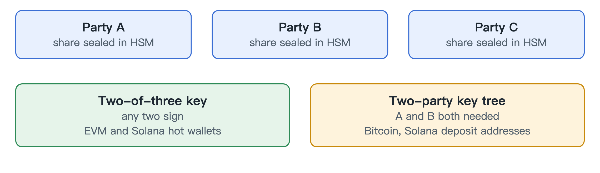

# MPC signing

[中文](zh/mpc.md)

No machine here holds a whole key. Each key is cut into shares held by different parties, and a signature is made by the parties together, like a vault door that needs several keyholders at once, where each keyholder holds only a piece of the key and no one can copy the whole.

## Two kinds of keys
| Kind | Who signs | Used for |
|---|---|---|
| Two-party key tree | A and B, both needed | Bitcoin, and Solana deposit addresses |
| Two-of-three key | Any two of A, B, C | EVM and Solana hot wallets |

A customer address needs a key tree, where one parent key yields a child key for each customer from public data. The two-party kind can do that; the two-of-three kind cannot, so it serves only the hot wallets.

## When a party is down
| Down | Effect |
|---|---|
| One of A, B, C, on a two-of-three key | Another pair signs; nobody notices |
| A or B, on a two-party key | Signing waits, the job is retried, one alert is raised |
| C only | Everything on two-party keys goes on |

## A failed check freezes the key
If a proof does not verify, a message cannot be read, or a final signature is wrong, the parties may be talking to a bad peer. The key is then frozen on every party that holds it. Nothing is deleted, withdrawals wait with their holds, and only an operator's signed unfreeze lifts it. A party that is merely slow or offline is not a freeze. See the [freeze runbook](runbooks/mpc-keyset-freeze.md).

## Shares are sealed, backed up and refreshed
Each share is encrypted under a key that never leaves the party's own HSM token, so a stolen disk gives nothing. A refresh gives every party new shares for the same public key, and a crash during it ends on one working generation. A lost party is rebuilt from its backup ([runbook](runbooks/mpc-backup-restore.md)).
