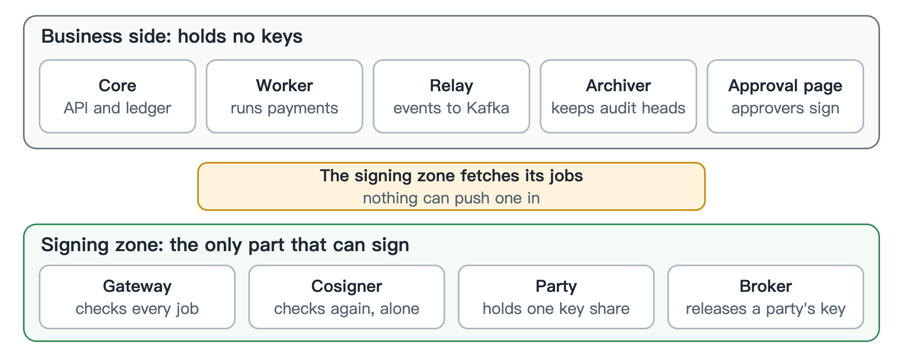

# Services

[中文](zh/services.md)

QuorumVault is made of nine small services in two groups. The business side takes requests and keeps the books, and holds no keys. The signing zone checks every payment and is the only part that can sign. This page says what each service does and what it is trusted with.

## The business side asks and records

| Service | What it does | What it holds |
|:---|:---|:---|
| Core | The one door in: checks who asks, records the request, keeps the ledger ([Core API](api.md), [Ledger](ledger.md)) | The business database. No keys |
| Worker | Carries each deposit, sweep and withdrawal to the end, and picks up after a crash ([Workflows](workflows.md)) | One key that approves only the smallest payments |
| Relay | Passes events from the database to Kafka, so nothing is lost between the two | Nothing |
| Archiver | Copies each published audit head into write-once storage ([Audit trail](audit.md)) | Access to the archive, nothing else |
| Approval page | The web page where an approver reads a payment and signs it with a passkey ([People](people.md)) | Nothing; it only serves the page |

## The signing zone checks and signs

| Service | What it does | What it holds |
|:---|:---|:---|
| Gateway | Fetches each job, checks it against the approvals and the zone's rules, then asks the parties to sign ([Signing zone](signing-zone.md)) | Its own rules and audit chain. No key share |
| Cosigner | An independent checker beside party B and party C. It checks the same job again, alone, and its party signs only if it agrees | Its own rules and audit chain |
| Party | Holds one share of each key and signs together with one other party ([MPC signing](mpc.md)). There are three: A, B and C | One key share, sealed |
| Broker | Gives a party the key that opens its sealed shares, after the party proves which program it runs ([Enclaves](enclaves.md)). Simulated today | The keys that open the shares |

## Why so many pieces

- **Taking over one service is not enough.** The services that hold keys never decide alone, and the services that decide hold no keys. An attacker would need two parties and their cosigners.
- **Each piece can fail alone.** A dead worker is replaced and the payment carries on. The signing zone keeps its own records while the business side is down.
- **Each piece has its own identity.** Every service has its own certificate and its own database role, with only the rights it uses ([Identity](identity.md)).

## What they run on

The services rely on a few standard components that QuorumVault does not write itself: PostgreSQL for the books and for each zone's records, Kafka for events and audit heads, Temporal for workflows, an identity provider for logins, and an HSM for the keys that seal each party's shares. Which service runs in which cluster is on the [Deployment](deployment.md) page.

Operators also have command-line tools for tasks done by hand, such as a key ceremony or a signed change of settings. These run only when needed and are not services.
