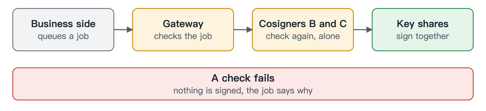

# Signing zone

[中文](zh/signing-zone.md)

The signing zone is the only part of QuorumVault that can move money. Think of it as a bank teller who reads every slip before paying: the slip may come from the manager's office, but the teller still checks the signatures and the amount.

## The business side can only ask
The core writes a job: what the approvers agreed to, in plain words (who gets how much of what), the transaction to sign, and the approvers' signatures. The zone fetches jobs itself; nothing outside can push one in.

## Every job is checked before any key signs
1. Enough different people approved it, and none of them is the person who asked. The signed statement names the requester, so the zone checks this itself; it does not take the core's word.
2. The transaction, read back, does exactly what the approvers agreed to, and nothing more.
3. The destination is one the zone's own rules allow.
4. The same job was never signed with different content.

## Approving with a security key or a passkey
An approver may sign with an Ed25519 key or with a security key or passkey (WebAuthn). The zone checks the passkey's answer itself: it was made for this exact job, on the approval page's own address, by a key the zone's config lists, with the person present and verified. It does not trust a login service for any of this, and no network call is made. A person may have one key of each kind; they still count as one approver. Enrolling one is in the [runbook](runbooks/webauthn-approver.md). The same answer cannot be used for another job, and sending it twice counts once.

The zone does not track the key's usage counter: many keys always send zero, and an answer is already tied to one job and its expiry, so a refusal on the counter would only lock out good keys.

## Who asked
Every withdrawal, alone or inside a batch, carries the identity of the person who requested it, and approvers sign it with the rest. The zone refuses a job with no requester, and a job any of whose counted approvers is that person. Two keys that belong to one person count as one approver.

Jobs nobody requests carry no requester, and the zone refuses one that has it: sweeps, consolidations, moves to cold, rebalances, cancels and nonce setup or close. They need no person's request: the first five are limited by the zone's own rules, and nonce work needs an operator's approval.

An approval made before this rule (the older statement format) no longer counts. A job still carrying one is refused; see the [upgrade runbook](runbooks/intent-v2-upgrade.md).

## Two checkers that don't trust each other
Parties B and C each have their own checker, with their own rules and their own records. Someone who takes over the gateway, party A or the business database still can't get a payment nobody approved.

## When something goes wrong

| What happened | What the zone does |
|---|---|
| A check fails | Nothing is signed, and the job says why |
| A party is down before signing starts | Another pair of parties signs |
| A party sends bad data during signing | The key is frozen everywhere until operators lift the freeze |
| The same job arrives twice | The first signature is returned; a changed job is refused |
