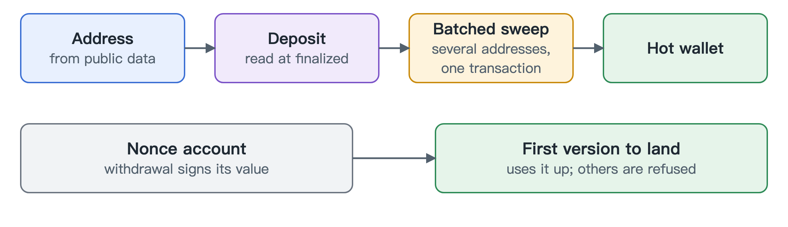

# Solana

[中文](zh/solana.md)

Solana works differently in three ways: an account must hold a minimum balance to exist, tokens live in separate token accounts, and a transaction's recent-block reference expires within a minute.

## Addresses and deposits
Customer addresses derive offline from a public node of a two-party Ed25519 key tree; hot wallets are two-of-three keys. A token balance sits in the address's own token account, the only one the books credit; tokens sent elsewhere raise a Reconcile alert. A payment below the minimum balance to a new address fails on the chain. The scan reads only finalized data, since a confirmed transaction can still be dropped with its fork. If the deposit key is replaced, a customer gets one address per key and the old ones stay watched ([Key replacement](key-replacement.md)).

## Withdrawals sign a durable nonce
A recent-block reference would expire before the signers finish. So a withdrawal signs the value of a nonce account instead; whichever version lands first uses it up, and the network refuses every other version. The signing zone reads the whole message and accepts only a few approved shapes.

| Situation | Result |
|---|---|
| Not landed | The same transaction is sent again, later with a higher priority fee |
| Landed and failed | The fee is booked and the hold released |
| The nonce moved without us | The withdrawal is parked with an alert |
| Cancelled | A message that only advances the nonce takes its place |

## Nonce accounts can be given back
Each nonce account holds rent. An operator retires one so nothing new uses it, then closes it when idle: the hot wallet takes the whole balance back, signed by the zone under an approval. The zone accepts only this shape, for an account of the wallet's own pool, paid to the wallet itself. The cold address's accounts close the same way, in an offline ceremony.

## Sweeps take several addresses at once
A sweep moves several deposit addresses into the hot wallet in one transaction, always leaving one nonce account for withdrawals. An empty token account is closed after a while and its rent returns to the hot wallet. Deposit keys need parties A and B, so sweeps wait if either is down.

## The deposit key can be replaced
The key that derives customer deposit addresses can be replaced by a second one that the two parties make and operators activate with signed records. New customers get addresses of the new key. Old addresses stay watched and swept for a stated period, signed with the old key, into the same hot wallet. The hot wallet itself is replaced separately. After the period, and once nothing is left on the old addresses, the old key is retired.
