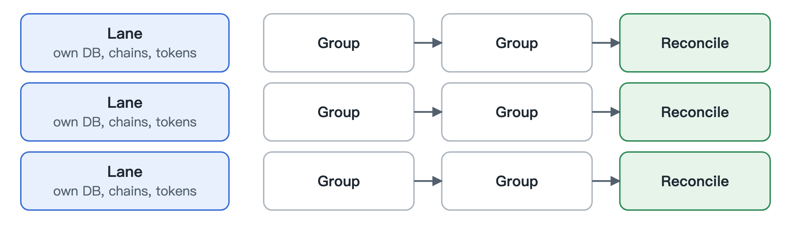

# Testing

[中文](zh/testing.md)

The tests try to break the system on purpose: they kill workers, attack the signing side and compare the books with the chain at the end. Everything runs on a laptop, on local chains.

## One command runs every CI group
The groups CI runs are spread over several lanes that run at the same time. A lane has its own Postgres, chains and SoftHSM tokens, because the tests mine blocks, reorganise chains and restart nodes. Each group writes its own log.

## A crash at every step
A worker is killed at each named step of each flow, then restarted. The payment must settle once, with no second nonce and no second send. Light crash tests run on every pull request; the heavy ones, which also kill the gateway, a party or the cosigner, cut the network and add latency, run nightly.

## Attacks on the signing side
The tests act as a compromised gateway, party or business database. They forge jobs, replay approvals under a new nonce, swap the destination, and send bad data from a party. Each must be refused, and the bad-data case must freeze the key.

## What is simulated

| Simulated | Real |
|---|---|
| HSMs are SoftHSM | The key sealing, per-party tokens and PIN handling |
| Chains are local nodes | The transactions, the signing and the books |
| M-of-N approval is software | The offline signer's checks |
| All parties run on one machine | The protocols and the trust zones |

Every test ends with a Reconcile, which must be clean. What this does not show is on the [Limits](limits.md) page.
