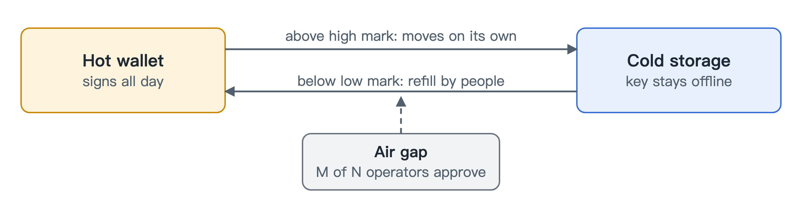

# Hot and cold

[中文](zh/tiers.md)

A hot wallet signs all day, so it holds only what the day needs. The rest sits in cold storage, whose key lives offline. Think of a shop's till and its safe.

## Bands decide when to move
Each hot wallet has a low mark, a high mark and a target.

| Hot balance | What the system does |
|---|---|
| Above the high mark | Moves the excess down to the target, into cold |
| Between the marks | Nothing |
| Below the low mark | Raises one alert and opens a refill request |

## Hot to cold needs no approval
The cold address is written into the signing zone's own config, which the business side cannot change. A move can only send coins somewhere safer, so no human has to approve it, and a hijacked core still cannot send "cold" money elsewhere.

## Cold to hot needs people
A refill makes coins more exposed, so it goes through a ceremony.
1. The core opens a refill request. Only one stays open per cold address.
2. An operator exports it as a file, with the current nonce and fees.
3. The file is carried across an air gap to the offline signer.
4. M of N operators approve, and the HSM signs. The offline config alone decides what may be signed.
5. The signed file comes back, is checked against the request, and is broadcast.

The online side is not trusted. The M-of-N rule is simulated in software. See the [refill runbook](runbooks/cold-refill.md); after a stolen hot key, see [that runbook](runbooks/stolen-hot-key.md).

## Hot shards are kept level
Sweeps land on one shard, so the others run dry. A rebalance moves coins from the fullest shard to one below its target, with no approval, and only to another shard of the same pool. Bitcoin keeps one shard per pool, so it has no rebalance.
