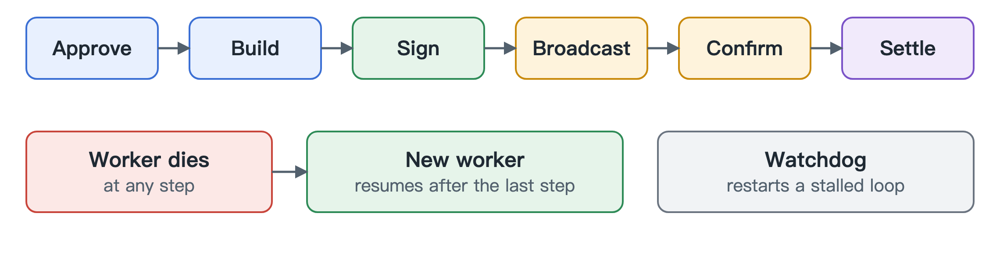

# Workflows

[中文](zh/workflows.md)

A deposit, a sweep or a withdrawal is a long job with many steps, and a machine can die in the middle of any one. Workflows work like a bookmark in a long form: a new worker opens the form at the bookmark and carries on.

## One workflow per payment

Each withdrawal, sweep and move to cold has its own workflow, run by Temporal. Every finished step is recorded. When a worker dies, another one replays the record and skips what is done. Starting the same workflow twice does nothing, so restarting is always safe.

## Every step is safe to repeat

A repeated step must do the same thing, not a second thing. The job keeps its ID and nonce, and the chain is asked what already happened before anything is sent.

| Crash | What happens on restart |
|:---|:---|
| After the transaction is built, before it is signed | The build is skipped; the same nonce is used |
| After the broadcast | The transaction is found on the chain, not sent twice |
| After the confirmation, before the books are updated | The books are updated once |

## The outbox: events leave only with the change

Every change that other systems should hear about writes an event in the same database transaction. A relay then sends the events to Kafka at least once, so a crash can only delay an event. Published rows are removed after a retention period; the audit trail keeps the record.

## The watchdog restarts loops that stall

Some jobs never end: scanning the chains, planning sweeps and moves to cold. If one stops making progress, the watchdog raises an alert, ends it and starts it again. Draining an old key is one more such loop. A worker that is told to stop first finishes or hands over its current step.

A small deposit is not swept while the fee of the sweep is more than a twentieth of its value. The planner looks at it again every round and sweeps it when the fee falls; the reconcile view says that it is waiting and why ([runbook](runbooks/unswept-deposits.md)).
