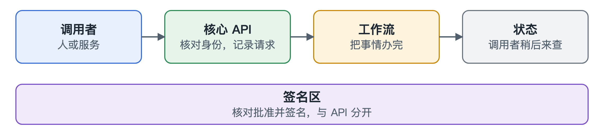

# 核心 API

[English](../api.md)

核心 API 是进入 QuorumVault 的唯一入口。人和服务向它提出请求：开立客户、获取充值地址、发起或批准提现。它核对请求者是谁，记录请求，再把工作交出去。它不持有密钥，也不签名。

## 可以向它请求什么

| 方面 | 请求 |
|:---|:---|
| 客户 | 开立客户、获取充值地址、查询余额 |
| 提现 | 发起、批准或拒绝、查询状态 |
| 冷钱包 | 导出和导入补充文件，登记冷钱包的资金变动 |
| 密钥 | 登记、启用、清空或退役某一代密钥 |
| 检查 | 运行对账（Reconcile），校验审计记录 |

## 它对每个请求做什么

1. 核对调用者的令牌和角色（[身份](identity.md)、[人员](people.md)）。
2. 在任何改动之前，先记录是谁发起的；记录写不进去，就什么都不做。
3. 同一个请求重复发来时，返回第一次的结果，所以重试是安全的。
4. 启动一个[工作流](workflows.md)并立即应答；调用者稍后再查询状态。

发到这里的批准只是被转交：[签名区](signing-zone.md)会自己核对。
