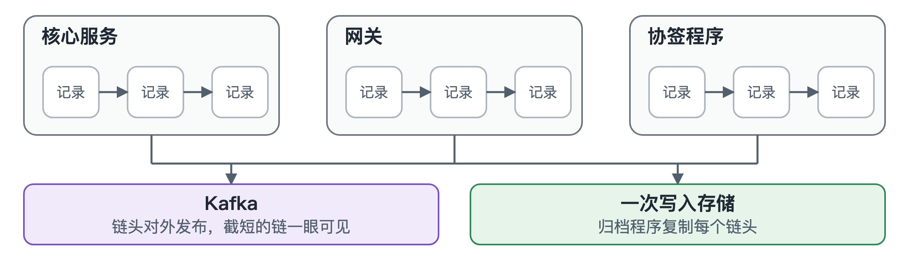

# 审计记录

[English](../audit.md)

审计记录会把每个决定都记下来，事后没法悄悄改。每一行都带着上一行的指纹，就像每页盖着上一页印章的编号账本：撕掉一页，印章就对不上。

## 每个信任区一条链
核心服务、网关和 cosigner 各自在自己的数据库里维护一条链。数据库规则会拒绝修改、删除和清空。网关和 cosigner 把每个决定和决定本身写进同一个事务：记录写不进去，就什么都不签。核心服务宕机时，它们的链照常运行。

## 链头对外发布
每条链只要有变化，并且每隔一段时间，就把链头（条数和最后一个指纹）发到 Kafka。有人关掉数据库规则，把链截短后，链本身仍然成立，但缺了已经发布过的那一条。Kafka 宕机时，签名照常，链头事后补发。

只靠 Kafka 留不住记录：主题会过期，管理 broker 的人也能删掉或压缩主题。所以信任区之外还有一个小的归档程序，把每个链头也复制进“一次写入”存储，每个链头一个对象，并且只在对象存好之后才把这个链头标为已处理。到保留期结束之前（默认七年），存储会拒绝删除、覆盖对象，也拒绝缩短保留期，存储自己的管理员也不例外。归档程序遇到不做这个承诺的存储桶会拒绝启动。它能证明链头存在过、归档之后没被改动，不能证明链本身是完整的。

## 校验就是拿链和链头比对

| 做了什么 | 校验发现 |
|---|---|
| 改了某一行 | 它的指纹对不上 |
| 删了中间某一行 | 链断开 |
| 截掉了末尾 | 已发布的链头不在链里 |
| 整条链被改写 | 链头和已发布的不同 |
| Kafka 主题被删除 | 校验改从一次写入的副本读取链头 |

核心服务、网关和 cosigner 各自带有校验命令，把链和已发布的链头比对，链头可以来自主题的导出文件、一次写入的副本，或两者。副本的搭建和运维见[运维手册](../runbooks/audit-archive.md)，为什么选这个存储、它的合规说法有多大分量见[调研笔记](../spikes/audit-worm.md)。
