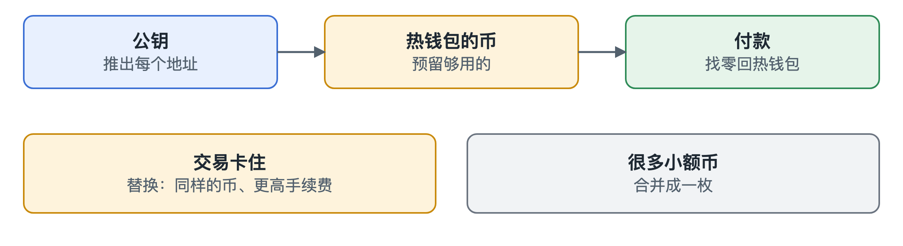

# 让 Bitcoin 交易上链

[English](../bitcoin-sending.md)

手续费上涨时，Bitcoin 交易可能久久不确认。系统为加价留好余量，能替换或取消一笔交易，也能一笔交易付给多个提现。

## 每笔交易都留着加价的余量
每笔交易的找零里都留足一笔钱，能把手续费一路加到上限，所以卡住的提现永远可以用它自己的币加价。热钱包付完款凑不出这笔预留时，提现就等待，报警里写明补多少就能放行。签名区检查同一件事。核心服务和签名区的手续费上限必须相等，否则签名区拒签并报警说明（[运维手册](../runbooks/btc-fee-caps.md)）。

## 交易卡住或失败时

| 情况 | 结果 |
|---|---|
| 卡住 | 用花同样几枚币、手续费更高的交易替换，多出的手续费从找零里出 |
| 替换次数用完或超出上限，仍不确认（已开启子交易） | 用一笔子交易把找零花回热钱包，并一起付两笔的手续费 |
| 一个 input 签了，另一个被拒 | 取消：把同样的币花回热钱包 |
| 币被别的交易花掉 | 提现挂起并报警 |

节点嫌手续费太低而拒绝替换或取消时，下一笔会比之前所有尝试付得更多，重启后也一样。两者都以手续费上限为界，到上限只报警一次；不会因为上限而作废提现（[运维手册](../runbooks/btc-stuck.md)）。

## 子交易可以把卡住的交易拉上链
子交易把卡住那笔的找零花回同一个热钱包，并付足够高的手续费，让这一对值得被打包。它默认关闭，替换次数用完后才启动，单笔提现和整个批都适用。

- **不越过上限。** 这一对合起来付的手续费，不能超过同样大小的一笔交易所允许的，所以已经付到费率上限的交易没有子交易。
- **不需要审批，**因为它只能让钱留在原处。签名区只签没有付款、把自己签过的交易的找零花回同一个热钱包的子交易。
- **一笔交易一个子交易。** 有了子交易，原交易就不再被替换；取消仍然可以，但必须比两笔加起来付得更多。
- **和原交易一起入账。** 它的手续费算作那笔提现或批的成本。

## 批量提现：一笔交易付给多个提现
批量默认关闭。打开后，已批准的提现按批准时间从早到晚排队，一笔交易付给其中许多个，输入和找零只付一次。队首最老的提现等够了时间，或排队数量够了，就封批。一批取队首起、已确认的币养得起的最长一段，不会跳过任何人。

批准仍然是一个提现一份：签名区只在每笔付款都恰好是一个已批准的提现、顺序一致、并且没超过签名区自己的限额时才签。

| 情况 | 结果 |
|---|---|
| 取消队列里的一个提现 | 它离开队列，冻结的额度释放 |
| 取消一个还没人签的批里的提现 | 整批作废，其余提现按原顺序回到队列 |
| 取消一个已签批里的提现 | 拒绝；只能取消整批，之后这些提现重新排队，只付一次 |
| 批卡住 | 整批替换，不超过手续费上限 |
| 某个提现没通过目的地检查 | 从批里移出，挂起并报警 |

每个提现记账一次，带上自己那份手续费。链上能看出这批收款人是一起被付的，能接受这一点再打开批量（[运维手册](../runbooks/btc-batch.md)）。
