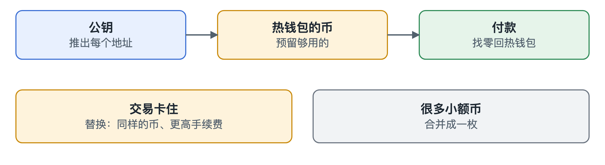

# Bitcoin

[English](../bitcoin.md)

Bitcoin 没有余额，只有一枚枚币（UTXO）。付款像递出整张钞票再收回找零：每笔交易都要点名花掉哪几枚币。交易怎么才能上链，见[单独的一页](bitcoin-sending.md)。

## 地址由公钥推出
核心服务持有账户的扩展公钥（xpub），自动推出每个客户的地址，不用问签名方。测试证明这个地址和各方推出的密钥一致。存款要等足够的确认数才入账；链重组得比这更深时，扫描会停下并报警，已入账的保留，由运维决定。如果账户密钥被更换，客户每把密钥有一个地址，旧地址继续被监控（见[密钥更换](key-replacement.md)）。

## 提现花掉选定的币
核心服务从热钱包挑几枚币，付给客户，找零回到热钱包。币不够时，提现等找零回来。每个 input 用各自推出的密钥签名，签名区自己重算每个 input 的摘要，这就挡住了在被低估的手续费下收集签名的攻击。

## 合并把小币并成大币
钱包被很多小额付款充值后，总额够用，却没有哪笔交易能装下这么多币。合并会提前把小币并成一枚，期间提现照常进行。每个分区只有一个热钱包分片，所以没有再平衡。

## 不支持 Taproot
签名库不支持密钥调整（tweak），也不支持存款地址需要的派生 Schnorr 密钥；冷钱包签名机也没有对应的机制。调研发现，对提现来说收益很小。

## 密钥可以更换，旧地址继续有效
存款地址和热钱包出自同一个账户密钥，所以更换密钥会同时换掉两者。两个参与方生成第二把密钥，运维人员用签名记录启用它。新客户拿到新密钥的地址；旧密钥按约定的期限保留，旧地址仍被监控，打到旧地址的币会被归集到新的热钱包。旧热钱包的币按合并的方式搬到新热钱包。签名区每一步都按自己的记录判断，所以说谎的业务侧也无法把钱转到运维人员没有签字的密钥上。期限过后、旧地址上不再有币，旧密钥才会被退役。
