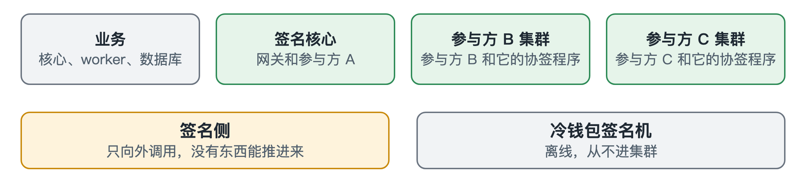

# 部署

[English](../deployment.md)

QuorumVault 计划在四个互相独立的集群里运行，每个集群对应一组"不允许互相接管"的人。本页说明什么跑在哪里、为什么这样分，以及测试和生产里哪些是一样的。

## 每个信任域一个集群

| 集群 | 运行什么 | 为什么要分开 |
|---|---|---|
| 业务 | 核心 API、worker、账本数据库、Kafka、Temporal、审批页面 | 不放任何密钥材料 |
| 签名核心 | 网关和参与方 A | 网关本来就不被信任，所以可以和参与方 A 共用一个集群 |
| 参与方 B | 参与方 B 和它自己的检查程序 | 这个集群的一位管理员，不该同时掌握 B 和那个读每个任务的检查程序 |
| 参与方 C | 参与方 C 和它自己的检查程序 | 同上，针对 C |

任意两方就能签名，所以两个参与方绝不能共用一位管理员。把它们放进一个集群，就等于把密钥交给了那位管理员。冷签名机是一台离线的机器，从不在集群里运行（[冷热钱包](tiers.md)）。

参与方在飞地里运行时，每个参与方还有自己的密钥代理。它放在该参与方的管理员和业务侧都管不到的地方，只释放这一个参与方的密钥，所以一个代理出事只损失一方，而不是两方（见[飞地](enclaves.md)）。

## 签名一侧只向外调用
没有任何东西可以从外面推进签名集群。它们自己去取任务、发布审计链头，并通过参与方之间的连接互相通信；外部也不来抓取它们的指标。这样[签名区](signing-zone.md)的规则在集群上依然成立：业务侧只能提出请求。

## 每个进程怎样保持安全
- **证书。** 每个服务都有带名字的证书，每个端点各有自己接受的名字清单（[身份](identity.md)）。参与方之间的连接使用固定的密钥。
- **数据库。** 每个服务有自己的数据库角色，只有它用得到的权限；签名区的数据库和业务数据库是分开的。
- **数据库结构变更**在新版本启动前作为单独一步执行，并且与旧版本兼容。
- **机密**在运行时以文件形式提供，不会出现在镜像、chart 或日志里。
- **状态。** 一个参与方只有一份实例和一个数据卷；旁边绝不能再跑第二份，滚动更新也不行。无状态的服务可以运行多份。
- **健康检查和停止。** 每个服务都能回答健康检查；收到停止指令的 worker 会做完或交接手里的工作。

## 每个进程一个镜像
每个进程各打成一个镜像，用摘要固定，每个区另有一套工具镜像。业务侧、签名核心、每个参与方和证书的 chart 都有自动检查。第一次发布还没有做。

## 测试和生产里，哪些相同、哪些只是模拟

| 与生产相同 | 测试里不同 |
|---|---|
| 代码、各项检查、镜像的内容 | HSM 是软件的，而且在开发和测试之外代码会拒绝它 |
| chart 和它们的规则 | 证书由脚本生成，不是证书管理器签发 |
| 信任域，以及它们之间的连接 | 链是本地的；所有参与方跑在一台机器上 |

还没有真实的集群运行过这些 chart。本页的形态是一个设计，由测试检查过，还不是一个装着真实资金的运行系统。
