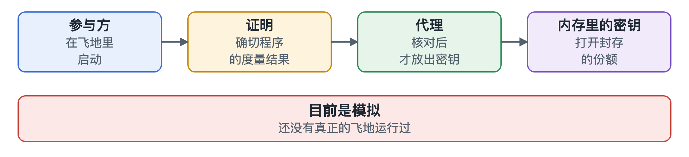

# 飞地

[English](../enclaves.md)

飞地（enclave）是机器里一间上了锁的房间：连机器的主人也看不进去，而且这间房能证明里面运行的是哪个程序。QuorumVault 计划把每个参与方都放进一间飞地，这样即使管理员拥有宿主机的全部权限，也读不到份额。目前它只在模拟环境里运行。

## 飞地多带来什么

现在，每个参与方的份额用它自己 HSM 令牌里的密钥封存，而这台宿主机由它的管理员控制。飞地再进一步：打开份额的密钥，只会交给确切批准过的那个程序。管理员换掉代码，或从外面读内存，都什么也拿不到（见 [MPC 签名](mpc.md)）。

## 只有出示证明才放出密钥

1. 参与方启动，向密钥代理（broker）要它的密钥。
2. 密钥代理回一个新的挑战。
3. 参与方回复一份证明（attestation），说明它运行的是哪个程序，并绑定自己的连接。
4. 密钥代理把证明和一份由多位运营人员签名的清单对照。只有吻合才放出密钥，并且先写下记录。

密钥只存在于内存里。密钥代理不可用时，正在运行的参与方可以继续签名；但重启的参与方，在密钥代理恢复之前打不开自己的份额。把某个程序从清单里去掉，只会阻止新的启动，不会影响已经在运行的参与方。

## 哪些是模拟的

密钥代理、它的各项检查、封存的份额、启动门槛，以及用真实参与方进程做的测试，都是真实的代码。飞地和它的证明则不是：由一个替身去度量程序文件和它的设置。还没有任何厂商硬件产生过证明，所以没有人证明过真实硬件度量的结果和替身一样（见[局限](limits.md)）。
