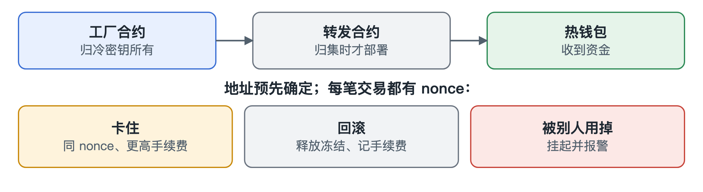

# EVM

[English](../evm.md)

在 EVM 链（以太坊及其同类）上，客户的充值地址可以在链上还什么都没有的时候就算出来。就像预订一个信箱编号：真有包裹要取的时候，才去建这个信箱。

## 充值地址是还没部署的合约

每个地址对应一个很小的转发合约。它的地址由工厂合约和客户信息离线算出，不需要密钥，也不需要节点。原生币在合约部署之前就能到账。代币转账不会通知合约，所以归集是一笔真实的交易，由热钱包支付手续费。

## 工厂合约决定充值流向哪里

每个转发合约都向工厂合约询问目的地。工厂合约归冷钱包的密钥所有，所以热钱包密钥被盗，也改不了充值的流向。运营密钥只能暂停归集，只有冷钱包密钥能解除暂停或更改目的地。签名区的配置随后也要跟着改，改好之前所有归集都会被拒绝，这正是设计目的。热钱包密钥可以更换，而充值地址一个都不用变（见[密钥更换](key-replacement.md)）。

## 每笔交易都有 nonce

热钱包地址给自己的交易编号。编号在提现落库的同一个数据库事务里领取，所以不会跳号，也不会重复使用。

| 情况 | 结果 |
|:---|:---|
| 卡住 | 用同一个 nonce 换更高的手续费重发，有上限 |
| 回滚（reverted） | 解除冻结，记下手续费 |
| 取消 | 用同一个 nonce 发一笔空交易顶替 |
| nonce 被别的交易用掉 | 提现挂起并报警 |

卡住的提现不会被作废，因为旧交易仍有可能被打包。
