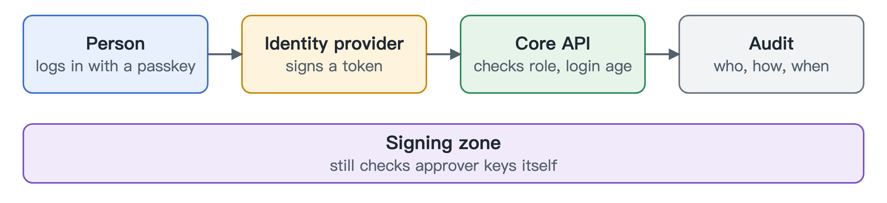

# 身份

[English](../identity.md)

核心 API 的每个调用者，都要出示 OpenID Connect 身份提供方签发的令牌来证明自己是谁。验证过的身份就是处处使用的操作人：双人审批的检查和审计记录都用它。

## 谁能进来
核心只接受这样的令牌：提供方公布的密钥能验证它，签发方、受众和时间都对。开发环境用 Keycloak；生产环境用客户自己的提供方，并配上它的组到核心角色的对应。

| 角色 | 可以做 |
|---|---|
| 发起人 | 建客户、充值地址和提现 |
| 审批人 | 批准或驳回提现 |
| 运维 | 补充申请、冷钱包仪式、批次和对账 |
| 管理员 | 更改工厂合约的行为 |

角色互不包含：发起提现的人不会同时批准它。每次写入都先记下是谁做的；这一行写不进去，就什么都不会改。

## 大动作要新鲜的登录
批准提现、给冷钱包记账、关闭卡住的补充申请、更改工厂，都要求登录又新又强。登录较旧的人会被要求重新登录。会话有总时长限制，由核心检查；空闲时间由身份提供方强制，因为只有它看得到人的活动。

## 服务
调用核心的工作进程和脚本用自己的服务身份和 client-credentials 令牌，不用人的令牌。服务不受“新鲜登录”约束，因为没人为它登录；但它永远不能审批，也不能改工厂。

## 登录不等于批准付款
签名区不信任身份提供方：审批仍然是签名，由它对照自己配置里的密钥检查（见[签名区](signing-zone.md)）。提供方被攻破，最多能排队提现，批准不了。

## 只在开发中
一个直接写明操作人的请求头，和一个用本地密钥签令牌的测试签发方，只在开发和测试里可用，生产会拒绝。测试登录时不用通行密钥（见[局限](limits.md)）。
