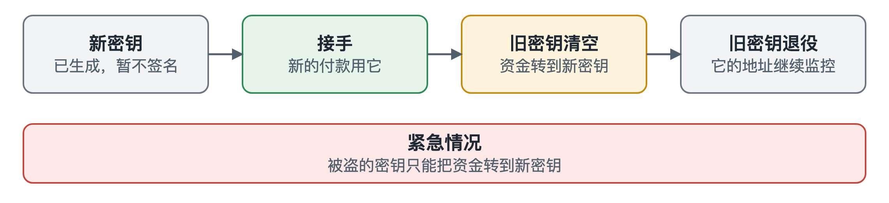

# 密钥更换

[English](../key-replacement.md)

一把可能被别人看到过的密钥，不能只做刷新，必须更换。QuorumVault 先在旧密钥旁边生成一把新的，切换过去，把旧密钥里的钱全部转进新密钥，再让旧密钥退役。就像给保险柜换锁，再把里面的东西搬过去。

## 刷新不等于更换
刷新给每个参与方换一套新份额，但密钥本身不变。它适用于有人看过一份份额、现在已经拿不到的情况。如果有人可能握有足够多的份额来签名，或者密钥本身泄露了，刷新就没有用，因为密钥没变。这时必须更换（见 [MPC 签名](mpc.md)）。

## 每把密钥有代数和状态
每个持有密钥的位置，例如一个热钱包分片，都给密钥编号：第 1 代、第 2 代，依此类推。[签名区](signing-zone.md)根据状态决定一把密钥能做什么。

| 状态 | 签名区能用它签什么 |
|---|---|
| 新建 | 什么都不签 |
| 使用中 | 正常付款 |
| 清空中 | 只能把全部资金转给后继密钥，以及完成已经签过的工作 |
| 已退役 | 什么都不签 |
| 已失陷 | 只能转给后继密钥 |

只有运营人员能改变状态。每次变更要多人签名，签名区把它记进自己的日志，业务侧无法发起。

## 计划更换和紧急更换

| | 计划更换 | 紧急更换 |
|---|---|---|
| 何时 | 密钥到了计划的使用期限，或人员变动 | 密钥可能被盗 |
| 新密钥 | 从容生成并检查，旧密钥继续工作 | 尽快生成 |
| 切换 | 新的付款改用新密钥，同时开始清空旧密钥 | 旧密钥立刻标为失陷，此后只能把资金转出 |
| 旧密钥 | 清空后退役 | 永不退役，一直留在监控名单上 |

紧急情况下，窃贼手里那份密钥不受影响，所以标记失陷之前的时间就是损失窗口。一条签名记录完成整个切换：旧密钥不再签普通交易，只能把资金转给后继密钥，同一条记录带着这次转移的较大限额，核心服务也不再用它付款。一个工具按顺序执行这些步骤，并先转最值钱的资产。窃贼在转移到账之前转走的钱无法挽回；[热钱包密钥被盗手册](../runbooks/stolen-hot-key.md)对此有明确说明并列出步骤，演练会完整走一遍。

## 旧密钥由系统清空
核心服务把每种代币、最后是主币，从旧密钥转到新密钥。不需要审批人：启动清空的那几位运营人员的签名就是批准。签名区只签转给指定后继密钥的转账，金额不超过运营人员在同一条记录里设的总额，而且只统计它真正签过的转账。被拒绝的转账不占额度，所以出故障的计划程序也耗不掉额度。一个工具走完整个更换流程，但它自己不签名（[运维手册](../runbooks/key-replacement.md)）。

## 冷钱包密钥走自己的仪式
冷钱包的资金不经过热钱包。旧冷钱包密钥在离线环境里由 N 位保管人中的 M 位签名，把所有资产转到新的冷钱包地址，而这个地址只由离线机自己的配置指定。新地址先在签名区固定下来，之后的热转冷就直接送过去；旧地址继续被监控和对账，直到清空并过了观察期，才销毁旧密钥（见[运行手册](../runbooks/cold-key-replacement.md)）。

## 客户会看到什么
EVM 链上什么都不会变：充值地址是一个转发合约，它向工厂合约询问转到哪里，所以地址不变。Bitcoin 和 Solana 的充值地址由密钥本身推出，换密钥就意味着换地址。客户于是每一代有一个地址。新密钥接手后，旧地址还会被监控一段约定的时间，落在旧地址上的钱，会用旧密钥签名，归集到新的热钱包。这段时间之内，签名区拒绝让旧密钥退役；旧地址上还有钱时，核心服务也拒绝（见 [Bitcoin](bitcoin.md)、[Solana](solana.md)）。Bitcoin 的热钱包用的是同一把密钥，所以按同样的办法更换和清空。

Solana 的热钱包用同样的办法更换，只有两点不同。旧密钥还拥有一小池 nonce 账户，所以清空时也要把它们取走，而新密钥得先有自己的一池才能付款；最后一步把旧地址清到恰好为零。紧急情况下，Solana 的清空不等新密钥建好 nonce 池（清空之后再由运维建），并且先转 SOL，再取走旧池的账户；每一步都算一次转移，所以 `max_drains_per_source` 在 Solana 上的默认值是 40 加池的大小再加代币个数，而不是 40。
