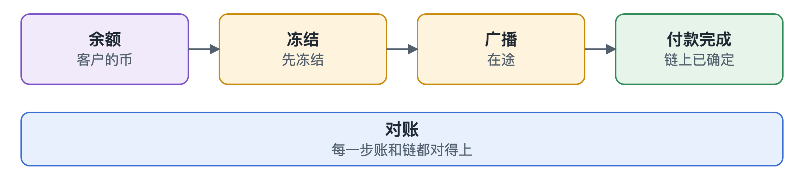

# 账本

[English](../ledger.md)

账本记录每一枚币在哪里：在客户的充值地址、热钱包、冷钱包里，或者正在它们之间转移。它就像一本要对着银行流水核对的支票簿，只不过核对从不停歇。

## 每笔变动都记两次

每条记录都从一个账户转出一笔金额，同时转入另一个账户，所以账面总和永远为零（复式记账）。金额用链上最小单位的整数记录（wei、聪、lamport），不会因四舍五入而丢钱。记录只增不改。

## 先冻结，再转出

客户申请提现时，先把这笔钱冻结，两笔申请就不会花掉同一份余额。付款上链后，冻结转为付款；付款失败，冻结就解除。

## 对账：把账本和链逐项比对

对账（Reconcile）从链上读出系统名下每个地址的余额，和账本逐项比对，精确到最小单位。在途的钱，根据链上对每笔交易的记录来解释，所以每一步都对得上，而不只是在没有交易的时候。密钥更换之后，新旧两把密钥的地址加在一起，再和唯一的那个账户比对，所以在它们之间转移资金，不会改变任何结果。比对以充值扫描已经到达的高度为准：扫描落后几个区块只是一种状态，不算差异；只有扫描卡住或落后太多才会报警。

## 结果不明确时对账怎么说

| 情况 | 对账的结论 |
|:---|:---|
| 账和链一致 | 干净 |
| 对不上 | 报警，写明地址、币种和两边的金额 |
| 还读不到链上已确定的状态 | 不算干净，并说明原因，绝不猜测 |
