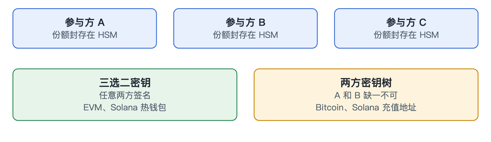

# MPC 签名

[English](../mpc.md)

这里没有哪台机器持有完整的密钥。每把密钥被切成份额，分给不同的参与方，签名由几方一起完成。就像金库门要几个人同时转钥匙，每人手里只有一小块，谁也复制不出整把。

## 两种密钥
| 类型 | 谁来签 | 用在哪里 |
|---|---|---|
| 两方密钥树 | A 和 B，缺一不可 | Bitcoin，以及 Solana 存款地址 |
| 三选二密钥 | A、B、C 任意两方 | EVM 和 Solana 热钱包 |

给每个客户一个地址，需要密钥树：从一把父密钥出发，只用公开数据就能推出每个客户的子密钥。两方密钥能做到，三选二密钥做不到，所以后者只用于热钱包。

## 某一方宕机时
| 宕机的是 | 影响 |
|---|---|
| 三选二密钥里的 A、B、C 之一 | 换另外两方签，没人察觉 |
| 两方密钥里的 A 或 B | 签名等待，任务重试，报一次警 |
| 只有 C | 两方密钥上的一切照常 |

重启后的参与方要先和其他方核对，才能签名。A 宕机时，B 和 C 互相核对，但前提是两者在同一个版本、没有做到一半的刷新，因为只有 A 知道某次刷新是否已经决定提交。否则它们等 A；A 回来后再和另外两方一起核对。

## 核对失败就冻结密钥
如果某个证明没通过、某条消息读不出来，或者最终签名不对，说明对方可能有问题。这把密钥会在所有持有它的参与方上冻结。不会删除任何东西，提现带着冻结的金额等待，只有运维签名的解冻才能恢复。只是网络慢或某一方离线，不算冻结。见[冻结运维手册](../runbooks/mpc-keyset-freeze.md)。

## 份额要封存、备份和刷新
每个份额都用一把密钥加密，这把密钥始终留在该参与方自己的 HSM 令牌里，所以硬盘被偷也拿不到东西。刷新（refresh）会给所有参与方换上新份额，公钥不变；中途崩溃也只会收敛到一个可用的版本。丢失的参与方按备份重建（[运维手册](../runbooks/mpc-backup-restore.md)）。
