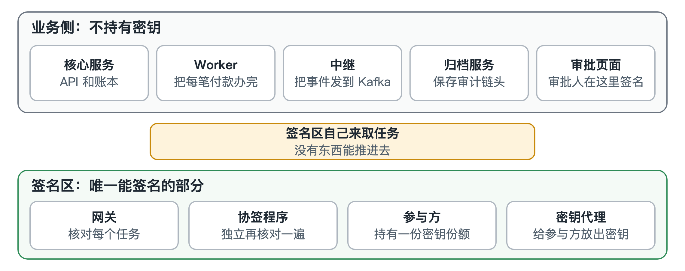

# 服务

[English](../services.md)

QuorumVault 由九个小服务组成，分成两组。业务侧接收请求、记账，不持有密钥。签名区核对每一笔付款，是唯一能签名的部分。这一页说明每个服务做什么，以及它被托付了什么。

## 业务侧负责接收请求和记录

| 服务 | 做什么 | 持有什么 |
|:---|:---|:---|
| 核心服务 | 唯一入口：核对请求者、记录请求、维护账本（[核心 API](api.md)、[账本](ledger.md)） | 业务数据库。没有密钥 |
| Worker | 把每笔充值、归集和提现办完，崩溃后接着办（[工作流](workflows.md)） | 一把只能批准最小额付款的密钥 |
| 中继 | 把数据库里的事件转发到 Kafka，保证两边之间不丢 | 什么都没有 |
| 归档服务 | 把每个已发布的审计链头复制进一次写入存储（[审计记录](audit.md)） | 只能访问归档存储 |
| 审批页面 | 审批人在这个网页上查看付款，并用通行密钥签名（[人员](people.md)） | 什么都没有：它只提供页面 |

## 签名区负责核对和签名

| 服务 | 做什么 | 持有什么 |
|:---|:---|:---|
| 网关 | 取来每个任务，按批准和签名区的规则核对，再请参与方签名（[签名区](signing-zone.md)） | 自己的规则和审计链。没有密钥份额 |
| 协签程序 | 参与方 B 和 C 各配一个。它独立地把同一个任务再核对一遍，它同意，它的参与方才签名 | 自己的规则和审计链 |
| 参与方 | 持有每把密钥的一份份额，和另一个参与方一起签名（[MPC 签名](mpc.md)）。共三个：A、B、C | 一份封存的密钥份额 |
| 密钥代理 | 参与方证明自己运行的是哪个程序之后，把打开封存份额的密钥交给它（[飞地](enclaves.md)）。目前是模拟 | 打开份额的密钥 |

## 为什么拆成这么多块

- **攻下一个服务不够。** 持有密钥的服务从不单独做决定，做决定的服务不持有密钥。攻击者需要拿下两个参与方和它们的协签程序。
- **每一块可以单独出故障。** Worker 挂了会被替换，付款接着走。业务侧停机时，签名区照样保留自己的记录。
- **每一块有自己的身份。** 每个服务有自己的证书和自己的数据库角色，只有它用得到的权限（[身份](identity.md)）。

## 它们运行在什么之上

这些服务共用几个不是 QuorumVault 自己写的标准部件：PostgreSQL 存放账本和每个区的记录，Kafka 传递事件和审计链头，Temporal 运行工作流，身份提供方负责登录，HSM 保管封存各参与方份额的密钥。哪个服务运行在哪个集群，见[部署](deployment.md)页。

运营人员还有一些命令行工具，用于手工完成的任务，例如密钥仪式或签名的设置变更。它们只在需要时运行，不算服务。
