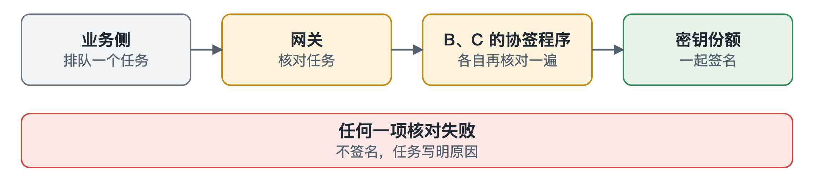

# 签名区

[English](../signing-zone.md)

签名区是 QuorumVault 里唯一能动用资金的部分。它像银行柜员：付款单哪怕来自经理办公室，柜员也要核对签字和金额，确认无误才付款。

## 业务侧只能提出申请

核心服务写入一个签名任务，包含三样内容：审批人同意的事项（付给谁、哪种币、多少）、要签的交易，以及审批人的签名。任务由签名区主动去取，外部无法推送。

## 签名前逐项核对

1. 有足够多不同的人批准，且发起人不在其中。发起人的名字包含在审批人所签的内容里，所以这一项由签名区自己核对。
2. 把交易解析回来，它做的事和审批内容完全一致，没有多余操作。
3. 收款地址符合签名区自己的规则。
4. 同一个任务从未用不同的内容签过名。

没有人发起的任务（如归集和转冷钱包）不带发起人，按签名区自己的规则处理。旧格式的审批不再有效（见[运维手册](../runbooks/intent-v2-upgrade.md)，英文）。

## 审批只认签名区认识的密钥

审批人可以用软件密钥，也可以用通行密钥（WebAuthn）。签名区自己验证通行密钥的响应：确认它针对的正是这一个任务，所用密钥在签名区自己的配置里，且本人在场（见[运维手册](../runbooks/webauthn-approver.md)，英文）。一个人有几把密钥，也只算一次。登录是另一回事，见[身份](identity.md)。

审批人名单不只是一份配置文件。新增、停用或撤销审批人，要由多位签名区管理员签名，他们用的密钥和审批人不是同一套。每次变更都会审计，并写进网关和每个协签程序各自保存的日志，下一次决定就生效，无需重启（见[运维手册](../runbooks/approvers.md)，英文）。

每把热钱包密钥还有一个状态（新建、使用中、清空中、已退役）。签名区只从签名区管理员签署的记录里得知状态，业务侧无法改动。状态决定这把密钥能签什么：正在更换的密钥只能把资金转给它的后继密钥，启动这次转移的管理员签名，就是对它的批准（见[密钥更换](key-replacement.md)）。被标记为失陷的密钥还可以取消它自己尚未完成的付款，这样在标记前后被拒绝的付款就不会挡住资金的转移。

## AgentGate 批准的付款

有些热钱包只付 AgentGate 批准的款。这类钱包的每笔付款都要带一份短寿命的凭证，由 Gate 只为这一笔付款签发，审批人替代不了它。哪些钱包属于这一类、认哪些 Gate 密钥、单笔和每小时、每天能付出多少，是一项由多位签名区管理员签署的设置。网关和每个协签程序各自拿凭证和自己将要签的交易核对，记下它以保证只用一次，并计入限额（见 [Gate 授权凭证](gate-credential.md)，以及[运维手册](../runbooks/gate-setting.md)，英文）。

## 两个互不信任的协签程序

参与方 B 和 C 各有一个自己的协签程序：它独立读取每个任务，规则和记录也各自独立。即使有人控制了网关、参与方 A 或业务数据库，也拿不到没人批准的付款。

每个参与方和它的协签程序之间还要互相验证身份：只占着通信路径的进程冒充不了协签程序，别的参与方也无法向它发起询问。

## 出问题时签名区怎么做

| 情况 | 签名区的做法 |
|:---|:---|
| 某项核对不通过 | 不签名，任务注明原因 |
| 签名过程中某个参与方发来错误数据 | 在所有持有该密钥的参与方上锁定它，直到参与方管理员解锁 |
| 同一个任务又来一次 | 返回第一次的签名；内容变了就拒绝 |
