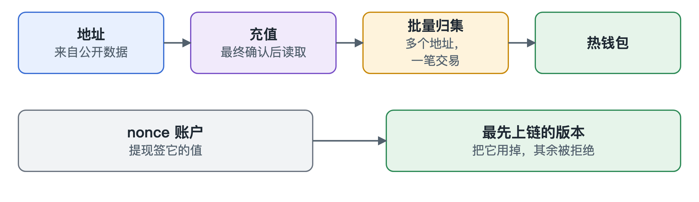

# Solana

[English](../solana.md)

Solana 和其他链有三处不同：账户要有最低余额才能存在，代币放在单独的代币账户里，交易引用的最近区块一分钟内就过期。

## 地址来自公开数据
客户地址由两方 Ed25519 密钥树，用公开的账户节点离线推出。热钱包是三选二密钥。

## 代币和租金
代币余额放在地址自己的代币账户里，账本只认这一个。转到别的账户的代币不入账，对账（Reconcile）会报警。向一个新地址付的钱，如果低于最低余额，会在链上失败，所以没有可入账的东西。

## 只认最终确认的付款
已确认的交易仍可能随分叉一起被丢弃。扫描只读最终确认（finalized）的数据，所以入账的都是撤不回的。

## 提现签的是 durable nonce
最近区块的引用在签名方签完之前就会过期。所以提现改为签一个 nonce 账户里的值：哪个版本先上链，就把这个值用掉，其他版本都会被网络拒绝。签名区会读取整条消息，只接受少数几种批准过的形态。

| 情况 | 结果 |
|---|---|
| 没上链 | 同一笔交易再发一次，之后用更高的优先费 |
| 上链但失败 | 记下手续费，释放冻结 |
| nonce 被我们之外的操作推进 | 提现挂起并报警 |
| 取消 | 用只推进 nonce 的消息顶替 |

## 归集一次处理多个地址
一笔归集交易把几个存款地址的钱一起转到热钱包，规划时总会给提现留一个 nonce 账户。空的代币账户过一段时间会被关闭，租金回到热钱包。存款密钥需要 A 和 B，所以任何一方宕机，归集就等着。
