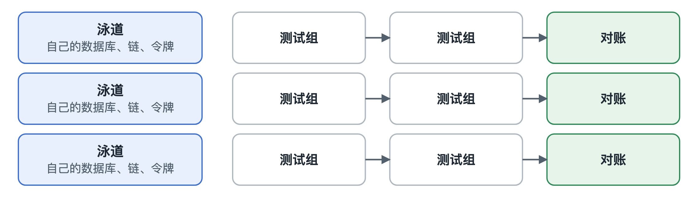

# 测试

[English](../testing.md)

测试专门想弄坏这个系统：杀掉 worker，攻击签名侧，最后把账本和链对一遍。一切都在笔记本电脑上、本地链上运行。

## 一条命令跑完 CI 的所有测试组
CI 跑的测试组被分到几条泳道里同时运行。每条泳道有自己的 Postgres、链和 SoftHSM 令牌，因为测试会挖块、让链重组、重启节点。每个测试组各写各的日志。

## 每一步都崩一次
每个流程的每个命名步骤都会杀一次 worker，再重启。付款必须只结算一次，没有第二个 nonce，也没有第二次发送。轻量的崩溃测试在每个 pull request 上跑；重量级的每晚跑，包括杀掉网关、某个参与方或 cosigner，断网和加延迟。

## 针对签名侧的攻击
测试会扮成被攻破的网关、参与方或业务数据库：伪造任务，换个新 nonce 重放审批，替换收款地址，让某个参与方发来坏数据。每一种都必须被拒绝，坏数据那种还必须冻结密钥。

## 哪些是模拟的

| 模拟的部分 | 真实的部分 |
|---|---|
| HSM 是 SoftHSM | 密钥封存、每方独立令牌和 PIN 的处理 |
| 链是本地节点 | 交易、签名和账本 |
| M-of-N 审批用软件实现 | 离线签名机的检查 |
| 所有参与方跑在一台机器上 | 协议和信任区 |

每个测试最后都要做一次对账，结果必须是干净的。这些测试没证明的东西，见[局限](limits.md)。
