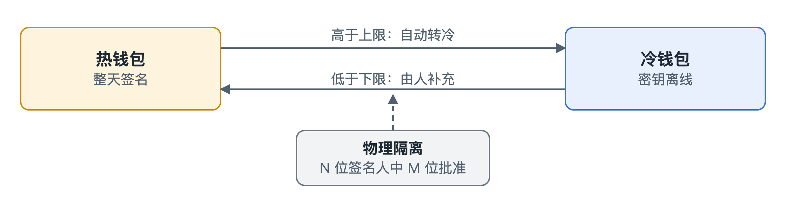

# 冷热钱包

[English](../tiers.md)

热钱包整天都在签名，所以只放当天够用的钱，其余放在冷钱包，冷钱包的密钥离线保管。就像店里的钱箱和保险柜。

## 上下限决定何时调拨

每个热钱包有下限、上限和目标三个数。

| 热钱包余额 | 系统的做法 |
|:---|:---|
| 高于上限 | 把超出的部分转入冷钱包，直到回到目标 |
| 介于上下限之间 | 不做任何事 |
| 低于下限 | 报警一次，并发起补充申请 |

## 热转冷不需要审批

冷钱包地址写在签名区自己的配置里，业务侧改不了。转冷只会把币送到更安全的地方，所以即使核心服务被劫持，也无法借"转冷"把钱转到别处。

## 热钱包可以更换密钥

热钱包换新密钥，账本不必另起一套：新的付款从新密钥发出，旧密钥把手里的全部资金转给新密钥，然后才退役（见[密钥更换](key-replacement.md)）。

## 冷转热要靠人

补充会让币面临更大风险，所以要走一套密钥仪式。

1. 核心服务发起补充申请。每个冷钱包地址同一时间只能有一个未完成的申请；Solana 上是每种资产一个。
2. 运营人员把申请导出成文件，文件里带着当前的 nonce 和手续费。
3. 把文件带过物理隔离（air gap），交给离线签名机。
4. N 位冷钱包签名人中有 M 位批准，HSM 才会签名。能签什么，只由离线机自己的配置决定。
5. 签好的文件带回来，与申请核对无误后广播。

在线一侧不被信任。M-of-N 规则目前用软件模拟。操作步骤见[补充运维手册](../runbooks/cold-refill.md)；热钱包密钥被盗时，见[被盗密钥运维手册](../runbooks/stolen-hot-key.md)。

## 热钱包分片要保持均衡

归集的币都落在同一个分片上，其他分片会见底。再平衡（rebalance）把最满的分片里的币转给低于目标的分片：不需要审批，而且只能在同一个池内转。Bitcoin 每个池只有一个分片，所以没有再平衡。
