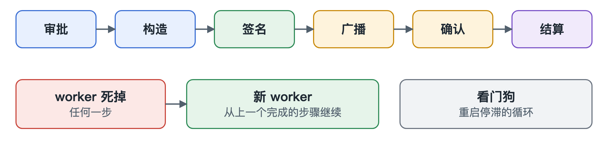

# 工作流

[English](../workflows.md)

一笔存款、归集或提现要走很多步，机器随时可能在某一步死掉。工作流像长表格里夹的书签：换一个 worker 接手，翻到书签处接着填。

## 每笔付款一个工作流
每笔提现、归集和转冷钱包都有自己的工作流，由 Temporal 运行。每个完成的步骤都会被记录。worker 死掉后，另一个 worker 重放记录，跳过已完成的部分。同一个工作流启动两次不会有任何影响，所以随时可以放心重启。

## 每一步重复执行也安全
重复执行的步骤必须得到同样的结果，而不是再做一遍。任务保留原来的 ID 和 nonce，发送之前先问链上已经发生了什么。

| 崩溃的时间点 | 重启后 |
|---|---|
| 交易构造好、还没签名 | 跳过构造，沿用同一个 nonce |
| 广播之后 | 在链上找到这笔交易，不会再发一次 |
| 确认之后、账还没更新 | 账只更新一次 |

## 发件箱：事件和变更一起落库
凡是其他系统需要知道的变更，都在同一个数据库事务里写一条事件。之后由 relay 把事件送到 Kafka，至少送达一次，所以崩溃最多让事件晚一点到。已发布的行保留一段时间后删除；审计链保留记录。

## 看门狗：循环停了就重启
有些任务是永不结束的循环：扫链、规划归集和转冷钱包。某个循环不再前进时，看门狗会报警、结束它，再重新启动。清空旧密钥也是这样的一个循环。收到停止指令的 worker 会先做完或交接手里这一步。
